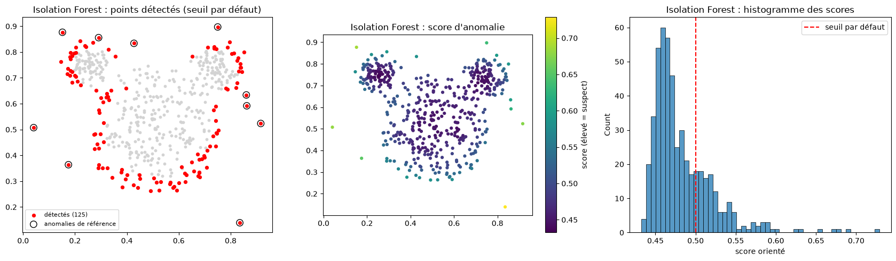
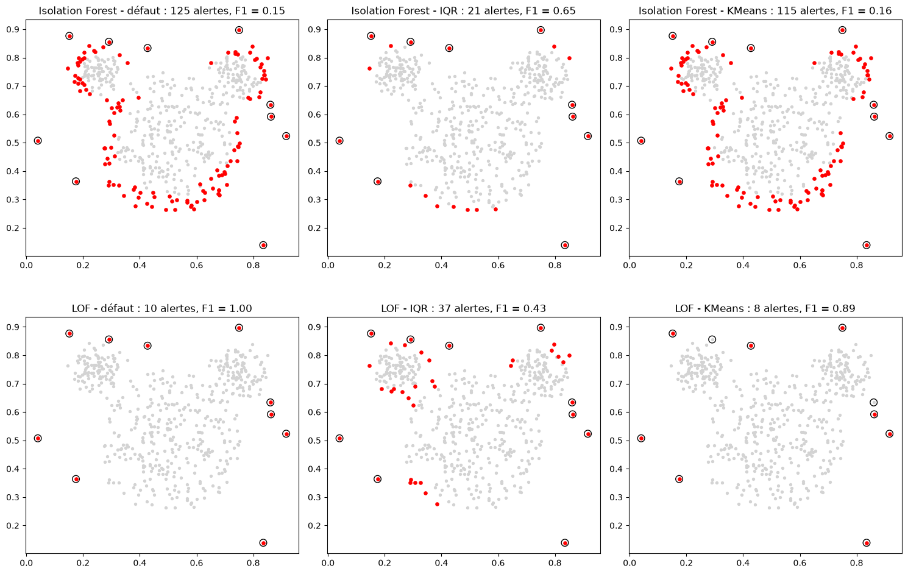
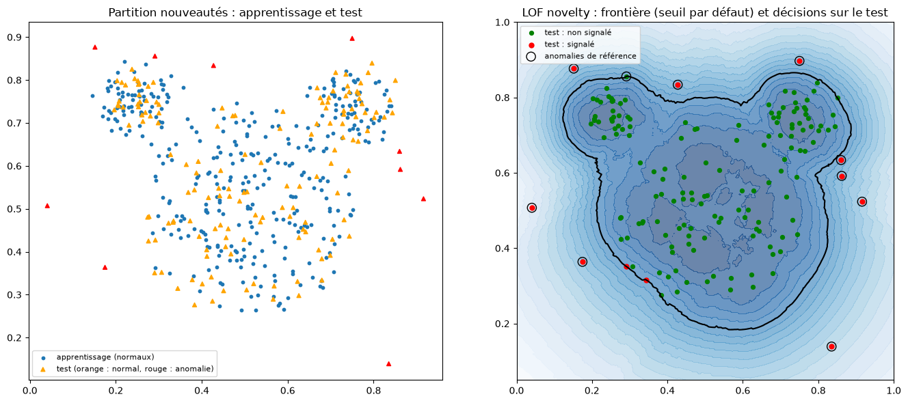
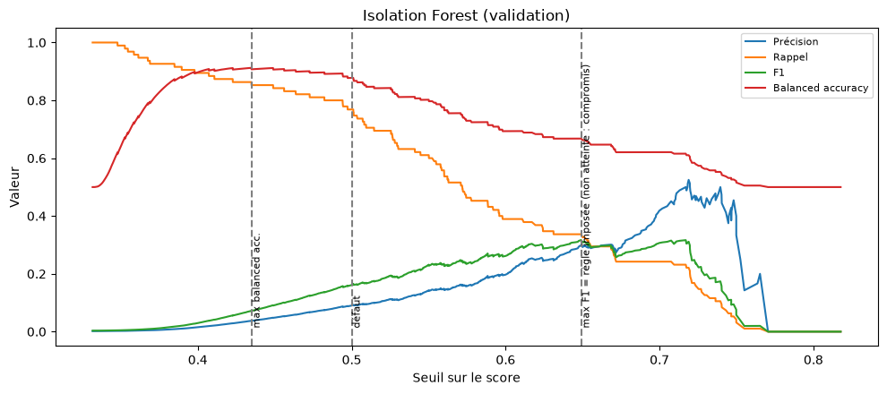
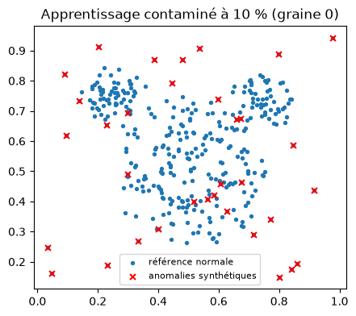
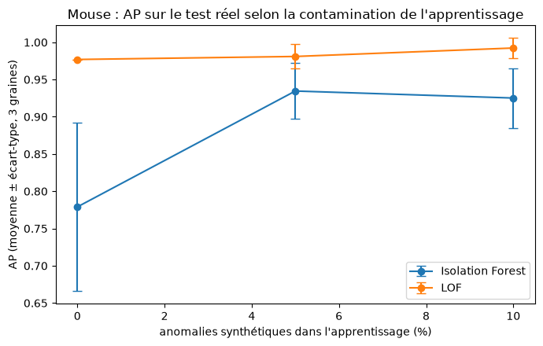
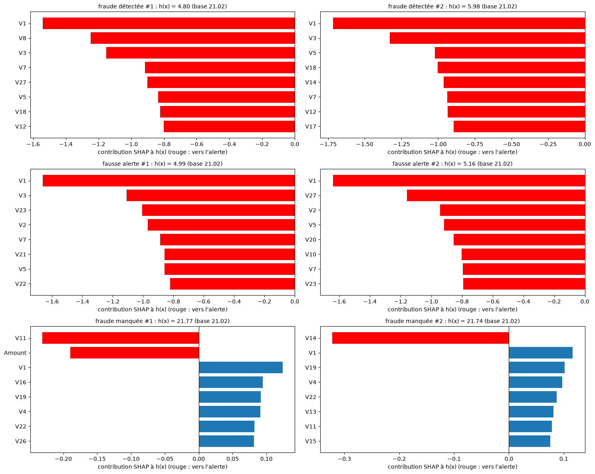

# Compte rendu du TP Détection d'anomalies - M'BEY Max

Ce document raconte, étape par étape, comment j'ai réalisé l'atelier « Détection d'anomalies avec Python ».
Le code se trouve dans `TP_detection_anomalies.ipynb` (notebook exécuté) et dans `utils.py` (fonctions réutilisables).
Les figures ci-dessous sont tirées du notebook.

## 1. Mise en place

J'ai commencé par installer les bibliothèques demandées : numpy, pandas, matplotlib, seaborn, scikit-learn,
imbalanced-learn et SHAP. Leurs versions sont dans `requirements.txt`.

Ensuite, j'ai écrit le fichier `utils.py`. Il regroupe tout ce qui sert plusieurs fois :
- le chargement des trois jeux de données ;
- le découpage stratifié 60 % apprentissage / 20 % validation / 20 % test ;
- les prétraitements ;
- le calcul d'un score où une valeur élevée veut toujours dire « suspect ». Pour Isolation Forest et LOF,
  scikit-learn donne l'inverse, donc j'ai inversé leur score ;
- les règles de seuil (écart interquartile, clustering, et la règle imposée « meilleur rappel sous une précision minimale ») ;
- l'évaluation (AP, AUC-ROC, matrice de confusion, précision, rappel, F1, balanced accuracy) et les courbes.

## 2. Partie 1 : les données Mouse

J'ai d'abord chargé `mouse.txt` : 500 points en deux dimensions. Comme le sujet indique que les dix derniers points
sont les anomalies, j'ai construit le vecteur d'étiquettes tout de suite, avant de mélanger quoi que ce soit.

On peut voir ici les données : la tête et les deux oreilles de Mickey, et les 10 anomalies en rouge autour.

Par la suite, j'ai appliqué Isolation Forest et LOF sur tout l'ensemble, sans utiliser les étiquettes. Pour chaque
méthode, j'affiche les points détectés, les points colorés par leur score et l'histogramme des scores.

Le seuil par défaut d'Isolation Forest signale 125 points, ce qui est beaucoup trop. Celui de LOF retrouve exactement
les 10 anomalies.

J'ai aussi remarqué que LOF n'a pas le même score selon le mode utilisé. En détection d'outliers, il note les points
qui ont servi à l'apprentissage. En détection de nouveautés, il est fait pour noter de nouveaux points : si on lui
redonne les points d'apprentissage, chaque point se retrouve parmi ses propres voisins et paraît moins atypique.

Pour choisir un seuil sans regarder les étiquettes, j'ai testé deux règles : l'écart interquartile (Q3 + 1,5 × IQR) et
un KMeans à deux groupes sur les scores. Je les ai comparées au seuil par défaut :

| Méthode | Règle | Alertes | F1 |
|---|---|---|---|
| Isolation Forest | défaut | 125 | 0,15 |
| Isolation Forest | IQR | 21 | 0,65 |
| Isolation Forest | KMeans | 115 | 0,16 |
| LOF | défaut | 10 | 1,00 |
| LOF | IQR | 37 | 0,43 |
| LOF | KMeans | 8 | 0,89 |

J'en retiens qu'aucune règle ne gagne à chaque fois : tout dépend de la forme de l'histogramme des scores. En
revanche, l'AP et l'AUC-ROC ne changent pas quand on change le seuil (IF : AP 0,96 ; LOF : AP 1,00), parce qu'elles
ne dépendent que de l'ordre des scores. Avec seulement 10 anomalies, ces résultats restent fragiles : une anomalie
manquée fait perdre 0,1 de rappel.

Enfin, je suis passé à la détection de nouveautés. J'ai mis de côté 30 % des points normaux et les 10 anomalies pour
faire un test, puis j'ai entraîné LOF en mode nouveautés uniquement sur les 343 points normaux restants. Sur le test,
LOF lève 11 alertes : 9 anomalies sur 10 et 2 fausses alertes (F1 = 0,86). Sur la figure de droite, on voit la frontière
apprise : l'anomalie manquée est juste au-dessus de l'oreille gauche, à l'intérieur de la frontière.

La différence importante est que, pour construire un apprentissage « propre », j'ai dû utiliser les étiquettes. On a
donc plus d'informations qu'en détection d'outliers, où l'on ne sait pas quels points sont normaux.

## 3. Partie 2 : la détection des fraudes

J'ai commencé par examiner `creditcard.csv` : 284 807 transactions, 492 fraudes (0,17 %), aucune valeur manquante. En
revanche, j'ai trouvé 9 144 transactions en double si l'on ne regarde pas Time. Pour éviter qu'une même transaction
se retrouve à la fois dans l'apprentissage et dans le test, j'ai gardé une seule copie de chaque. Il reste 275 663
transactions, dont 473 fraudes.

Ensuite, j'ai regardé les échelles des variables. V1 à V28 viennent d'une ACP et ont des écarts-types entre 0,3 et 2,
alors qu'Amount atteint 25 691,16 sur le jeu complet et 11 898,09 dans l'apprentissage. Cette variable est très
asymétrique : j'ai donc utilisé son logarithme. Un montant élevé n'est pas forcément une fraude ; je n'ai pas supprimé
ces transactions normales. J'ai standardisé les données pour les méthodes sensibles à l'échelle (régression
logistique, LOF et SMOTE), mais pas pour l'arbre ni pour Isolation Forest. J'ai écarté Time des variables, mais je l'ai
gardée pour remarquer que le découpage aléatoire mélange le passé et le futur.

Par la suite, j'ai comparé :
- un arbre de décision (profondeur 4 ou 8) et une régression logistique (C = 0,01 ou 1), chacun sans correction du
  déséquilibre, avec une pondération des classes et avec SMOTE, soit 6 configurations par modèle. J'ai choisi SMOTE parce
  qu'il crée de nouvelles fraudes au lieu de dupliquer les mêmes ou de jeter presque toutes les transactions normales ;
- Isolation Forest (4 configurations) sur tout l'apprentissage ;
- LOF en mode nouveautés (4 valeurs de k) sur un sous-échantillon de 30 000 transactions, car il est plus coûteux.

Pour chaque configuration, j'ai cherché sur la validation le seuil qui donne le meilleur rappel avec une précision
d'au moins 80 %.

Sur la validation, la régression logistique (C = 1, pondération des classes) est sélectionnée : précision 0,80,
rappel 0,80. Isolation Forest et LOF n'atteignent jamais 80 % de précision. LOF avec k = 10
est presque au niveau du hasard (AUC 0,53). Une explication possible est que certaines fraudes forment de petits
groupes localement denses : LOF peut alors les juger peu atypiques. Cette hypothèse n'est pas démontrée ici.

La figure suivante montre pourquoi on ne peut pas simplement prendre le maximum du F1 ou de la balanced accuracy :
le maximum de la balanced accuracy correspond à environ 2 200 alertes avec une précision de 4 %.

Une fois tout figé, j'ai évalué sur le test :

| Méthode | Précision | Rappel | Alertes | Fausses alertes | Fraudes manquées |
|---|---|---|---|---|---|
| Régression logistique (sélectionnée) | 0,775 | 0,734 | 89 | 20 | 25 |
| Arbre de décision | 0,920 | 0,734 | 75 | 6 | 25 |
| LOF (k = 100) | 0,468 | 0,617 | 124 | 66 | 36 |
| Isolation Forest | 0,200 | 0,160 | 75 | 60 | 79 |

La méthode sélectionnée ne respecte plus la contrainte sur le test (0,775 au lieu de 0,80). Sur la validation, elle
était exactement à 0,80, sans aucune marge : avec environ 95 fraudes, une ou deux alertes suffisent à passer dessous.
Je n'ai pas changé le seuil après coup.

## 4. Partie 3 : une méthode non vue en cours, HBOS

J'ai choisi HBOS (Histogram-Based Outlier Score, Goldstein et Dengel, 2012). Le principe est simple : pour chaque
variable, on fait un histogramme sur l'apprentissage, et une observation qui tombe dans une case peu remplie est
rare pour cette variable. Le score additionne la rareté de chaque variable, ce qui suppose que les variables sont
indépendantes. L'implémentation se trouve dans `utils.py`.

Je pensais qu'il serait intéressant sur Credit Card, car les variables V1 à V28 viennent d'une ACP et sont donc
décorrélées, et parce qu'il est très rapide. J'ai testé 3 nombres de cases (10, 50, 200).

HBOS obtient une AP de validation comprise entre 0,16 et 0,20, derrière LOF. Aucune configuration n'atteint la
précision demandée : le choix se fait donc au meilleur F1 de validation. Les 200 cases sont retenues avec un
F1 de 0,340, contre 0,312 pour 10 cases, et une AP de validation de 0,201.
HBOS peut repérer des valeurs rares prises séparément, mais ne modélise pas leurs dépendances : il peut manquer
une fraude dont chaque variable paraît banale, mais dont la combinaison est inhabituelle.
Sur le test, cette configuration obtient une AP de 0,164. Elle lève 62 alertes, dont 43 fausses alertes,
et manque 75 fraudes sur 94 : la contrainte de précision reste non atteinte.

## 5. Partie 4 : la maintenance (AI4I 2020)

J'ai chargé AI4I avec `Machine failure` comme cible, et j'ai retiré les identifiants et les colonnes TWF, HDF, PWF,
OSF et RNF qui décrivent le type de panne (sinon le modèle connaîtrait la réponse). Il y a 3,4 % de pannes. J'ai encodé
`Type` en one-hot et standardisé les variables numériques pour la régression logistique.

Le contrôle des étiquettes révèle aussi 27 discordances : 18 lignes ont `Machine failure = 0` avec `RNF = 1`,
et 9 ont `Machine failure = 1` alors que les cinq indicateurs de panne sont nuls. Je conserve la cible fournie
sans correction automatique : ces discordances sont une limite de qualité des données, pas une règle suffisante
pour réétiqueter les observations.

J'ai repris la régression logistique et l'Isolation Forest de la partie 2 avec les mêmes hyperparamètres, réentraînés
sur AI4I, avec cette fois une contrainte de précision à 90 %.

La régression logistique atteint 90 % de précision sur la validation, mais seulement avec 12 alertes (rappel 0,16).
Sur le test, elle ne lève que 4 alertes et laisse passer 64 pannes sur 68. L'objectif est atteint sur le papier, mais
le modèle n'est presque pas utile. À titre indicatif, un arbre de décision obtient une meilleure AP de validation
(0,59 contre 0,41), mais sa précision de 0,811 reste inférieure à 0,90 : il n'atteint donc pas non plus l'objectif.
Les pannes d'AI4I dépendent notamment de combinaisons de variables (couple × vitesse, usure × couple,
écart de températures), difficiles à représenter par une frontière linéaire. Isolation Forest peut aussi détecter
des combinaisons inhabituelles grâce aux coupures successives de ses arbres ; il ne se limite pas aux extrêmes
de chaque variable prise séparément.
Pour Isolation Forest, les deux alertes de validation étaient correctes, mais sur le test une seule des deux
alertes correspond à une panne : précision de 0,50, et 67 pannes manquées. La contrainte n'est donc plus respectée.

## 6. Partie 5 : robustesse et explicabilité

Pour la robustesse, j'ai repris l'apprentissage normal de Mouse et j'ai remplacé 0 %, 5 % ou 10 % des points par des
anomalies tirées au hasard autour des données. J'ai répété avec trois graines et
j'ai toujours évalué sur le même test.

LOF reste stable (AP de 0,98 à 0,99). Dans cette expérience, Isolation Forest s'améliore (AP de 0,78 à 0,93).
Une hypothèse est que les anomalies ajoutées modifient les bornes utilisées pour tirer les coupures des arbres,
et donc l'isolement des points du test. L'expérience ne démontre pas cette cause et ne permet pas de conclure
que la contamination améliore généralement Isolation Forest : le résultat dépend notamment des anomalies générées.

Pour l'explicabilité, j'ai utilisé SHAP sur l'Isolation Forest de Credit Card, pour deux fraudes détectées, deux
fausses alertes et deux fraudes manquées du test. J'ai vérifié que SHAP explique la longueur moyenne du chemin dans
les arbres, et pas directement le score : une contribution négative raccourcit le chemin, donc rend la transaction
plus suspecte.

Dans les deux fraudes détectées et les deux fausses alertes choisies, V1, V3, V5 et V7 figurent parmi les
contributions qui poussent vers l'alerte. Cela ne signifie pas que toutes les contributions sont négatives :
d'autres variables peuvent allonger le chemin et compenser cet effet. Dans les deux fraudes manquées choisies,
les contributions conduisent à un score insuffisant pour franchir le seuil. Ces six exemples ne décrivent pas
toutes les transactions de leur catégorie. SHAP explique la décision du modèle, pas la cause d'une fraude ;
V1 à V28 restent anonymisées.
