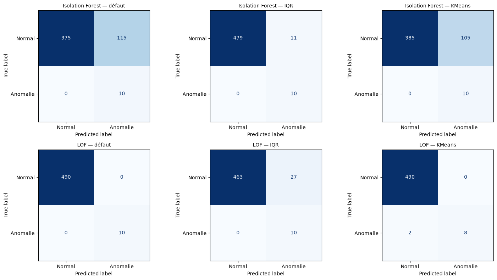
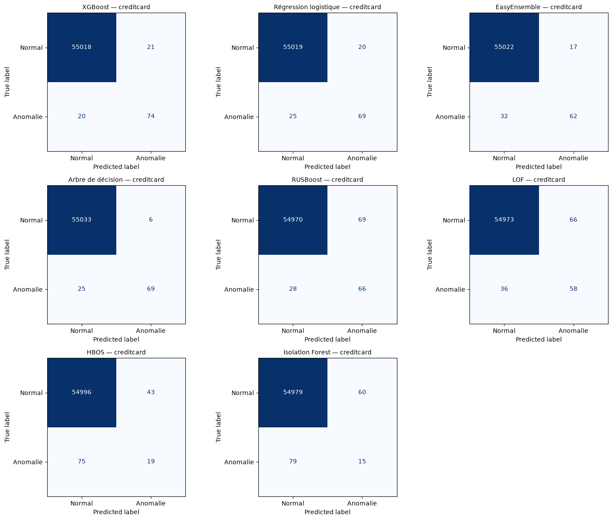
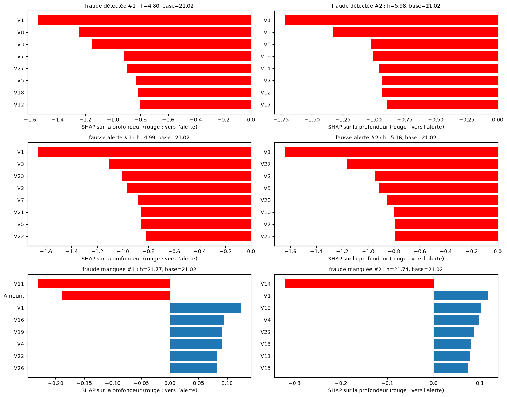

# Compte rendu du TP Détection d’anomalies

M’BEY Max — M2 Data Science

J’ai séparé les calculs et la présentation. Le notebook montre les résultats finaux et les figures ; les expériences et réglages sont dans les fichiers Python. Le Q/R garde les comparaisons de validation et les explications détaillées.

## Mouse : classer ne suffit pas

J’ai commencé par ajuster IF et LOF sans étiquettes sur Mouse, puis comparé les seuils par défaut, IQR et KMeans. Les étiquettes servent à évaluer, pas à régler ces deux règles. Le choix du seuil change fortement les alertes sans changer l’AP ou l’AUC-ROC.

| Méthode | Règle | Seuil | Précision | Rappel | F1 | BA | Alertes | FP | FN |
| --- | --- | --- | --- | --- | --- | --- | --- | --- | --- |
| Isolation Forest | défaut | 0,500000 | 0,0800 | 1,0000 | 0,1481 | 0,8827 | 125 | 115 | 0 |
| Isolation Forest | IQR | 0,562563 | 0,4762 | 1,0000 | 0,6452 | 0,9888 | 21 | 11 | 0 |
| Isolation Forest | KMeans | 0,503079 | 0,0870 | 1,0000 | 0,1600 | 0,8929 | 115 | 105 | 0 |
| LOF | défaut | 1,500000 | 1,0000 | 1,0000 | 1,0000 | 1,0000 | 10 | 0 | 0 |
| LOF | IQR | 1,225625 | 0,2703 | 1,0000 | 0,4255 | 0,9724 | 37 | 27 | 0 |
| LOF | KMeans | 1,914617 | 1,0000 | 0,8000 | 0,8889 | 0,9000 | 8 | 0 | 2 |

Pour les nouveautés, j’ai constitué une référence normale et réservé un test distinct. Cette référence exige les étiquettes, donc la comparaison n’est pas faite à information identique.

| Règle | Seuil | Précision | Rappel | F1 | BA | Alertes | FP | FN |
| --- | --- | --- | --- | --- | --- | --- | --- | --- |
| défaut | 1,500000 | 0,8182 | 0,9000 | 0,8571 | 0,9432 | 11 | 2 | 1 |
| IQR (apprentissage) | 1,232431 | 0,4348 | 1,0000 | 0,6061 | 0,9558 | 23 | 13 | 0 |

## Credit Card : choisir avant le test

J’ai retiré les répétitions de prédicteurs avant le découpage pour éviter de tester une copie d’une transaction apprise. Amount est transformée par log(1 + Amount), puis les méthodes sensibles à l’échelle sont standardisées. Les transformations et rééchantillonnages concernent seulement l’apprentissage. Les mêmes validations et tests servent à toutes les familles.

Les familles classiques ont six configurations au total, pas six par variante. Pour l’arbre (profondeurs 4 et 8) et la logistique (C=0,01 et 1), on croise les deux valeurs avec absence de correction ou poids équilibrés, soit quatre essais. On ajoute un seul sur-échantillonnage au réglage fort et un seul RandomUnderSampler au réglage fort. Sur Credit Card, SMOTE vise un ratio positif/négatif de 0,1 et RUS équilibre les classes (`auto`). Sur KDD, RandomOverSampler remplace SMOTE pour préserver les catégories : il copie des lignes réelles au lieu d’interpoler leurs encodages. ROS et RUS utilisent `auto`. Cette correction porte sur la validité des données synthétiques, pas sur le choix d’un meilleur score de test.

EasyEnsemble compare 5 et 10 ensembles, chacun avec un AdaBoost de 50 souches. RUSBoost compare 50 et 100 arbres de profondeur 2. XGBoost compare les profondeurs 3 et 5 avec 100 arbres et un taux d’apprentissage de 0,1 ; son poids positif est le rapport négatifs/positifs de l’apprentissage seulement. IF compare 100/300 arbres × 256/2048 points ; LOF compare 10/20/50/100 voisins en mode nouveauté. HBOS compare 10, 50 et 200 cases, avec alpha=0,1.

La sélection étendue sur validation retient « XGBoost | n_estimators=100, max_depth=5 ». La logistique pondérée était le choix historique, avant les ensembles ; ses mauvais résultats de test restent visibles. Pour chaque configuration, je maximise le rappel sous précision ≥ 80 %, ou rapporte le meilleur compromis F1 si cette contrainte est inaccessible.

L’extension (RUS, ensembles et KDD) a été réalisée après une première lecture du test Credit Card. Les réglages sont annoncés a priori et les seuils utilisent uniquement la validation, mais cette comparaison reste exploratoire : le test ne peut plus être présenté comme un holdout entièrement vierge. Une confirmation demanderait de nouvelles données.

| Famille | AP | AUC-ROC | Seuil | Précision | Rappel | F1 | BA | Alertes | FP | FN | Objectif test |
| --- | --- | --- | --- | --- | --- | --- | --- | --- | --- | --- | --- |
| XGBoost | 0,7923 | 0,9759 | 0,695443 | 0,7789 | 0,7872 | 0,7831 | 0,8934 | 95 | 21 | 20 | non atteint |
| Régression logistique | 0,6798 | 0,9835 | 0,999968 | 0,7753 | 0,7340 | 0,7541 | 0,8668 | 89 | 20 | 25 | non atteint |
| EasyEnsemble | 0,6785 | 0,9776 | 0,658872 | 0,7848 | 0,6596 | 0,7168 | 0,8296 | 79 | 17 | 32 | non atteint |
| Arbre de décision | 0,6811 | 0,8439 | 1,000000 | 0,9200 | 0,7340 | 0,8166 | 0,8670 | 75 | 6 | 25 | atteint |
| RUSBoost | 0,4018 | 0,9674 | 0,817290 | 0,4889 | 0,7021 | 0,5764 | 0,8504 | 135 | 69 | 28 | non atteint |
| LOF | 0,3295 | 0,9396 | 2,796372 | 0,4677 | 0,6170 | 0,5321 | 0,8079 | 124 | 66 | 36 | non atteint |
| HBOS | 0,1640 | 0,9265 | 46,664026 | 0,3065 | 0,2021 | 0,2436 | 0,6007 | 62 | 43 | 75 | non atteint |
| Isolation Forest | 0,1524 | 0,9430 | 0,649011 | 0,2000 | 0,1596 | 0,1775 | 0,5792 | 75 | 60 | 79 | non atteint |

Les objectifs de précision ne sont pas des garanties sur le test. Je conserve les seuils de validation, y compris quand les résultats passent sous la contrainte.

## HBOS : des raretés marginales

HBOS additionne −log(hauteur normalisée + alpha) sur des histogrammes ajustés par variable. Les composantes d’ACP sont décorrélées, pas nécessairement indépendantes. La méthode est lisible mais ignore les dépendances : une combinaison rare de valeurs banales peut lui échapper. J’ai comparé trois nombres de cases sur validation, avec le même critère de choix que les autres méthodes.

| Famille | AP | AUC-ROC | Seuil | Précision | Rappel | F1 | BA | Alertes | FP | FN | Objectif test |
| --- | --- | --- | --- | --- | --- | --- | --- | --- | --- | --- | --- |
| LOF | 0,3295 | 0,9396 | 2,796372 | 0,4677 | 0,6170 | 0,5321 | 0,8079 | 124 | 66 | 36 | non atteint |
| HBOS | 0,1640 | 0,9265 | 46,664026 | 0,3065 | 0,2021 | 0,2436 | 0,6007 | 62 | 43 | 75 | non atteint |
| Isolation Forest | 0,1524 | 0,9430 | 0,649011 | 0,2000 | 0,1596 | 0,1775 | 0,5792 | 75 | 60 | 79 | non atteint |

## AI4I : transférer les réglages, pas les modèles appris

J’ai conservé Machine failure comme cible et retiré identifiants et modes de panne des entrées. L’audit relève 27 discordances avec ces modes ; je les signale sans réétiqueter les lignes. AI4I est synthétique : les résultats ne décrivent pas directement une usine réelle.

Le meilleur supervisé global sur Credit Card, ensembles compris, et IF sont transférés à AI4I avec leurs hyperparamètres conservés. Le classique de référence ({classique}) est conservé, sans être la gagnante globale de la comparaison étendue Credit Card. Les transformations et modèles sont réajustés sur l’apprentissage AI4I ; les seuils sont choisis à nouveau sur sa validation sous précision ≥ 90 %. Pour XGBoost, `scale_pos_weight` est conservé depuis Credit Card, conformément au transfert demandé : il n’est ni recalculé sur AI4I ni réglé sur son test.

Le choix sur validation AI4I est « XGBoost | n_estimators=100, max_depth=5 (AI4I) ». Les résultats de tous les modèles, y compris la référence historique, restent publiés :

| Famille | AP | AUC-ROC | Seuil | Précision | Rappel | F1 | BA | Alertes | FP | FN | Objectif test |
| --- | --- | --- | --- | --- | --- | --- | --- | --- | --- | --- | --- |
| XGBoost | 0,6985 | 0,9715 | 0,988007 | 0,8039 | 0,6029 | 0,6891 | 0,7989 | 51 | 10 | 27 | non atteint |
| Régression logistique | 0,4087 | 0,9046 | 0,979916 | 1,0000 | 0,0588 | 0,1111 | 0,5294 | 4 | 0 | 64 | atteint |
| Isolation Forest | 0,0919 | 0,7465 | 0,681207 | 0,5000 | 0,0147 | 0,0286 | 0,5071 | 2 | 1 | 67 | non atteint |

XGBoost : 51 alertes, dont 41 pannes et 10 fausses alertes ; 27 cas manqués. Précision 0,8039, rappel 0,6029, objectif au test non atteint.

Régression logistique : 4 alertes, dont 4 pannes et 0 fausses alertes ; 64 cas manqués. Précision 1,0000, rappel 0,0588, objectif au test atteint.

Isolation Forest : 2 alertes, dont 1 pannes et 1 fausses alertes ; 67 cas manqués. Précision 0,5000, rappel 0,0147, objectif au test non atteint.

## Robustesse et SHAP

J’ai remplacé des points de la référence normale Mouse par des points uniformes dans sa boîte élargie, en gardant taille d’apprentissage et test fixes. Trois graines permettent de voir une dispersion, pas de garantir une stabilité générale. Une amélioration avec cette contamination ne vaut pas pour tous les générateurs.

| Méthode | Contamination | AP moyenne | Écart-type AP | AUC-ROC moyenne | Écart-type AUC-ROC |
| --- | --- | --- | --- | --- | --- |
| Isolation Forest | 0,0000 | 0,7790 | 0,1133 | 0,9803 | 0,0096 |
| Isolation Forest | 0,0500 | 0,9346 | 0,0373 | 0,9948 | 0,0026 |
| Isolation Forest | 0,1000 | 0,9252 | 0,0400 | 0,9934 | 0,0041 |
| LOF | 0,0000 | 0,9769 | 0,0000 | 0,9980 | 0,0000 |
| LOF | 0,0500 | 0,9810 | 0,0165 | 0,9982 | 0,0016 |
| LOF | 0,1000 | 0,9923 | 0,0133 | 0,9993 | 0,0012 |

SHAP explique la longueur moyenne de chemin corrigée d’IF : les contributions négatives poussent vers l’alerte. Le fond vient seulement de l’apprentissage. L’écart maximal de reconstruction observé vaut 2.57950970806e-07. Les six cas sont choisis pour contraster détections, fausses alertes et fraudes manquées ; ce ne sont ni une importance globale ni une explication causale.

## KDDCup99 : une comparaison d’intrusions historique

J’ai utilisé le corpus officiel à 10 %, disponible localement, après exclusion du groupe à cible binaire contradictoire et dédoublonnage. Un tirage stratifié de 60 000 lignes précède la partition. Les sept familles partagent 30 000 lignes d’apprentissage effectif, et les mêmes validations et tests de 12 000 lignes. Intrusion reste la classe 1. La précision minimale de 80 % est un choix pédagogique, pas une exigence propre à ce jeu.

| Famille | AP | AUC-ROC | Seuil | Précision | Rappel | F1 | BA | Alertes | FP | FN | Objectif test |
| --- | --- | --- | --- | --- | --- | --- | --- | --- | --- | --- | --- |
| XGBoost | 0,9999 | 1,0000 | 0,044919 | 0,9716 | 0,9994 | 0,9853 | 0,9901 | 4 896 | 139 | 3 | atteint |
| RUSBoost | 0,9998 | 0,9999 | 0,304810 | 0,8410 | 1,0000 | 0,9136 | 0,9378 | 5 660 | 900 | 0 | atteint |
| EasyEnsemble | 0,9995 | 0,9996 | 0,405317 | 0,8231 | 0,9998 | 0,9029 | 0,9292 | 5 782 | 1 023 | 1 | atteint |
| Régression logistique | 0,9945 | 0,9989 | 0,002935 | 0,8115 | 0,9992 | 0,8956 | 0,9233 | 5 861 | 1 105 | 4 | atteint |
| Arbre de décision | 0,9970 | 0,9987 | 0,010579 | 0,8490 | 0,9994 | 0,9181 | 0,9413 | 5 603 | 846 | 3 | atteint |
| LOF | 0,4439 | 0,4938 | 3,064195 | 0,7820 | 0,1078 | 0,1894 | 0,5440 | 656 | 143 | 4 247 | non atteint |
| Isolation Forest | 0,5116 | 0,6782 | 0,431533 | 0,7727 | 0,0607 | 0,1126 | 0,5245 | 374 | 85 | 4 471 | non atteint |

Le choix de validation est « XGBoost | n_estimators=100, max_depth=3 ». Le corpus est ancien et simulé ; ses répétitions et les proportions modifiées par dédoublonnage empêchent d’assimiler ce test aléatoire à la détection d’attaques nouvelles sur un réseau actuel. Seul le bonus autoencodeur n’est pas réalisé.

## Sources

- Sujet : *Atelier : Détection d’anomalies avec Python*, 2026–2027, et cours de H. Elghazel, fournis à la racine.
- Mouse : fichier fourni avec le TP, `data/mouse.txt`.
- Credit Card : https://www.kaggle.com/datasets/mlg-ulb/creditcardfraud
- AI4I 2020 : https://doi.org/10.24432/C5HS5C
- KDDCup99, corpus officiel à 10 % : https://kdd.ics.uci.edu/databases/kddcup99/kddcup99.html ; archive https://kdd.ics.uci.edu/databases/kddcup99/kddcup.data_10_percent.gz
- Goldstein et Dengel (2012), *HBOS: A Fast Unsupervised Anomaly Detection Algorithm*, KI-2012 ; documentation https://pyod.readthedocs.io/en/latest/_modules/pyod/models/hbos.html
- EasyEnsemble et RUSBoost : https://imbalanced-learn.org/stable/ensemble.html ; XGBoost : https://xgboost.readthedocs.io/en/stable/ ; SHAP : https://shap.readthedocs.io/
