# TP Détection d’anomalies — Questions / Réponses

M’BEY Max — M2 Data Science

## 0. Objectif, organisation et protocole commun

Quel est l’objectif du TP ?

Comparer le classement des observations et les décisions après seuillage sur Mouse, Credit Card, AI4I et KDDCup99. Le TP couvre les cinq parties, puis le bloc complémentaire non bonus : sous-échantillonnage supervisé, EasyEnsemble, RUSBoost, XGBoost et intrusions. Seul le bonus autoencodeur n’est pas réalisé.

L’extension (RUS, ensembles et KDD) a été réalisée après une première lecture du test Credit Card. Les réglages sont annoncés a priori et les seuils utilisent uniquement la validation, mais cette comparaison reste exploratoire : le test ne peut plus être présenté comme un holdout entièrement vierge. Une confirmation demanderait de nouvelles données.

Où se trouve le code ?

Le notebook exécuté ne contient que des imports, appels et résultats finaux. L’entraînement et la sélection sont dans `experiences.py`, `experiences_kdd.py`, `modeles_complementaires.py` et `utils.py`. Les appels nommés sont protocole, mouse, nouveautes, creditcard, hbos, ai4i, robustesse, shap et kdd. `generer_notebook.py` reconstruit et exécute le notebook ; `generer_rendus.py` produit les documents sans entraînement, depuis `rendus/resultats.json` et les figures du notebook. Les analyses de validation restent dans ce Q/R.

Comment rendre les expériences reproductibles ?

Les partitions et modèles aléatoires utilisent la graine 42. La robustesse est répétée sur les graines 0, 1 et 2. Les partitions sont communes aux méthodes et les données locales permettent de travailler hors connexion. Les versions effectives sont affichées dans la rubrique protocole du notebook, les dépendances fixées dans `requirements.txt`. Les temps ci-dessous viennent du JSON de cette exécution : ce ne sont pas des moyennes de benchmarks.

### 1. Séparer apprentissage et évaluation

Comment sont séparées les données ?

Les partitions sont stratifiées 60/20/20. Le dédoublonnage précède le partage pour Credit Card et KDD ; les transformations apprennent seulement sur l’apprentissage. La validation choisit les réglages et les seuils ; le test décrit les résultats des choix figés.

| Jeu | Partition | Observations | Positifs |
| --- | --- | --- | --- |
| creditcard | app | 165 397 | 284 |
| creditcard | val | 55 133 | 95 |
| creditcard | test | 55 133 | 94 |
| ai4i | app | 6 000 | 203 |
| ai4i | val | 2 000 | 68 |
| ai4i | test | 2 000 | 68 |
| kdd | app | 36 000 | 14 281 |
| kdd | val | 12 000 | 4 761 |
| kdd | test | 12 000 | 4 760 |

Sur KDD, la partition d’apprentissage contient 36 000 lignes, mais les sept familles utilisent le même sous-échantillon stratifié de 30 000 lignes. Mouse suit les cadres outliers puis nouveautés.

L’extension (RUS, ensembles et KDD) a été réalisée après une première lecture du test Credit Card. Les réglages sont annoncés a priori et les seuils utilisent uniquement la validation, mais cette comparaison reste exploratoire : le test ne peut plus être présenté comme un holdout entièrement vierge. Une confirmation demanderait de nouvelles données.

Qu’est-ce qu’une fuite de données et comment est-elle évitée ?

Une fuite apparaît lorsqu’une information indisponible au moment prévu pour la prédiction influence l’apprentissage ou la sélection. Par exemple : standardiser avec les statistiques du test, placer des copies d’une transaction dans plusieurs partitions, ou utiliser les indicateurs de panne comme entrées pour prédire la panne.

Les transformations sont ajustées sur l’apprentissage seulement, dans les pipelines. SMOTE ne rééchantillonne que l’apprentissage. Les doublons de Credit Card sont traités avant le découpage. Les indicateurs de panne et identifiants d’AI4I sont exclus des prédicteurs. Le fond de référence de SHAP vient uniquement de l’apprentissage.

Combien de configurations sont comparées et pourquoi LOF utilise-t-il moins de données ?

Les familles classiques ont six configurations au total, pas six par variante. Pour l’arbre (profondeurs 4 et 8) et la logistique (C=0,01 et 1), on croise les deux valeurs avec absence de correction ou poids équilibrés, soit quatre essais. On ajoute un seul sur-échantillonnage au réglage fort et un seul RandomUnderSampler au réglage fort. Sur Credit Card, SMOTE vise un ratio positif/négatif de 0,1 et RUS équilibre les classes (`auto`). Sur KDD, RandomOverSampler remplace SMOTE pour préserver les catégories : il copie des lignes réelles au lieu d’interpoler leurs encodages. ROS et RUS utilisent `auto`. Cette correction porte sur la validité des données synthétiques, pas sur le choix d’un meilleur score de test.

EasyEnsemble compare 5 et 10 ensembles, chacun avec un AdaBoost de 50 souches. RUSBoost compare 50 et 100 arbres de profondeur 2. XGBoost compare les profondeurs 3 et 5 avec 100 arbres et un taux d’apprentissage de 0,1 ; son poids positif est le rapport négatifs/positifs de l’apprentissage seulement. IF compare 100/300 arbres × 256/2048 points ; LOF compare 10/20/50/100 voisins en mode nouveauté. HBOS compare 10, 50 et 200 cases, avec alpha=0,1.

LOF Credit Card utilise un sous-échantillon stratifié fixe : 30 000 lignes dont 52 fraudes. Validation et test restent complets. Sur AI4I, on transfère les réglages retenus, sans nouvelle grille.

Le meilleur supervisé global sur Credit Card, ensembles compris, et IF sont transférés à AI4I avec leurs hyperparamètres conservés. La logistique reste une référence historique, pas la gagnante globale de la comparaison étendue Credit Card. Les transformations et modèles sont réajustés sur l’apprentissage AI4I ; les seuils sont choisis à nouveau sur sa validation sous précision ≥ 90 %. Pour XGBoost, `scale_pos_weight` est conservé depuis Credit Card, conformément au transfert demandé : il n’est ni recalculé sur AI4I ni réglé sur son test.

La validation croisée est-elle utilisée ? Faut-il aussi un découpage temporel ?

La validation croisée n’est pas utilisée : le sujet ne l’exige pas. Les choix reposent sur la partition de validation réservée.

Le découpage aléatoire 60/20/20 constitue ici le cadre commun de comparaison. Il mélange passé et futur. Pour évaluer un déploiement prospectif, il faudrait aussi étudier un découpage temporel. Cette expérience complémentaire n’a pas été réalisée.

### 2. Deux niveaux d’évaluation

Que signifient la classe positive et les scores ?

La classe 1 désigne ce que l’on cherche : anomalie, fraude ou panne. La classe 0 désigne le reste. Tous les scores sont orientés pour qu’une grande valeur indique un point plus suspect. Les scores sklearn d’IF et de LOF sont donc inversés. Les classifieurs utilisent la probabilité prédite de la classe 1, sans supposer que cette probabilité est bien calibrée après pondération ou SMOTE. Un score d’Isolation Forest n’est pas une probabilité de fraude.

Quelle différence y a-t-il entre évaluer un classement et évaluer des alertes ?

Le classement est évalué avec les scores continus : courbes ROC et précision-rappel, AUC-ROC et Average Precision (AP). Les alertes sont évaluées après le choix d’un seuil : matrice de confusion, précision, rappel, F1 et balanced accuracy. Un bon classement ne garantit pas que le seuil par défaut donne de bonnes alertes.

Comment lire une matrice de confusion ?

Les lignes représentent les vraies classes et les colonnes les prédictions, dans l’ordre 0 puis 1 :

| | Prédit normal | Prédit anomalie |
|---|---|---|
| Vrai normal | VN : vrai négatif | FP : fausse alerte |
| Vraie anomalie | FN : anomalie manquée | VP : anomalie détectée |

Les mêmes termes s’appliquent aux fraudes et aux pannes. Dans les matrices compactes de ce document, `[[VN, FP], [FN, VP]]` conserve cet ordre.

Quels indicateurs faut-il lire, et que mesure chacun ?

| Indicateur | Calcul | Question à laquelle il répond |
|---|---|---|
| Précision | VP / (VP + FP) | Parmi les alertes, combien sont correctes ? |
| Rappel | VP / (VP + FN) | Parmi les anomalies, combien sont retrouvées ? |
| F1 | 2 × précision × rappel / (précision + rappel) | Quel compromis entre précision et rappel ? |
| Balanced accuracy | (rappel positif + rappel négatif) / 2 | Quelle performance moyenne sur les deux classes ? |
| AP | `average_precision_score(y, scores)` | Les positifs sont-ils bien placés dans le classement ? |
| AUC-ROC | Aire sous la courbe TPR en fonction du FPR | Les positifs sont-ils généralement classés devant les négatifs ? |

L’AP utilisée ici n’est pas l’aire PR calculée par intégration trapézoïdale. En l’absence de prédiction positive, la précision est fixée à 0 pour l’évaluation des décisions.

De quel « taux d’erreur » parle-t-on ?

Il faut préciser le dénominateur. Ces quatre taux ne sont pas interchangeables :

| Taux | Calcul | Interprétation |
|---|---|---|
| Taux de fausses alertes (FPR) | FP / (VN + FP) | Part des observations normales signalées à tort |
| Taux d’anomalies manquées (FNR) | FN / (VP + FN) = 1 − rappel | Part des anomalies qui passent inaperçues |
| Part d’alertes inutiles | FP / (VP + FP) = 1 − précision | Part du travail d’investigation dépensée à tort |
| Taux d’erreur global | (FP + FN) / N | Part de toutes les observations mal classées |

Avec des anomalies rares, un faible taux d’erreur global peut cacher un échec total de détection. Prédire « normal » partout sur le fichier Credit Card brut ne commettrait que 492 erreurs sur 284 807 transactions, soit environ 0,173 %, mais manquerait toutes les fraudes. On ne retient donc pas un modèle à partir de ce seul taux.

### 3. Objectifs opérationnels imposés

Pourquoi imposer 80 % de précision pour les fraudes et 90 % pour la maintenance ?

Pour les fraudes, le scénario demande de retrouver le plus de fraudes possible tout en limitant les enquêtes inutiles : sur la validation, au moins quatre alertes sur cinq doivent être correctes.

Pour la maintenance, chaque alerte entraîne une intervention coûteuse : le sujet exige une précision d’au moins 90 %. Dans les deux cas, on maximise le rappel seulement parmi les seuils respectant cette exigence. Ces valeurs sont pédagogiques, pas des normes universelles.

Comment les seuils et la méthode gagnante sont-ils choisis ?

Pour chaque configuration, la validation choisit le rappel maximal parmi les seuils donnant au moins une alerte et respectant la précision minimale (0,80 en fraude, 0,90 en maintenance). Les égalités sont départagées par précision puis AP. Les configurations conformes sont prioritaires ; à défaut, le meilleur F1, puis rappel, précision et AP désignent un compromis explicitement non conforme. Les choix sont ensuite figés. Une alerte correspond à un score supérieur ou égal au seuil. Pour les détecteurs sklearn, le seuil inclusif représente la décision native stricte grâce à `nextafter(-offset_, +inf)`.

Un résultat de test inférieur à la contrainte signifie-t-il que le TP est faux ?

Non. La contrainte est utilisée pour sélectionner le seuil sur la validation ; elle n’est pas garantie sur un autre échantillon. Le résultat doit être rapporté, même défavorable. Retoucher le seuil pour satisfaire la contrainte sur le test transformerait ce test en nouveau jeu de validation.

Où retrouve-t-on ce protocole dans le code du notebook ?

Le notebook appelle `calculer_resultats()` puis `afficher_resultats(resultats, nom)` ; aucun apprentissage ou réglage n’est caché dans une cellule de présentation. Les expériences réutilisent `utils.decouper_donnees`, les pipelines de prétraitement, `utils.comparer_configurations`, `utils.choisir_seuil_contraint` et `utils.selectionner`. L’évaluation finale applique les modèles déjà ajustés et les seuils de validation. Les résultats sont exportés par `exporter_resultats` sous des clés nommées, pas des numéros de cellule.

## Partie 1 — Données Mouse

1.1.a. Quel est le format des données et que montre leur représentation ?

`mouse.txt` contient 500 points décrits par deux variables numériques, x1 et x2, sans valeur manquante. Les dix derniers points sont les anomalies de référence. Leurs étiquettes sont construites avant tout mélange, mais ne servent pas à entraîner les détecteurs. On reconnaît la tête et les deux oreilles de Mickey, avec des densités différentes. Les deux variables ont des échelles comparables : je ne les standardise pas.

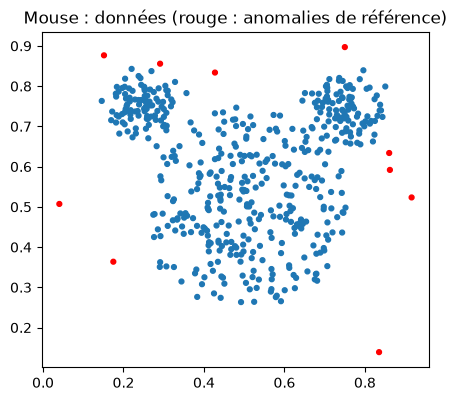

1.1.b. Comment appliquer IF et LOF, visualiser leurs décisions et interpréter leurs scores ?

IF et LOF sont ajustés sans étiquettes sur les points Mouse, anomalies comprises. IF utilise 100 arbres et 256 points par arbre ; LOF utilise 20 voisins. Une grande valeur indique toujours une observation suspecte : on inverse `score_samples` pour IF et `negative_outlier_factor_` pour LOF outlier. Ce ne sont pas des probabilités. Le mode nouveauté de LOF ne doit pas servir à réévaluer ses propres points d’apprentissage, car les voisinages diffèrent.

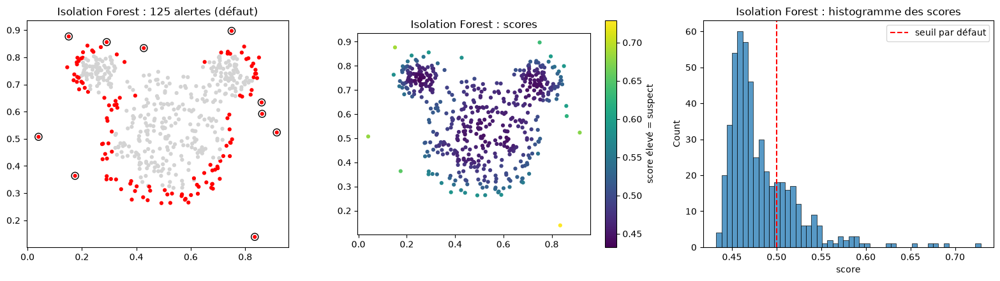

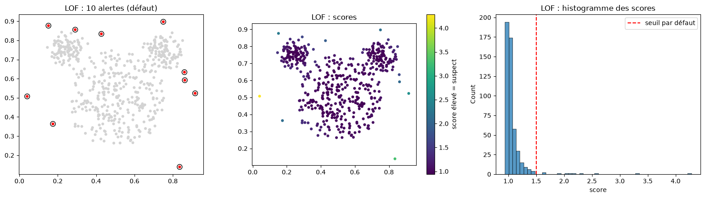

1.2.a–b. Comment choisir un seuil sans étiquettes et comparer les règles ?

IQR utilise Q3 + 1,5 × (Q3 − Q1), avec coefficient fixé sans étiquettes. KMeans forme deux groupes sur les scores et retient le groupe de centre le plus élevé. Les étiquettes ne servent qu’à évaluer ces règles. Le tableau contient les décisions sur l’échantillon observé, pas une performance prospective.

| Méthode | Règle | Seuil | Précision | Rappel | F1 | BA | Alertes | FP | FN |
| --- | --- | --- | --- | --- | --- | --- | --- | --- | --- |
| Isolation Forest | défaut | 0,500000 | 0,0800 | 1,0000 | 0,1481 | 0,8827 | 125 | 115 | 0 |
| Isolation Forest | IQR | 0,562563 | 0,4762 | 1,0000 | 0,6452 | 0,9888 | 21 | 11 | 0 |
| Isolation Forest | KMeans | 0,503079 | 0,0870 | 1,0000 | 0,1600 | 0,8929 | 115 | 105 | 0 |
| LOF | défaut | 1,500000 | 1,0000 | 1,0000 | 1,0000 | 1,0000 | 10 | 0 | 0 |
| LOF | IQR | 1,225625 | 0,2703 | 1,0000 | 0,4255 | 0,9724 | 37 | 27 | 0 |
| LOF | KMeans | 1,914617 | 1,0000 | 0,8000 | 0,8889 | 0,9000 | 8 | 0 | 2 |

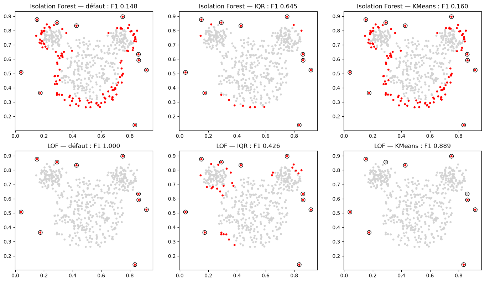

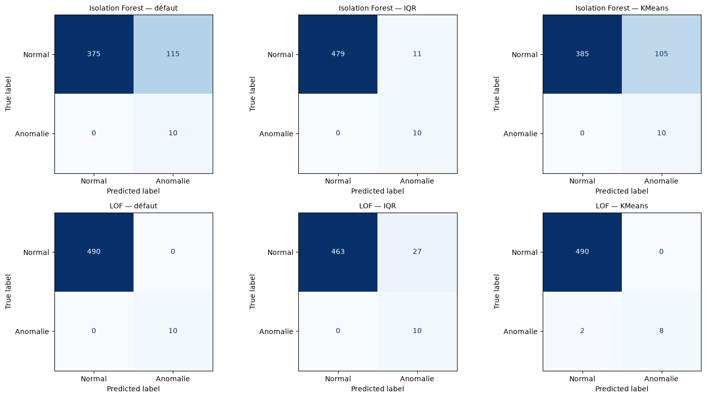

Une règle peut améliorer IF et dégrader LOF : un seuil n’est pas meilleur indépendamment de la distribution des scores.

1.2.c. Quelles sont les AP et AUC-ROC et pourquoi sont-elles indépendantes du seuil choisi ?

| Méthode | AP | AUC-ROC |
| --- | --- | --- |
| Isolation Forest | 0,9614 | 0,9990 |
| LOF | 1,0000 | 1,0000 |

Ces indicateurs utilisent les scores continus. Déplacer uniquement le seuil ne change pas leur classement ; cela déplace le point de fonctionnement, sans modifier AP ou AUC-ROC. Les résultats concernent l’ensemble ajusté, avec dix anomalies seulement : une anomalie manquée enlève dix points de pourcentage de rappel.

1.3.a–b. Comment passer à la détection de nouveautés et quelles informations supplémentaires utilise-t-on ?

LOF en mode nouveauté apprend sur les 343 normaux réservés à l’apprentissage. Le test distinct contient 147 normaux et les dix anomalies. L’IQR vient des scores d’apprentissage, pas des scores du test. Construire cette référence normale utilise les étiquettes : on dispose donc de plus d’information que dans la détection d’outliers.

| Règle | Seuil | Précision | Rappel | F1 | BA | Alertes | FP | FN | AP test | AUC-ROC test |
| --- | --- | --- | --- | --- | --- | --- | --- | --- | --- | --- |
| défaut | 1,500000 | 0,8182 | 0,9000 | 0,8571 | 0,9432 | 11 | 2 | 1 | 0,9769 | 0,9980 |
| IQR (apprentissage) | 1,232431 | 0,4348 | 1,0000 | 0,6061 | 0,9558 | 23 | 13 | 0 | 0,9769 | 0,9980 |

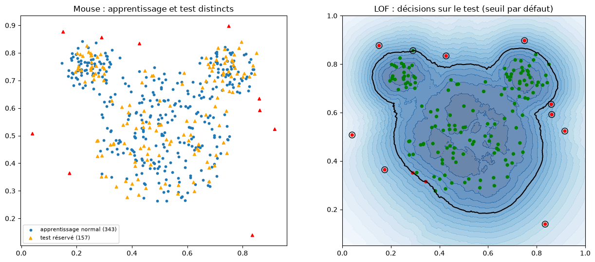

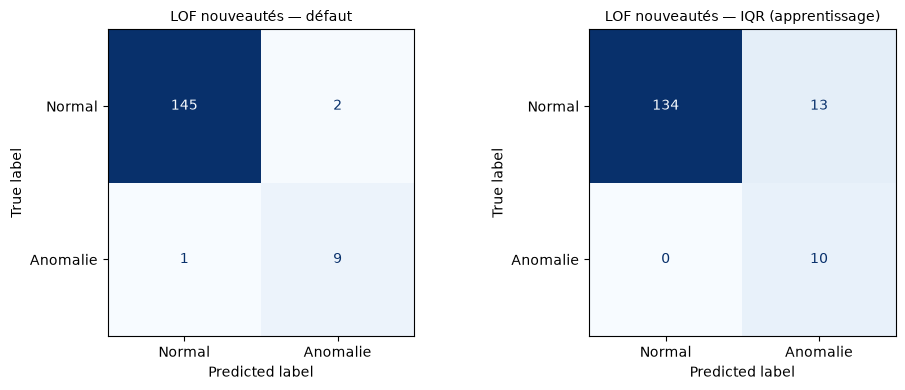

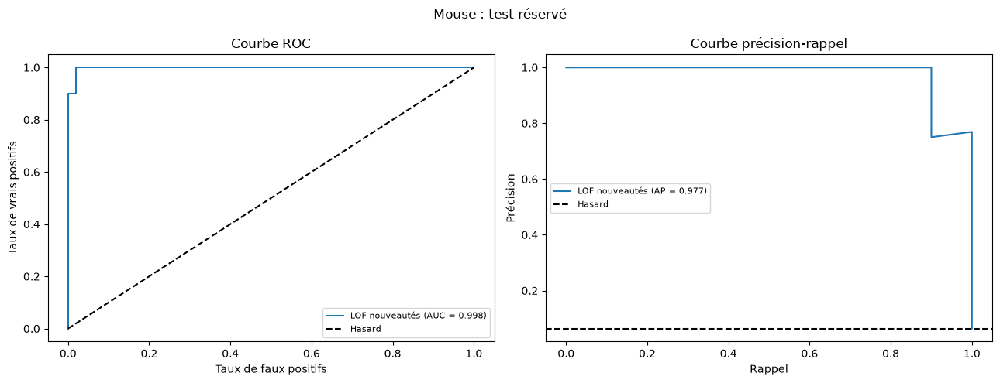

Quels taux d&#x27;erreur distinguer sur Mouse ?

FPR = FP/(VN+FP), FNR = FN/(VP+FN), part d’alertes inutiles = FP/(VP+FP), erreur globale = (FP+FN)/N. Les effectifs de FP et FN sont publiés dans les tableaux Mouse précédents ; leurs dénominateurs ne sont pas interchangeables. Avec dix anomalies parmi 500 points, prédire partout normal donne peu d’erreurs globales mais manque toutes les anomalies. Les matrices figurées permettent de lire séparément les deux classes.

## Partie 2 — Détection des fraudes Credit Card

2.1.a. Quels contrôles effectuer et comment empêcher la fuite par doublons ?

Credit Card est dédoublonné sur les prédicteurs V1 à V28 et Amount avant la partition. Time est exclue des entrées mais gardée pour discuter la temporalité. Le fichier brut a 284 807 lignes et 492 fraudes ; la population dédoublonnée utilisée compte 275 663 transactions et 473 fraudes. Les mêmes prédicteurs ne traversent donc pas apprentissage et test. La population évaluée diffère du fichier brut.

| Jeu | Partition | Observations | Positifs |
| --- | --- | --- | --- |
| creditcard | app | 165 397 | 284 |
| creditcard | val | 55 133 | 95 |
| creditcard | test | 55 133 | 94 |
| ai4i | app | 6 000 | 203 |
| ai4i | val | 2 000 | 68 |
| ai4i | test | 2 000 | 68 |
| kdd | app | 36 000 | 14 281 |
| kdd | val | 12 000 | 4 761 |
| kdd | test | 12 000 | 4 760 |

2.1.b. Quelles échelles et quels prétraitements retenir selon les familles ?

Amount est asymétrique : une transformation fixe log(1 + Amount) est appliquée, sans supprimer les montants élevés. La logistique et LOF sont standardisés ; SMOTE utilise également la standardisation avant ses voisins. Les arbres, IF et HBOS n’en ont pas besoin. Les moyennes, écarts-types et encodages s’apprennent uniquement sur l’apprentissage. Les variables ACP anonymisées ne retrouvent pas leur sens métier par cette transformation. Ni validation ni test ne sont rééchantillonnés.

2.2.a–b. Quelles variantes supervisées et quelles six configurations comparer ?

Les familles classiques ont six configurations au total, pas six par variante. Pour l’arbre (profondeurs 4 et 8) et la logistique (C=0,01 et 1), on croise les deux valeurs avec absence de correction ou poids équilibrés, soit quatre essais. On ajoute un seul sur-échantillonnage au réglage fort et un seul RandomUnderSampler au réglage fort. Sur Credit Card, SMOTE vise un ratio positif/négatif de 0,1 et RUS équilibre les classes (`auto`). Sur KDD, RandomOverSampler remplace SMOTE pour préserver les catégories : il copie des lignes réelles au lieu d’interpoler leurs encodages. ROS et RUS utilisent `auto`. Cette correction porte sur la validité des données synthétiques, pas sur le choix d’un meilleur score de test.

EasyEnsemble compare 5 et 10 ensembles, chacun avec un AdaBoost de 50 souches. RUSBoost compare 50 et 100 arbres de profondeur 2. XGBoost compare les profondeurs 3 et 5 avec 100 arbres et un taux d’apprentissage de 0,1 ; son poids positif est le rapport négatifs/positifs de l’apprentissage seulement. IF compare 100/300 arbres × 256/2048 points ; LOF compare 10/20/50/100 voisins en mode nouveauté. HBOS compare 10, 50 et 200 cases, avec alpha=0,1.

Résultats de validation des deux familles classiques (les lignes non conformes sont des compromis F1) :

| Configuration | n apprentissage | AP | AUC-ROC | Seuil | Précision | Rappel | F1 | Alertes | Objectif atteint | Apprentissage (s) | Score validation (s) |
| --- | --- | --- | --- | --- | --- | --- | --- | --- | --- | --- | --- |
| Arbre de décision  /  max_depth=4  /  aucun | 165 397 | 0,7206 | 0,8841 | 0,600000 | 0,8590 | 0,7053 | 0,7746 | 78 | oui | 1,6389 | 0,0076 |
| Arbre de décision  /  max_depth=4  /  class_weight | 165 397 | 0,5083 | 0,9267 | 0,999167 | 0,6293 | 0,7684 | 0,6919 | 116 | non | 1,6654 | 0,0039 |
| Arbre de décision  /  max_depth=8  /  aucun | 165 397 | 0,6387 | 0,8716 | 1,000000 | 0,8452 | 0,7474 | 0,7933 | 84 | oui | 3,2043 | 0,0031 |
| Arbre de décision  /  max_depth=8  /  class_weight | 165 397 | 0,5371 | 0,9147 | 0,999494 | 0,6577 | 0,7684 | 0,7087 | 111 | non | 2,7539 | 0,0029 |
| Arbre de décision  /  max_depth=8  /  SMOTE | 165 397 | 0,5732 | 0,9133 | 0,994286 | 0,7579 | 0,7579 | 0,7579 | 95 | non | 3,5189 | 0,0054 |
| Arbre de décision  /  max_depth=8  /  RandomUnderSampler | 165 397 | 0,0195 | 0,9083 | 1,000000 | 0,0215 | 0,8947 | 0,0421 | 3 947 | non | 0,0191 | 0,0025 |
| Régression logistique  /  C=0.01  /  aucun | 165 397 | 0,7261 | 0,9658 | 0,213307 | 0,8049 | 0,6947 | 0,7458 | 82 | oui | 0,1367 | 0,0035 |
| Régression logistique  /  C=0.01  /  class_weight | 165 397 | 0,6780 | 0,9613 | 0,999920 | 0,8022 | 0,7684 | 0,7849 | 91 | oui | 0,1815 | 0,0034 |
| Régression logistique  /  C=1.0  /  aucun | 165 397 | 0,7239 | 0,9636 | 0,384913 | 0,8442 | 0,6842 | 0,7558 | 77 | oui | 0,1481 | 0,0039 |
| Régression logistique  /  C=1.0  /  class_weight | 165 397 | 0,6762 | 0,9619 | 0,999968 | 0,8000 | 0,8000 | 0,8000 | 95 | oui | 0,2055 | 0,0034 |
| Régression logistique  /  C=1.0  /  SMOTE | 165 397 | 0,7221 | 0,9644 | 0,995750 | 0,8140 | 0,7368 | 0,7735 | 86 | oui | 0,3173 | 0,0037 |
| Régression logistique  /  C=1.0  /  RandomUnderSampler | 165 397 | 0,2897 | 0,9527 | 0,999993 | 0,3490 | 0,5474 | 0,4262 | 149 | non | 0,0322 | 0,0035 |

La pondération modifie les coûts relatifs des classes. SMOTE interpole la minorité ; RUS supprime des observations de la majorité. Aucune correction n’est automatiquement préférable. L’AP maximale et le rappel maximal sous précision minimale ne sélectionnent pas nécessairement la même configuration.

2.2.c–d. Comment intégrer IF et LOF sans confondre ajustement non supervisé et sélection supervisée ?

IF et LOF ajustent leurs estimateurs sans cible, sur un apprentissage contaminé. Le sous-échantillonnage stratifié de LOF utilise néanmoins la cible pour conserver la composition ; la sélection des réglages et seuils utilise les étiquettes de validation. Le protocole complet n’est donc pas purement non supervisé. LOF emploie `novelty=True` pour scorer validation et test, jamais pour remplacer les scores outliers de l’apprentissage.

| Configuration | n apprentissage | AP | AUC-ROC | Seuil | Précision | Rappel | F1 | Alertes | Objectif atteint | Apprentissage (s) | Score validation (s) |
| --- | --- | --- | --- | --- | --- | --- | --- | --- | --- | --- | --- |
| Isolation Forest  /  n_estimators=100, max_samples=256 | 165 397 | 0,1623 | 0,9478 | 0,656559 | 0,2793 | 0,3263 | 0,3010 | 111 | non | 0,1127 | 0,1294 |
| Isolation Forest  /  n_estimators=100, max_samples=2048 | 165 397 | 0,1873 | 0,9464 | 0,701385 | 0,4231 | 0,2316 | 0,2993 | 52 | non | 0,2463 | 0,1550 |
| Isolation Forest  /  n_estimators=300, max_samples=256 | 165 397 | 0,1465 | 0,9478 | 0,644182 | 0,2479 | 0,3158 | 0,2778 | 121 | non | 0,3077 | 0,3944 |
| Isolation Forest  /  n_estimators=300, max_samples=2048 | 165 397 | 0,2086 | 0,9493 | 0,649011 | 0,2991 | 0,3368 | 0,3168 | 107 | non | 0,7143 | 0,4610 |
| LOF  /  n_neighbors=10 | 30 000 | 0,0026 | 0,5262 | 2,313252 | 0,0093 | 0,0211 | 0,0129 | 215 | non | 0,2940 | 0,5510 |
| LOF  /  n_neighbors=20 | 30 000 | 0,0071 | 0,7216 | 2,641017 | 0,0385 | 0,0316 | 0,0347 | 78 | non | 0,3027 | 0,5774 |
| LOF  /  n_neighbors=50 | 30 000 | 0,1677 | 0,9426 | 2,146801 | 0,2488 | 0,5684 | 0,3462 | 217 | non | 0,3347 | 0,5938 |
| LOF  /  n_neighbors=100 | 30 000 | 0,3825 | 0,9487 | 2,796372 | 0,4336 | 0,6526 | 0,5210 | 143 | non | 0,3838 | 0,7004 |

2.3.a. Que montrent les courbes, l&#x27;AP et les maxima de F1/BA ?

Le classement est résumé par AP et AUC-ROC. Une AUC-ROC élevée peut accompagner beaucoup de fausses alertes lorsque les normales dominent. Les maxima de F1 et de BA sont calculés sur validation, pas sur le test ; maximiser ces métriques n’impose pas un plancher de précision. La BA équilibre les rappels des classes, pas la proportion d’enquêtes utiles.

| Configuration | n apprentissage | AP | AUC-ROC | Seuil | Précision | Rappel | F1 | Alertes | Objectif atteint | Apprentissage (s) | Score validation (s) |
| --- | --- | --- | --- | --- | --- | --- | --- | --- | --- | --- | --- |
| Arbre de décision  /  max_depth=8  /  aucun | 165 397 | 0,6387 | 0,8716 | 1,000000 | 0,8452 | 0,7474 | 0,7933 | 84 | oui | 3,2043 | 0,0031 |
| Régression logistique  /  C=1.0  /  class_weight | 165 397 | 0,6762 | 0,9619 | 0,999968 | 0,8000 | 0,8000 | 0,8000 | 95 | oui | 0,2055 | 0,0034 |
| EasyEnsemble  /  n_estimators=5 | 165 397 | 0,6725 | 0,9669 | 0,658872 | 0,8022 | 0,7684 | 0,7849 | 91 | oui | 1,9314 | 0,3923 |
| RUSBoost  /  n_estimators=50, max_depth=2 | 165 397 | 0,4048 | 0,9603 | 0,817290 | 0,4930 | 0,7368 | 0,5907 | 142 | non | 0,1356 | 0,0112 |
| XGBoost  /  n_estimators=100, max_depth=5 | 165 397 | 0,8371 | 0,9638 | 0,695443 | 0,8191 | 0,8105 | 0,8148 | 94 | oui | 0,6404 | 0,0196 |
| Isolation Forest  /  n_estimators=300, max_samples=2048 | 165 397 | 0,2086 | 0,9493 | 0,649011 | 0,2991 | 0,3368 | 0,3168 | 107 | non | 0,7143 | 0,4610 |
| LOF  /  n_neighbors=100 | 30 000 | 0,3825 | 0,9487 | 2,796372 | 0,4336 | 0,6526 | 0,5210 | 143 | non | 0,3838 | 0,7004 |
| HBOS  /  n_bins=200, alpha=0.1 | 165 397 | 0,2008 | 0,9416 | 46,664026 | 0,3441 | 0,3368 | 0,3404 | 93 | non | 0,2340 | 0,0650 |

| Famille | Critère maximisé | Seuil | Précision | Rappel | F1 | BA | Alertes |
| --- | --- | --- | --- | --- | --- | --- | --- |
| XGBoost | f1 | 0,955971 | 0,9136 | 0,7789 | 0,8409 | 0,8894 | 81,0000 |
| XGBoost | balanced_accuracy | 0,115237 | 0,2778 | 0,8947 | 0,4239 | 0,9454 | 306,0000 |
| Régression logistique | f1 | 0,999968 | 0,8000 | 0,8000 | 0,8000 | 0,8998 | 95,0000 |
| Régression logistique | balanced_accuracy | 0,825068 | 0,1913 | 0,8842 | 0,3146 | 0,9389 | 439,0000 |
| EasyEnsemble | f1 | 0,658872 | 0,8022 | 0,7684 | 0,7849 | 0,8840 | 91,0000 |
| EasyEnsemble | balanced_accuracy | 0,553695 | 0,1976 | 0,8737 | 0,3223 | 0,9338 | 420,0000 |
| Arbre de décision | f1 | 1,000000 | 0,8452 | 0,7474 | 0,7933 | 0,8736 | 84,0000 |
| Arbre de décision | balanced_accuracy | 0,022814 | 0,4898 | 0,7579 | 0,5950 | 0,8783 | 147,0000 |
| RUSBoost | f1 | 0,817290 | 0,4930 | 0,7368 | 0,5907 | 0,8678 | 142,0000 |
| RUSBoost | balanced_accuracy | 0,549362 | 0,0594 | 0,9053 | 0,1114 | 0,9402 | 1449,0000 |
| LOF | f1 | 2,796372 | 0,4336 | 0,6526 | 0,5210 | 0,8256 | 143,0000 |
| LOF | balanced_accuracy | 1,462993 | 0,0266 | 0,8737 | 0,0517 | 0,9093 | 3116,0000 |
| HBOS | f1 | 46,664026 | 0,3441 | 0,3368 | 0,3404 | 0,6679 | 93,0000 |
| HBOS | balanced_accuracy | 26,595975 | 0,0309 | 0,8632 | 0,0596 | 0,9082 | 2658,0000 |
| Isolation Forest | f1 | 0,649011 | 0,2991 | 0,3368 | 0,3168 | 0,6677 | 107,0000 |
| Isolation Forest | balanced_accuracy | 0,434896 | 0,0376 | 0,8632 | 0,0720 | 0,9125 | 2183,0000 |

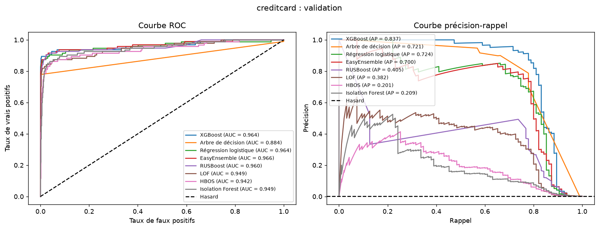

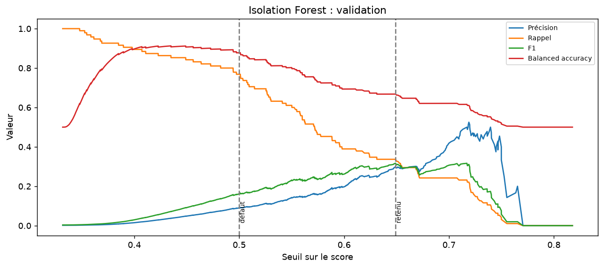

2.3.b. Quelle règle de choix appliquer, quelle méthode sélectionner, et que change le seuil par défaut ?

Le choix de la comparaison étendue est « XGBoost | n_estimators=100, max_depth=5 », selon la règle annoncée sur validation. La logistique pondérée C=1 était le choix historique avant l’ajout des ensembles ; elle reste dans la comparaison, sans être présentée comme sélectionnée globale. Le test ne change pas ce choix.

| Famille | Règle | Seuil | Précision | Rappel | F1 | BA | Alertes | FP | FN |
| --- | --- | --- | --- | --- | --- | --- | --- | --- | --- |
| XGBoost | défaut | 0,500000 | 0,7091 | 0,8211 | 0,7610 | 0,9102 | 110 | 32 | 17 |
| XGBoost | retenu | 0,695443 | 0,8191 | 0,8105 | 0,8148 | 0,9051 | 94 | 17 | 18 |
| Régression logistique | défaut | 0,500000 | 0,0587 | 0,8947 | 0,1102 | 0,9350 | 1 447 | 1 362 | 10 |
| Régression logistique | retenu | 0,999968 | 0,8000 | 0,8000 | 0,8000 | 0,8998 | 95 | 19 | 19 |
| EasyEnsemble | défaut | 0,500000 | 0,0591 | 0,8737 | 0,1107 | 0,9248 | 1 405 | 1 322 | 12 |
| EasyEnsemble | retenu | 0,658872 | 0,8022 | 0,7684 | 0,7849 | 0,8840 | 91 | 18 | 22 |
| Arbre de décision | défaut | 0,500000 | 0,8452 | 0,7474 | 0,7933 | 0,8736 | 84 | 13 | 24 |
| Arbre de décision | retenu | 1,000000 | 0,8452 | 0,7474 | 0,7933 | 0,8736 | 84 | 13 | 24 |
| RUSBoost | défaut | 0,500000 | 0,0461 | 0,9053 | 0,0877 | 0,9365 | 1 866 | 1 780 | 9 |
| RUSBoost | retenu | 0,817290 | 0,4930 | 0,7368 | 0,5907 | 0,8678 | 142 | 72 | 25 |
| LOF | défaut | 1,500000 | 0,0318 | 0,8526 | 0,0612 | 0,9039 | 2 550 | 2 469 | 14 |
| LOF | retenu | 2,796372 | 0,4336 | 0,6526 | 0,5210 | 0,8256 | 143 | 81 | 33 |
| HBOS | défaut | 22,257302 | 0,0149 | 0,8737 | 0,0294 | 0,8871 | 5 559 | 5 476 | 12 |
| HBOS | retenu | 46,664026 | 0,3441 | 0,3368 | 0,3404 | 0,6679 | 93 | 61 | 63 |
| Isolation Forest | défaut | 0,500000 | 0,0902 | 0,7684 | 0,1615 | 0,8775 | 809 | 736 | 22 |
| Isolation Forest | retenu | 0,649011 | 0,2991 | 0,3368 | 0,3168 | 0,6677 | 107 | 75 | 63 |

Le défaut d’un classifieur est 0,5. Pour les détecteurs, le seuil inclusif reproduit la frontière native stricte. Relever le seuil limite généralement les alertes au prix d’un rappel plus faible ; les valeurs exactes, non les arrondis imprimés, produisent les décisions.

L’extension (RUS, ensembles et KDD) a été réalisée après une première lecture du test Credit Card. Les réglages sont annoncés a priori et les seuils utilisent uniquement la validation, mais cette comparaison reste exploratoire : le test ne peut plus être présenté comme un holdout entièrement vierge. Une confirmation demanderait de nouvelles données.

2.3.c. Quels sont les résultats finaux sur le test réservé et les coûts mesurés ?

Les modèles ajustés et seuils de validation sont appliqués au test sans nouvel ajustement.

| Famille | AP | AUC-ROC | Seuil | Précision | Rappel | F1 | BA | Alertes | FP | FN | Objectif test |
| --- | --- | --- | --- | --- | --- | --- | --- | --- | --- | --- | --- |
| XGBoost | 0,7923 | 0,9759 | 0,695443 | 0,7789 | 0,7872 | 0,7831 | 0,8934 | 95 | 21 | 20 | non atteint |
| Régression logistique | 0,6798 | 0,9835 | 0,999968 | 0,7753 | 0,7340 | 0,7541 | 0,8668 | 89 | 20 | 25 | non atteint |
| EasyEnsemble | 0,6785 | 0,9776 | 0,658872 | 0,7848 | 0,6596 | 0,7168 | 0,8296 | 79 | 17 | 32 | non atteint |
| Arbre de décision | 0,6811 | 0,8439 | 1,000000 | 0,9200 | 0,7340 | 0,8166 | 0,8670 | 75 | 6 | 25 | atteint |
| RUSBoost | 0,4018 | 0,9674 | 0,817290 | 0,4889 | 0,7021 | 0,5764 | 0,8504 | 135 | 69 | 28 | non atteint |
| LOF | 0,3295 | 0,9396 | 2,796372 | 0,4677 | 0,6170 | 0,5321 | 0,8079 | 124 | 66 | 36 | non atteint |
| HBOS | 0,1640 | 0,9265 | 46,664026 | 0,3065 | 0,2021 | 0,2436 | 0,6007 | 62 | 43 | 75 | non atteint |
| Isolation Forest | 0,1524 | 0,9430 | 0,649011 | 0,2000 | 0,1596 | 0,1775 | 0,5792 | 75 | 60 | 79 | non atteint |

| Configuration retenue | Prétraitement | Déséquilibre | n apprentissage fourni | Apprentissage (s) | Score test (s) |
| --- | --- | --- | --- | --- | --- |
| XGBoost  /  n_estimators=100, max_depth=5 | log_amount | scale_pos_weight (apprentissage) | 165 397 | 0,6404 | 0,0225 |
| Régression logistique  /  C=1.0  /  class_weight | log_amount + standard | class_weight | 165 397 | 0,2055 | 0,0038 |
| EasyEnsemble  /  n_estimators=5 | log_amount | sous-échantillonnage interne | 165 397 | 1,9314 | 0,3478 |
| Arbre de décision  /  max_depth=8  /  aucun | log_amount | aucun | 165 397 | 3,2043 | 0,0026 |
| RUSBoost  /  n_estimators=50, max_depth=2 | log_amount | sous-échantillonnage interne | 165 397 | 0,1356 | 0,0115 |
| LOF  /  n_neighbors=100 | log_amount + standard | aucun (non supervisé) | 30 000 | 0,3838 | 0,7699 |
| HBOS  /  n_bins=200, alpha=0.1 | log_amount | aucun (non supervisé) | 165 397 | 0,2340 | 0,0662 |
| Isolation Forest  /  n_estimators=300, max_samples=2048 | log_amount | aucun (non supervisé) | 165 397 | 0,7143 | 0,4579 |

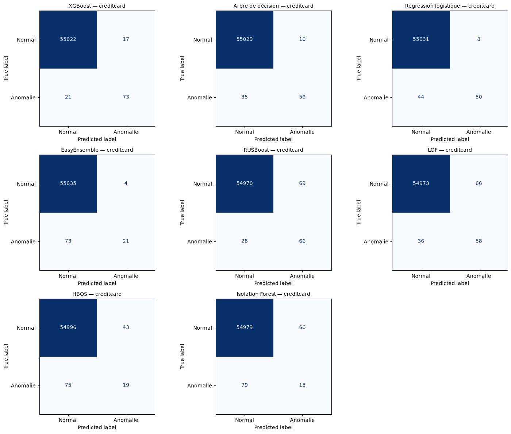

Les temps viennent de cette exécution et ne sont pas des mesures répétées. Les coûts LOF ne sont pas à effectifs d’apprentissage égaux ; toutes les familles scorent le même test complet.

2.3.d. Combien d&#x27;enquêtes, de fraudes manquées, et la contrainte résiste-t-elle au test ?

XGBoost : 95 alertes, dont 74 fraudes et 21 fausses alertes ; 20 cas manqués. Précision 0,7789, rappel 0,7872, objectif au test non atteint.

Régression logistique : 89 alertes, dont 69 fraudes et 20 fausses alertes ; 25 cas manqués. Précision 0,7753, rappel 0,7340, objectif au test non atteint.

EasyEnsemble : 79 alertes, dont 62 fraudes et 17 fausses alertes ; 32 cas manqués. Précision 0,7848, rappel 0,6596, objectif au test non atteint.

Arbre de décision : 75 alertes, dont 69 fraudes et 6 fausses alertes ; 25 cas manqués. Précision 0,9200, rappel 0,7340, objectif au test atteint.

RUSBoost : 135 alertes, dont 66 fraudes et 69 fausses alertes ; 28 cas manqués. Précision 0,4889, rappel 0,7021, objectif au test non atteint.

LOF : 124 alertes, dont 58 fraudes et 66 fausses alertes ; 36 cas manqués. Précision 0,4677, rappel 0,6170, objectif au test non atteint.

HBOS : 62 alertes, dont 19 fraudes et 43 fausses alertes ; 75 cas manqués. Précision 0,3065, rappel 0,2021, objectif au test non atteint.

Isolation Forest : 75 alertes, dont 15 fraudes et 60 fausses alertes ; 79 cas manqués. Précision 0,2000, rappel 0,1596, objectif au test non atteint.

Une précision exigée sur validation n’est pas garantie au test. Les échecs restent visibles ; aucun seuil n’est retouché pour les effacer. Le choix historique logistique et le choix global étendu ne doivent pas être confondus.

Quels sont les taux d&#x27;erreur de fraude et pourquoi un faible taux global est-il trompeur ?

| Modèle | FPR (%) | FNR (%) | Alertes inutiles (%) | Erreur globale (%) |
| --- | --- | --- | --- | --- |
| XGBoost | 0,0382 | 21,2766 | 22,1053 | 0,0744 |
| Régression logistique | 0,0363 | 26,5957 | 22,4719 | 0,0816 |
| EasyEnsemble | 0,0309 | 34,0426 | 21,5190 | 0,0889 |
| Arbre de décision | 0,0109 | 26,5957 | 8,0000 | 0,0562 |
| RUSBoost | 0,1254 | 29,7872 | 51,1111 | 0,1759 |
| LOF | 0,1199 | 38,2979 | 53,2258 | 0,1850 |
| HBOS | 0,0781 | 79,7872 | 69,3548 | 0,2140 |
| Isolation Forest | 0,1090 | 84,0426 | 80,0000 | 0,2521 |

Un faible FPR utilise toutes les normales au dénominateur ; il ne garantit pas une faible proportion d’alertes inutiles. Prédire toujours normale manquerait toutes les fraudes malgré un faible taux global d’erreur.

## Partie 3 — Rechercher une nouvelle méthode : HBOS

3.a-b. Quelle méthode nouvelle choisir, sur quelle source repose-t-elle et comment construit-elle son score ?

Je choisis **HBOS (Histogram-Based Outlier Score)**. Référence : Goldstein et Dengel, *HBOS: A Fast Unsupervised Anomaly Detection Algorithm*, KI-2012 Poster and Demo Track, p. 59–63. La [documentation officielle de PyOD](https://pyod.readthedocs.io/en/latest/pyod.models.html#module-pyod.models.hbos) présente une implémentation de référence. Le notebook utilise l'implémentation locale `utils.HBOS`, à histogrammes statiques ; il ne faut pas assimiler tous ses détails à ceux de PyOD.

Pour chaque variable, un histogramme à cases de même largeur est ajusté sur l'apprentissage, puis ses hauteurs sont divisées par la hauteur maximale. Une case peu remplie correspond à une valeur rare. Le score utilisé est :

$$S(x)=\sum_{j=1}^{d}\log\frac{1}{\operatorname{hist}_j(x_j)+\alpha}.$$

Le lissage `alpha` évite le logarithme de zéro. Avec alpha = 0,1, une contribution plafonne à environ 2,303 : les variables proches de ce plafond ne permettent pas un classement fin de leur importance. Dans cette implémentation, une valeur hors de l'étendue d'apprentissage reçoit une hauteur nulle. Une grande valeur de $S$ indique une observation suspecte. `score_samples` renvoie son opposé pour respecter la convention sklearn ; la fonction commune réoriente ensuite le score vers « grand = suspect ».

Cette somme repose sur une approximation par distributions marginales indépendantes. Elle ressemble à une log-vraisemblance négative sous indépendance, sans être une densité jointe calibrée : les hauteurs sont normalisées par leur maximum et lissées. Les hypothèses sont que les anomalies présentent des valeurs marginalement rares et que les histogrammes représentent suffisamment les distributions. Une combinaison inhabituelle de valeurs individuellement courantes peut échapper à HBOS.

3.c. Quel intérêt attendre sur Credit Card et quels hyperparamètres étudier ?

HBOS évite les distances entre observations et peut utiliser tout l’apprentissage Credit Card, soit 165 397 transactions. Ses contributions s’additionnent par variable. Les composantes ACP sont décorrélées, ce qui motive l’essai sans garantir l’indépendance. Le nombre de cases règle la finesse des distributions, alpha la pénalisation des cases vides. Trois nombres de cases sont comparés, 10, 50 et 200, avec alpha=0,1 fixé ; trop de cases peut rendre les histogrammes instables, trop peu masquer leurs queues.

3.d. Comment intégrer et sélectionner HBOS sans consulter le test ?

HBOS utilise les partitions communes et log(1 + Amount), sans standardisation ni correction du déséquilibre. Les histogrammes sont ajustés sans étiquettes ; les paramètres et seuils sont ensuite sélectionnés avec les étiquettes de validation. Les objectifs non atteints restent marqués ; leur seuil est un compromis de F1, pas un seuil conforme.

| Configuration | n apprentissage | AP | AUC-ROC | Seuil | Précision | Rappel | F1 | Alertes | Objectif atteint | Apprentissage (s) | Score validation (s) |
| --- | --- | --- | --- | --- | --- | --- | --- | --- | --- | --- | --- |
| HBOS  /  n_bins=10, alpha=0.1 | 165 397 | 0,1631 | 0,9501 | 26,102088 | 0,2440 | 0,4316 | 0,3118 | 168 | non | 0,1456 | 0,0297 |
| HBOS  /  n_bins=50, alpha=0.1 | 165 397 | 0,1681 | 0,9483 | 39,477502 | 0,2360 | 0,4000 | 0,2969 | 161 | non | 0,1839 | 0,0465 |
| HBOS  /  n_bins=200, alpha=0.1 | 165 397 | 0,2008 | 0,9416 | 46,664026 | 0,3441 | 0,3368 | 0,3404 | 93 | non | 0,2340 | 0,0650 |

3.e. Comment HBOS se compare-t-il à IF et LOF, en réussite, limites et coût ?

Sur validation, les configurations retenues par famille sont :

| Configuration | n apprentissage | AP | AUC-ROC | Seuil | Précision | Rappel | F1 | Alertes | Objectif atteint | Apprentissage (s) | Score validation (s) |
| --- | --- | --- | --- | --- | --- | --- | --- | --- | --- | --- | --- |
| Isolation Forest  /  n_estimators=300, max_samples=2048 | 165 397 | 0,2086 | 0,9493 | 0,649011 | 0,2991 | 0,3368 | 0,3168 | 107 | non | 0,7143 | 0,4610 |
| LOF  /  n_neighbors=100 | 30 000 | 0,3825 | 0,9487 | 2,796372 | 0,4336 | 0,6526 | 0,5210 | 143 | non | 0,3838 | 0,7004 |
| HBOS  /  n_bins=200, alpha=0.1 | 165 397 | 0,2008 | 0,9416 | 46,664026 | 0,3441 | 0,3368 | 0,3404 | 93 | non | 0,2340 | 0,0650 |

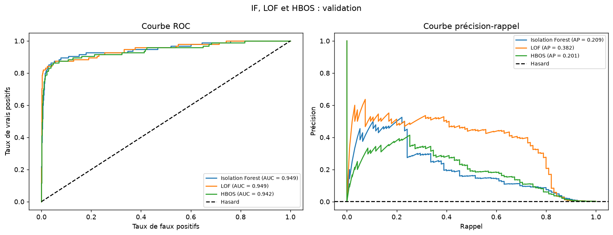

Au test, sans modifier les seuils :

| Famille | AP | AUC-ROC | Seuil | Précision | Rappel | F1 | BA | Alertes | FP | FN | Objectif test |
| --- | --- | --- | --- | --- | --- | --- | --- | --- | --- | --- | --- |
| LOF | 0,3295 | 0,9396 | 2,796372 | 0,4677 | 0,6170 | 0,5321 | 0,8079 | 124 | 66 | 36 | non atteint |
| HBOS | 0,1640 | 0,9265 | 46,664026 | 0,3065 | 0,2021 | 0,2436 | 0,6007 | 62 | 43 | 75 | non atteint |
| Isolation Forest | 0,1524 | 0,9430 | 0,649011 | 0,2000 | 0,1596 | 0,1775 | 0,5792 | 75 | 60 | 79 | non atteint |

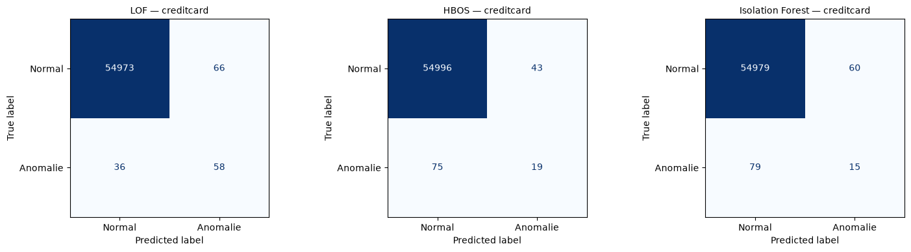

HBOS permet une somme de contributions marginales lisibles, mais ignore les dépendances. Une combinaison rare de valeurs ordinaires peut lui échapper. Les profils moyens montrés dans le notebook sont descriptifs, pas une preuve de la cause des erreurs. Les temps et effectifs de chaque modèle sont dans la comparaison finale : ne pas transformer un temps ponctuel en rapport de vitesse universel.

Quels taux d’erreur obtient-on avec HBOS sur le test Credit Card ?

| Modèle | FPR (%) | FNR (%) | Alertes inutiles (%) | Erreur globale (%) |
| --- | --- | --- | --- | --- |
| HBOS | 0,0781 | 79,7872 | 69,3548 | 0,2140 |

Le FNR mesure les fraudes manquées, la proportion d’alertes inutiles le coût des enquêtes : le FPR seul ne répond à aucune de ces deux questions.

## Partie 4 — Transférer à la maintenance

4.a. Quelle cible et quelles entrées retenir pour AI4I ? Comment traiter les discordances ?

La cible positive est Machine failure=1. Les identifiants UDI et Product ID ainsi que TWF, HDF, PWF, OSF et RNF sont exclus des prédicteurs : ces modes révèlent directement la panne. Les entrées restantes sont Type, les deux températures, la vitesse de rotation, le couple et l’usure de l’outil. L’audit relève 27 discordances entre la cible et le OU des modes. On conserve la cible fournie et toutes les lignes : reconstruire une cible ou supprimer ces cas modifierait la tâche. Les modes servent uniquement à l’audit descriptif.

4.b. Quelle fréquence de pannes, quelles partitions et quel prétraitement ?

AI4I contient 10 000 observations synthétiques et 339 pannes. La cible d’origine est conservée. Type est encodé en one-hot ; les variables numériques sont standardisées pour les modèles sensibles à l’échelle, pas pour les arbres ou IF. Les transformations sont ajustées sur l’apprentissage uniquement.

| Partition | Observations | Pannes |
| --- | --- | --- |
| app | 6 000 | 203 |
| val | 2 000 | 68 |
| test | 2 000 | 68 |

4.c. Quels modèles transférer et que conserve-t-on ?

Le meilleur supervisé global sur Credit Card, ensembles compris, et IF sont transférés à AI4I avec leurs hyperparamètres conservés. La logistique reste une référence historique, pas la gagnante globale de la comparaison étendue Credit Card. Les transformations et modèles sont réajustés sur l’apprentissage AI4I ; les seuils sont choisis à nouveau sur sa validation sous précision ≥ 90 %. Pour XGBoost, `scale_pos_weight` est conservé depuis Credit Card, conformément au transfert demandé : il n’est ni recalculé sur AI4I ni réglé sur son test.

Configurations effectivement réajustées :

| Configuration | n apprentissage | AP | AUC-ROC | Seuil | Précision | Rappel | F1 | Alertes | Objectif atteint | Apprentissage (s) | Score validation (s) |
| --- | --- | --- | --- | --- | --- | --- | --- | --- | --- | --- | --- |
| XGBoost  /  n_estimators=100, max_depth=5 (AI4I) | 6 000 | 0,7199 | 0,9542 | 0,988007 | 0,9091 | 0,5882 | 0,7143 | 44 | oui | 0,0499 | 0,0025 |
| Isolation Forest  /  n_estimators=300, max_samples=2048 (AI4I) | 6 000 | 0,1514 | 0,7816 | 0,681207 | 1,0000 | 0,0294 | 0,0571 | 2 | oui | 0,2124 | 0,0429 |
| Régression logistique  /  C=1.0  /  class_weight (AI4I) | 6 000 | 0,4072 | 0,8811 | 0,979916 | 0,9167 | 0,1618 | 0,2750 | 12 | oui | 0,0076 | 0,0016 |

4.d. Quels seuils retient-on sous précision ≥ 90 %, et quels résultats obtient-on ?

Sur validation AI4I, le choix est « XGBoost | n_estimators=100, max_depth=5 (AI4I) ». La contrainte de 90 % est appliquée avant le test. Une contrainte satisfaite sur très peu d’alertes reste fragile.

| Configuration | n apprentissage | AP | AUC-ROC | Seuil | Précision | Rappel | F1 | Alertes | Objectif atteint | Apprentissage (s) | Score validation (s) |
| --- | --- | --- | --- | --- | --- | --- | --- | --- | --- | --- | --- |
| XGBoost  /  n_estimators=100, max_depth=5 (AI4I) | 6 000 | 0,7199 | 0,9542 | 0,988007 | 0,9091 | 0,5882 | 0,7143 | 44 | oui | 0,0499 | 0,0025 |
| Isolation Forest  /  n_estimators=300, max_samples=2048 (AI4I) | 6 000 | 0,1514 | 0,7816 | 0,681207 | 1,0000 | 0,0294 | 0,0571 | 2 | oui | 0,2124 | 0,0429 |
| Régression logistique  /  C=1.0  /  class_weight (AI4I) | 6 000 | 0,4072 | 0,8811 | 0,979916 | 0,9167 | 0,1618 | 0,2750 | 12 | oui | 0,0076 | 0,0016 |

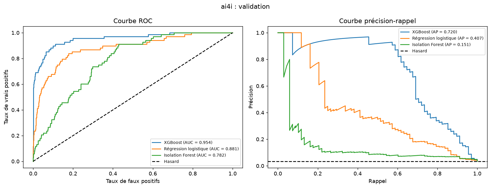

Résultats finaux aux seuils conservés :

| Famille | AP | AUC-ROC | Seuil | Précision | Rappel | F1 | BA | Alertes | FP | FN | Objectif test |
| --- | --- | --- | --- | --- | --- | --- | --- | --- | --- | --- | --- |
| XGBoost | 0,6985 | 0,9715 | 0,988007 | 0,8039 | 0,6029 | 0,6891 | 0,7989 | 51 | 10 | 27 | non atteint |
| Régression logistique | 0,4087 | 0,9046 | 0,979916 | 1,0000 | 0,0588 | 0,1111 | 0,5294 | 4 | 0 | 64 | atteint |
| Isolation Forest | 0,0919 | 0,7465 | 0,681207 | 0,5000 | 0,0147 | 0,0286 | 0,5071 | 2 | 1 | 67 | non atteint |

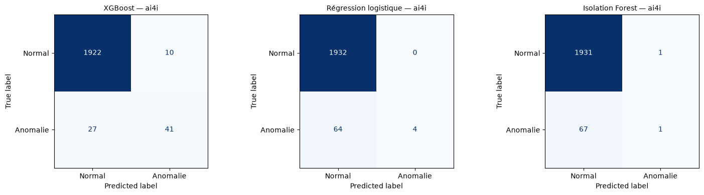

### XGBoost

| Réalité / prédiction | Classe 0 | Classe 1 |
|---|---:|---:|
| Classe 0 | 1922 | 10 |
| Classe 1 | 27 | 41 |

### Régression logistique

| Réalité / prédiction | Classe 0 | Classe 1 |
|---|---:|---:|
| Classe 0 | 1932 | 0 |
| Classe 1 | 64 | 4 |

### Isolation Forest

| Réalité / prédiction | Classe 0 | Classe 1 |
|---|---:|---:|
| Classe 0 | 1931 | 1 |
| Classe 1 | 67 | 1 |

XGBoost : 51 alertes, dont 41 pannes et 10 fausses alertes ; 27 cas manqués. Précision 0,8039, rappel 0,6029, objectif au test non atteint.

Régression logistique : 4 alertes, dont 4 pannes et 0 fausses alertes ; 64 cas manqués. Précision 1,0000, rappel 0,0588, objectif au test atteint.

Isolation Forest : 2 alertes, dont 1 pannes et 1 fausses alertes ; 67 cas manqués. Précision 0,5000, rappel 0,0147, objectif au test non atteint.

La référence logistique reste visible même si un modèle transféré plus performant est sélectionné. Peu d’interventions toutes correctes ne suffisent pas lorsque la plupart des pannes sont manquées.

4.e. Pourquoi le gagnant sur les fraudes peut-il changer, et pourquoi ne pas comparer directement les AP des deux jeux ?

Les variables, interactions et distributions changent entre fraude et maintenance. Conserver une famille et ses hyperparamètres ne garantit pas le même classement des méthodes. Les mécanismes synthétiques d’AI4I peuvent limiter une frontière linéaire ; les seules métriques ne prouvent cependant pas la cause de ses erreurs. Le transfert inclut désormais le meilleur supervisé global et IF, avec logistique de référence : l’ancien contrôle isolé d’arbre ne sert plus de résultat complémentaire.

L’AP dépend de la prévalence positive, différente entre les jeux. Les cibles et contraintes diffèrent aussi. On compare les méthodes au sein d’une même partition, sans attribuer leurs écarts entre jeux à une seule cause.

Quels sont les taux d’erreur sur le test AI4I ?

| Modèle | FPR (%) | FNR (%) | Alertes inutiles (%) | Erreur globale (%) |
| --- | --- | --- | --- | --- |
| XGBoost | 0,5176 | 39,7059 | 19,6078 | 1,8500 |
| Régression logistique | 0,0000 | 94,1176 | 0,0000 | 3,2000 |
| Isolation Forest | 0,0518 | 98,5294 | 50,0000 | 3,4000 |

La fiabilité des alertes et leur couverture sont distinctes. Un résultat de test inférieur à la contrainte reste rapporté, sans nouvelle sélection.

## Partie 5 — Robustesse et explicabilité

5.1. Comment contaminer la référence normale sans modifier le test ni la taille d&#x27;apprentissage ?

La référence normale Mouse de 343 points est contaminée par remplacement, pas par ajout : sa taille reste fixe. Le test réel réservé ne reçoit aucun point injecté. Les points uniformes sont tirés dans la boîte englobante de la référence, élargie de 20 % de chaque côté ; certains peuvent tomber dans un nuage normal. Les taux nominaux ne sont donc pas une garantie de proportion d’anomalies réellement atypiques. IF et LOF gardent leurs hyperparamètres ; les graines déterminent les remplacements et l’aléa des modèles.

| Taux nominal | Normaux remplacés | Graines |
| --- | --- | --- |
| 0,0000 | 0 | 0, 1, 2 |
| 0,0500 | 17 | 0, 1, 2 |
| 0,1000 | 34 | 0, 1, 2 |

5.1. Quelles moyennes et dispersions observe-t-on, et quelles conclusions sont permises ?

Les agrégats portent sur le même test réel Mouse ; l’écart-type est l’écart-type échantillonnal sur les trois graines, pas un intervalle de confiance.

| Méthode | Contamination | AP moyenne | Écart-type AP | AUC-ROC moyenne | Écart-type AUC-ROC |
| --- | --- | --- | --- | --- | --- |
| Isolation Forest | 0,0000 | 0,7790 | 0,1133 | 0,9803 | 0,0096 |
| Isolation Forest | 0,0500 | 0,9346 | 0,0373 | 0,9948 | 0,0026 |
| Isolation Forest | 0,1000 | 0,9252 | 0,0400 | 0,9934 | 0,0041 |
| LOF | 0,0000 | 0,9769 | 0,0000 | 0,9980 | 0,0000 |
| LOF | 0,0500 | 0,9810 | 0,0165 | 0,9982 | 0,0016 |
| LOF | 0,1000 | 0,9923 | 0,0133 | 0,9993 | 0,0012 |

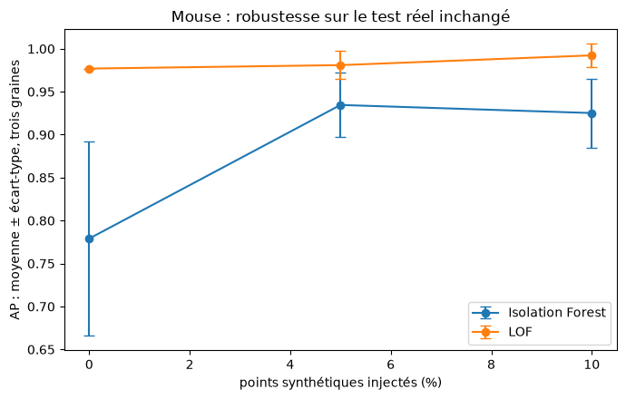

Une amélioration sous ce générateur n’implique pas que la contamination soit bénéfique en général. Les points uniformes peuvent modifier les coupures d’IF, mais ce mécanisme n’est pas isolé expérimentalement. Le générateur, sa boîte et les dix anomalies de test limitent les conclusions.

5.2. Quelles six observations Credit Card sont expliquées avec SHAP et quel fond utilise-t-on ?

On explique IF retenu sur Credit Card, avec son modèle et son seuil de validation figés. Le fond contient 50 transactions d’apprentissage uniquement. Les cas sont choisis pour contraster deux fraudes détectées, deux fausses alertes et deux fraudes manquées, quand ces catégories sont disponibles ; les sorties du notebook signalent toute catégorie manquante. Les scores les plus élevés des deux premières catégories et les plus faibles des fraudes manquées sont privilégiés : ce n’est pas un échantillon représentatif.

| Catégorie disponible sur test | Effectif |
| --- | --- |
| fraude détectée | 15 |
| fausse alerte | 60 |
| fraude manquée | 79 |

5.2. Quelle sortie SHAP explique-t-il exactement, quel est le signe des contributions et comment le vérifier ?

TreeExplainer explique ici la longueur moyenne de chemin corrigée h(x), pas une probabilité ni directement le score d’anomalie. Le score orienté vaut s(x)=2^(−h(x)/c(ψ)). Une contribution SHAP négative raccourcit le chemin et pousse donc vers l’alerte ; une contribution positive allonge le chemin. On compare la base plus la somme des contributions à −c(ψ) log₂(s(x)). L’écart maximal observé sur les six cas vaut 2.57950970806e-07. Les sorties par cas sont conservées dans le notebook exécuté.

5.2. Quelles variables contribuent aux alertes et que peut-on affirmer à partir de ces six cas ?

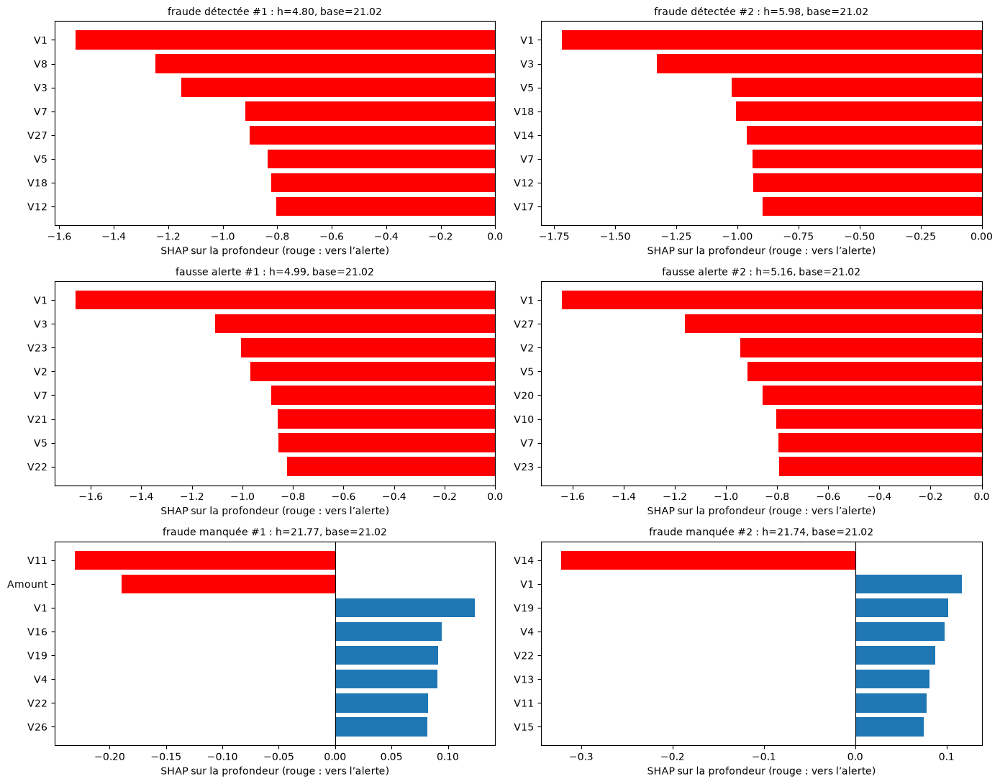

Les variables affichées dans chaque panneau sont celles dont les contributions absolues sont les plus fortes pour ce cas. Des contributions vers l’alerte peuvent apparaître dans une fraude comme dans une fausse alerte. La somme avec la valeur de base, pas une barre isolée, détermine la sortie expliquée. Les fraudes manquées choisies sont volontairement les moins suspectes pour IF ; elles ne représentent pas toutes les fraudes manquées. SHAP décrit le modèle relativement au fond, sans causalité, sans garantie de fraude et sans restituer le sens métier des composantes anonymisées.

## 6. Bilan, limites et éléments à rendre

Que retenir de la comparaison des modèles ?

Le seuil change l’utilité des alertes sans changer le classement. Sur Credit Card, le choix étendu sur validation est « XGBoost | n_estimators=100, max_depth=5 » ; la logistique était le choix historique avant l’extension. Sur AI4I, le choix est « XGBoost | n_estimators=100, max_depth=5 (AI4I) ». Les résultats test ne servent pas à réécrire ces décisions. Les limites des jeux et le caractère exploratoire de l’extension empêchent de conclure à une supériorité générale.

Quels sont les principaux pièges à éviter ?

Confondre valeur extrême et erreur de saisie ; retirer des anomalies pour améliorer le score ; utiliser une information révélant directement la cible ; standardiser avant le découpage ; appliquer SMOTE à la validation ou au test ; calculer ROC et AP sur des prédictions binaires au lieu des scores ; choisir le modèle avec les résultats du test ; comparer des taux d’erreur qui n’ont pas le même dénominateur ; présenter une explication plausible comme un mécanisme démontré.

Les discordances d’étiquettes d’AI4I sont signalées, mais pas corrigées arbitrairement. Les faibles résultats restent dans le rendu : ils font partie de l’évaluation.

Quelles conclusions ne peut-on pas tirer de ce TP ?

Aucune garantie de précision future ni supériorité universelle n’est établie. Mouse comporte dix anomalies ; les faibles effectifs positifs fragilisent les seuils. AI4I est synthétique, KDD est un corpus historique simulé et dédoublonné. Les découpages aléatoires ne mesurent ni le futur ni des attaques nouvelles. Trois graines ne couvrent pas toutes les contaminations ; six cas SHAP ne décrivent pas toute la population.

L’extension (RUS, ensembles et KDD) a été réalisée après une première lecture du test Credit Card. Les réglages sont annoncés a priori et les seuils utilisent uniquement la validation, mais cette comparaison reste exploratoire : le test ne peut plus être présenté comme un holdout entièrement vierge. Une confirmation demanderait de nouvelles données.

Quelles améliorations seraient pertinentes dans une étude réelle ?

Étudier un découpage temporel, la stabilité des seuils, des intervalles d’incertitude, le coût des fausses alertes et des cas manqués, et la qualité de l’étiquetage. On pourrait aussi comparer plusieurs générateurs d’anomalies et explorer des variables d’interaction en maintenance. Ce sont des pistes, pas des expériences réalisées dans ce TP. Toute nouvelle sélection devrait garder une évaluation finale indépendante.

Quels fichiers constituent le rendu ?

Le notebook exécuté, `experiences.py`, `experiences_kdd.py`, `modeles_complementaires.py`, `utils.py`, `generer_notebook.py`, `generer_rendus.py`, `requirements.txt` et les données de `data/` permettent de reprendre le travail. `rendus/resultats.json` est la source des chiffres du compte rendu, du Q/R Markdown et HTML et de la synthèse. La synthèse PDF de deux pages reste le rendu court demandé ; ce Q/R détaillé ne la remplace pas. Conserver `rendus/figures/` avec les documents. Le bloc complémentaire non bonus est réalisé ; seul le bonus autoencodeur ne l’est pas.

Quelles sources ont été utilisées ?

- Sujet : *Atelier : Détection d’anomalies avec Python*, 2026–2027, et cours de H. Elghazel, fournis à la racine.
- Mouse : fichier fourni avec le TP, `data/mouse.txt`.
- Credit Card : https://www.kaggle.com/datasets/mlg-ulb/creditcardfraud
- AI4I 2020 : https://doi.org/10.24432/C5HS5C
- KDDCup99, corpus officiel à 10 % : https://kdd.ics.uci.edu/databases/kddcup99/kddcup99.html ; archive https://kdd.ics.uci.edu/databases/kddcup99/kddcup.data_10_percent.gz
- Goldstein et Dengel (2012), *HBOS: A Fast Unsupervised Anomaly Detection Algorithm*, KI-2012 ; documentation https://pyod.readthedocs.io/en/latest/_modules/pyod/models/hbos.html
- EasyEnsemble et RUSBoost : https://imbalanced-learn.org/stable/ensemble.html ; XGBoost : https://xgboost.readthedocs.io/en/stable/ ; SHAP : https://shap.readthedocs.io/

## Bloc complémentaire et KDDCup99

Quels modèles complémentaires sont comparés et selon quelle grille ?

Les familles classiques ont six configurations au total, pas six par variante. Pour l’arbre (profondeurs 4 et 8) et la logistique (C=0,01 et 1), on croise les deux valeurs avec absence de correction ou poids équilibrés, soit quatre essais. On ajoute un seul sur-échantillonnage au réglage fort et un seul RandomUnderSampler au réglage fort. Sur Credit Card, SMOTE vise un ratio positif/négatif de 0,1 et RUS équilibre les classes (`auto`). Sur KDD, RandomOverSampler remplace SMOTE pour préserver les catégories : il copie des lignes réelles au lieu d’interpoler leurs encodages. ROS et RUS utilisent `auto`. Cette correction porte sur la validité des données synthétiques, pas sur le choix d’un meilleur score de test.

EasyEnsemble compare 5 et 10 ensembles, chacun avec un AdaBoost de 50 souches. RUSBoost compare 50 et 100 arbres de profondeur 2. XGBoost compare les profondeurs 3 et 5 avec 100 arbres et un taux d’apprentissage de 0,1 ; son poids positif est le rapport négatifs/positifs de l’apprentissage seulement. IF compare 100/300 arbres × 256/2048 points ; LOF compare 10/20/50/100 voisins en mode nouveauté. HBOS compare 10, 50 et 200 cases, avec alpha=0,1.

L’extension (RUS, ensembles et KDD) a été réalisée après une première lecture du test Credit Card. Les réglages sont annoncés a priori et les seuils utilisent uniquement la validation, mais cette comparaison reste exploratoire : le test ne peut plus être présenté comme un holdout entièrement vierge. Une confirmation demanderait de nouvelles données.

| Configuration | n apprentissage | AP | AUC-ROC | Seuil | Précision | Rappel | F1 | Alertes | Objectif atteint | Apprentissage (s) | Score validation (s) |
| --- | --- | --- | --- | --- | --- | --- | --- | --- | --- | --- | --- |
| EasyEnsemble  /  n_estimators=5 | 165 397 | 0,6725 | 0,9669 | 0,658872 | 0,8022 | 0,7684 | 0,7849 | 91 | oui | 1,9314 | 0,3923 |
| EasyEnsemble  /  n_estimators=10 | 165 397 | 0,6998 | 0,9662 | 0,676962 | 0,8171 | 0,7053 | 0,7571 | 82 | oui | 0,6093 | 0,5168 |
| RUSBoost  /  n_estimators=50, max_depth=2 | 165 397 | 0,4048 | 0,9603 | 0,817290 | 0,4930 | 0,7368 | 0,5907 | 142 | non | 0,1356 | 0,0112 |
| RUSBoost  /  n_estimators=100, max_depth=2 | 165 397 | 0,4048 | 0,9603 | 0,817290 | 0,4930 | 0,7368 | 0,5907 | 142 | non | 0,1354 | 0,0113 |
| XGBoost  /  n_estimators=100, max_depth=3 | 165 397 | 0,7587 | 0,9680 | 0,973944 | 0,8085 | 0,8000 | 0,8042 | 94 | oui | 0,5216 | 0,0153 |
| XGBoost  /  n_estimators=100, max_depth=5 | 165 397 | 0,8371 | 0,9638 | 0,695443 | 0,8191 | 0,8105 | 0,8148 | 94 | oui | 0,6404 | 0,0196 |

Quels sont les effectifs après rééchantillonnage sur Credit Card ?

| Configuration | Avant | Après rééchantillonnage externe | Positifs après |
| --- | --- | --- | --- |
| Arbre de décision  /  max_depth=4  /  aucun | 165 397 | 165 397 | 284 |
| Arbre de décision  /  max_depth=4  /  class_weight | 165 397 | 165 397 | 284 |
| Arbre de décision  /  max_depth=8  /  aucun | 165 397 | 165 397 | 284 |
| Arbre de décision  /  max_depth=8  /  class_weight | 165 397 | 165 397 | 284 |
| Arbre de décision  /  max_depth=8  /  SMOTE | 165 397 | 181 624 | 16 511 |
| Arbre de décision  /  max_depth=8  /  RandomUnderSampler | 165 397 | 568 | 284 |
| Régression logistique  /  C=0.01  /  aucun | 165 397 | 165 397 | 284 |
| Régression logistique  /  C=0.01  /  class_weight | 165 397 | 165 397 | 284 |
| Régression logistique  /  C=1.0  /  aucun | 165 397 | 165 397 | 284 |
| Régression logistique  /  C=1.0  /  class_weight | 165 397 | 165 397 | 284 |
| Régression logistique  /  C=1.0  /  SMOTE | 165 397 | 181 624 | 16 511 |
| Régression logistique  /  C=1.0  /  RandomUnderSampler | 165 397 | 568 | 284 |
| EasyEnsemble  /  n_estimators=5 | 165 397 | 165 397 | 284 |
| EasyEnsemble  /  n_estimators=10 | 165 397 | 165 397 | 284 |
| RUSBoost  /  n_estimators=50, max_depth=2 | 165 397 | 165 397 | 284 |
| RUSBoost  /  n_estimators=100, max_depth=2 | 165 397 | 165 397 | 284 |
| XGBoost  /  n_estimators=100, max_depth=3 | 165 397 | 165 397 | 284 |
| XGBoost  /  n_estimators=100, max_depth=5 | 165 397 | 165 397 | 284 |
| Isolation Forest  /  n_estimators=100, max_samples=256 | 165 397 | 165 397 | 284 |
| Isolation Forest  /  n_estimators=100, max_samples=2048 | 165 397 | 165 397 | 284 |
| Isolation Forest  /  n_estimators=300, max_samples=256 | 165 397 | 165 397 | 284 |
| Isolation Forest  /  n_estimators=300, max_samples=2048 | 165 397 | 165 397 | 284 |
| LOF  /  n_neighbors=10 | 30 000 | 30 000 | 52 |
| LOF  /  n_neighbors=20 | 30 000 | 30 000 | 52 |
| LOF  /  n_neighbors=50 | 30 000 | 30 000 | 52 |
| LOF  /  n_neighbors=100 | 30 000 | 30 000 | 52 |
| HBOS  /  n_bins=10, alpha=0.1 | 165 397 | 165 397 | 284 |
| HBOS  /  n_bins=50, alpha=0.1 | 165 397 | 165 397 | 284 |
| HBOS  /  n_bins=200, alpha=0.1 | 165 397 | 165 397 | 284 |

Les effectifs fournis à EasyEnsemble et RUSBoost ne décrivent pas leurs tirages internes : ces méthodes rééchantillonnent pendant leur propre apprentissage. XGBoost pondère sans modifier le nombre de lignes.

6.a. Quel corpus KDDCup99 est utilisé et comment sont traités les doublons ?

Le fichier local est le vrai corpus officiel à 10 %, réexporté en CSV gzip ASCII depuis `fetch_kddcup99(percent10=True)`, pas une donnée synthétique fabriquée pour le TP. Il est inclus pour une exécution hors connexion. L’étiquette positive est intrusion=1 pour toute attaque différente de normal.

| Étape | Total | Normales | Intrusions | Proportion d’intrusions |
| --- | --- | --- | --- | --- |
| effectifs_bruts | 494 021 | 97 278 | 396 743 | 0,8031 |
| effectifs_dedoublonnes | 145 583 | 87 831 | 57 752 | 0,3967 |
| effectifs_echantillon | 60 000 | 36 198 | 23 802 | 0,3967 |
| effectifs_apprentissage_effectif | 30 000 | 18 099 | 11 901 | 0,3967 |

1 groupe à cibles binaires contradictoires, soit 2 lignes, est exclu. Un représentant par vecteur prédictif univoque est ensuite gardé, avant le tirage et la partition. Les répétitions retirées changent fortement la prévalence ; la rareté statistique et l’étiquette d’intrusion ne sont pas synonymes.

SHA-256 du fichier local fourni : `7e704c56479ba6179ecb14f79bbc25a77ac07247e336f82771f8c3f20602b388`.

6.b. Quels prétraitements, partitions et contrainte utilise-t-on ?

Après dédoublonnage, un tirage stratifié fixe de 60 000 vecteurs précède le partage 60/20/20. Les sept familles partagent exactement le même sous-échantillon d’apprentissage stratifié de 30 000 lignes ; les validations et tests de 12 000 lignes sont inchangés. Trois variables catégorielles sont encodées en one-hot ; les numériques sont standardisées pour logistique et LOF. RandomOverSampler copie des lignes minoritaires réelles : les catégories restent valides, contrairement à une interpolation après one-hot. Les estimateurs IF et LOF n’utilisent pas y, mais leur sélection sur validation est supervisée.

La précision minimale de 0,80 est un choix pédagogique annoncé a priori, pas une exigence propre à KDD dans l’énoncé. La règle reste rappel maximal sous contrainte, sinon compromis F1.

| Configuration | n apprentissage | AP | AUC-ROC | Seuil | Précision | Rappel | F1 | Alertes | Objectif atteint | Apprentissage (s) | Score validation (s) |
| --- | --- | --- | --- | --- | --- | --- | --- | --- | --- | --- | --- |
| Arbre de décision  /  max_depth=4  /  aucun | 30 000 | 0,9845 | 0,9872 | 0,214286 | 0,9785 | 0,9748 | 0,9766 | 4 743 | oui | 0,0663 | 0,0077 |
| Arbre de décision  /  max_depth=4  /  class_weight | 30 000 | 0,9845 | 0,9872 | 0,293168 | 0,9785 | 0,9748 | 0,9766 | 4 743 | oui | 0,0639 | 0,0069 |
| Arbre de décision  /  max_depth=8  /  aucun | 30 000 | 0,9979 | 0,9984 | 0,014516 | 0,9481 | 0,9973 | 0,9721 | 5 008 | oui | 0,0884 | 0,0065 |
| Arbre de décision  /  max_depth=8  /  class_weight | 30 000 | 0,9975 | 0,9981 | 0,021910 | 0,9479 | 0,9971 | 0,9718 | 5 008 | oui | 0,0927 | 0,0065 |
| Arbre de décision  /  max_depth=8  /  RandomOverSampler | 30 000 | 0,9979 | 0,9990 | 0,010579 | 0,8535 | 0,9996 | 0,9208 | 5 576 | oui | 0,1028 | 0,0071 |
| Arbre de décision  /  max_depth=8  /  RandomUnderSampler | 30 000 | 0,9963 | 0,9984 | 0,010172 | 0,8492 | 0,9992 | 0,9181 | 5 602 | oui | 0,0714 | 0,0062 |
| Régression logistique  /  C=0.01  /  aucun | 30 000 | 0,9957 | 0,9988 | 0,033001 | 0,8124 | 0,9981 | 0,8958 | 5 849 | oui | 0,0659 | 0,0068 |
| Régression logistique  /  C=0.01  /  class_weight | 30 000 | 0,9957 | 0,9988 | 0,044697 | 0,8158 | 0,9981 | 0,8978 | 5 825 | oui | 0,0592 | 0,0068 |
| Régression logistique  /  C=1.0  /  aucun | 30 000 | 0,9983 | 0,9995 | 0,003293 | 0,8416 | 0,9998 | 0,9139 | 5 656 | oui | 0,2093 | 0,0067 |
| Régression logistique  /  C=1.0  /  class_weight | 30 000 | 0,9983 | 0,9996 | 0,002935 | 0,8090 | 1,0000 | 0,8944 | 5 885 | oui | 0,1565 | 0,0068 |
| Régression logistique  /  C=1.0  /  RandomOverSampler | 30 000 | 0,9983 | 0,9996 | 0,002979 | 0,8205 | 0,9998 | 0,9013 | 5 801 | oui | 0,2481 | 0,0068 |
| Régression logistique  /  C=1.0  /  RandomUnderSampler | 30 000 | 0,9983 | 0,9996 | 0,004137 | 0,8283 | 0,9998 | 0,9060 | 5 747 | oui | 0,1237 | 0,0073 |
| EasyEnsemble  /  n_estimators=5 | 30 000 | 0,9994 | 0,9996 | 0,405317 | 0,8224 | 1,0000 | 0,9026 | 5 789 | oui | 2,4391 | 0,2652 |
| EasyEnsemble  /  n_estimators=10 | 30 000 | 0,9994 | 0,9996 | 0,407594 | 0,8183 | 1,0000 | 0,9001 | 5 818 | oui | 4,1052 | 0,3335 |
| RUSBoost  /  n_estimators=50, max_depth=2 | 30 000 | 0,9998 | 0,9999 | 0,304810 | 0,8363 | 1,0000 | 0,9108 | 5 693 | oui | 0,4996 | 0,0159 |
| RUSBoost  /  n_estimators=100, max_depth=2 | 30 000 | 0,9998 | 0,9999 | 0,304810 | 0,8363 | 1,0000 | 0,9108 | 5 693 | oui | 0,4951 | 0,0161 |
| XGBoost  /  n_estimators=100, max_depth=3 | 30 000 | 1,0000 | 1,0000 | 0,044919 | 0,9710 | 1,0000 | 0,9853 | 4 903 | oui | 0,2420 | 0,0095 |
| XGBoost  /  n_estimators=100, max_depth=5 | 30 000 | 1,0000 | 1,0000 | 0,011448 | 0,9667 | 1,0000 | 0,9831 | 4 925 | oui | 0,2934 | 0,0103 |
| Isolation Forest  /  n_estimators=100, max_samples=256 | 30 000 | 0,5062 | 0,6926 | 0,547489 | 0,8087 | 0,0195 | 0,0381 | 115 | oui | 0,1077 | 0,0362 |
| Isolation Forest  /  n_estimators=100, max_samples=2048 | 30 000 | 0,4847 | 0,6434 | 0,443062 | 0,8090 | 0,0489 | 0,0923 | 288 | oui | 0,1230 | 0,0359 |
| Isolation Forest  /  n_estimators=300, max_samples=256 | 30 000 | 0,5329 | 0,7171 | 0,530159 | 0,8128 | 0,0319 | 0,0614 | 187 | oui | 0,2491 | 0,0926 |
| Isolation Forest  /  n_estimators=300, max_samples=2048 | 30 000 | 0,5189 | 0,6832 | 0,431533 | 0,8011 | 0,0626 | 0,1161 | 372 | oui | 0,3026 | 0,0976 |
| LOF  /  n_neighbors=10 | 30 000 | 0,3490 | 0,4361 | 0,911106 | 0,3969 | 1,0000 | 0,5683 | 11 995 | non | 0,5302 | 0,2198 |
| LOF  /  n_neighbors=20 | 30 000 | 0,3994 | 0,4701 | 0,957647 | 0,3983 | 0,9966 | 0,5692 | 11 912 | non | 0,5134 | 0,2495 |
| LOF  /  n_neighbors=50 | 30 000 | 0,4493 | 0,4921 | 3,064195 | 0,8015 | 0,1094 | 0,1926 | 650 | oui | 0,5459 | 0,2324 |
| LOF  /  n_neighbors=100 | 30 000 | 0,4288 | 0,4640 | 3,850746 | 0,8122 | 0,1063 | 0,1880 | 623 | oui | 0,5909 | 0,2676 |

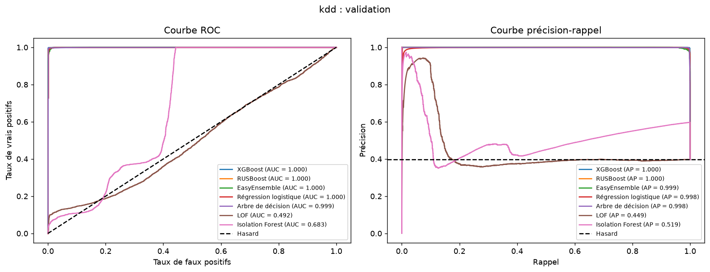

6.c. Quels résultats d’intrusion obtient-on au test ?

Le choix de validation est « XGBoost | n_estimators=100, max_depth=3 ».

| Famille | AP | AUC-ROC | Seuil | Précision | Rappel | F1 | BA | Alertes | FP | FN | Objectif test |
| --- | --- | --- | --- | --- | --- | --- | --- | --- | --- | --- | --- |
| XGBoost | 0,9999 | 1,0000 | 0,044919 | 0,9716 | 0,9994 | 0,9853 | 0,9901 | 4 896 | 139 | 3 | atteint |
| RUSBoost | 0,9998 | 0,9999 | 0,304810 | 0,8410 | 1,0000 | 0,9136 | 0,9378 | 5 660 | 900 | 0 | atteint |
| EasyEnsemble | 0,9995 | 0,9996 | 0,405317 | 0,8231 | 0,9998 | 0,9029 | 0,9292 | 5 782 | 1 023 | 1 | atteint |
| Régression logistique | 0,9945 | 0,9989 | 0,002935 | 0,8115 | 0,9992 | 0,8956 | 0,9233 | 5 861 | 1 105 | 4 | atteint |
| Arbre de décision | 0,9970 | 0,9987 | 0,010579 | 0,8490 | 0,9994 | 0,9181 | 0,9413 | 5 603 | 846 | 3 | atteint |
| LOF | 0,4439 | 0,4938 | 3,064195 | 0,7820 | 0,1078 | 0,1894 | 0,5440 | 656 | 143 | 4 247 | non atteint |
| Isolation Forest | 0,5116 | 0,6782 | 0,431533 | 0,7727 | 0,0607 | 0,1126 | 0,5245 | 374 | 85 | 4 471 | non atteint |

| Configuration | n apprentissage fourni | Apprentissage (s) | Score test (s) |
| --- | --- | --- | --- |
| XGBoost  /  n_estimators=100, max_depth=3 | 30 000 | 0,2420 | 0,0085 |
| RUSBoost  /  n_estimators=50, max_depth=2 | 30 000 | 0,4996 | 0,0161 |
| EasyEnsemble  /  n_estimators=5 | 30 000 | 2,4391 | 0,2427 |
| Régression logistique  /  C=1.0  /  class_weight | 30 000 | 0,1565 | 0,0072 |
| Arbre de décision  /  max_depth=8  /  RandomOverSampler | 30 000 | 0,1028 | 0,0061 |
| LOF  /  n_neighbors=50 | 30 000 | 0,5459 | 0,2261 |
| Isolation Forest  /  n_estimators=300, max_samples=2048 | 30 000 | 0,3026 | 0,1017 |

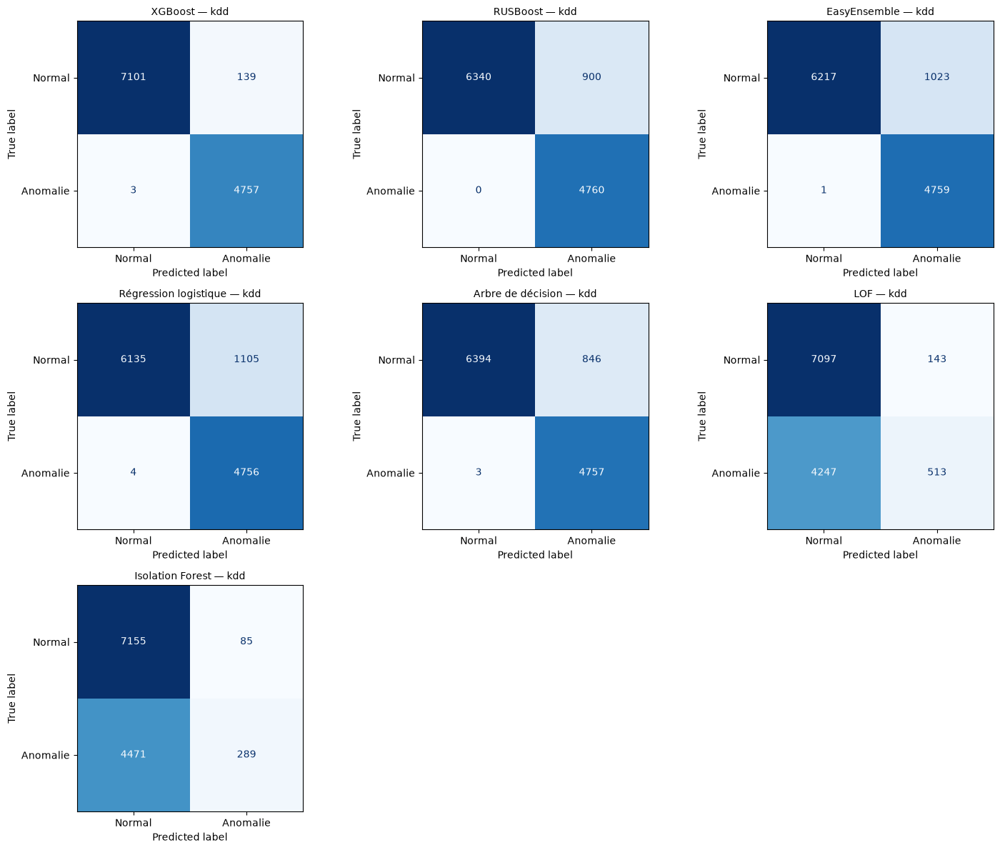

XGBoost : 4 896 alertes, dont 4 757 intrusions et 139 fausses alertes ; 3 cas manqués. Précision 0,9716, rappel 0,9994, objectif au test atteint.

RUSBoost : 5 660 alertes, dont 4 760 intrusions et 900 fausses alertes ; 0 cas manqués. Précision 0,8410, rappel 1,0000, objectif au test atteint.

EasyEnsemble : 5 782 alertes, dont 4 759 intrusions et 1 023 fausses alertes ; 1 cas manqués. Précision 0,8231, rappel 0,9998, objectif au test atteint.

Régression logistique : 5 861 alertes, dont 4 756 intrusions et 1 105 fausses alertes ; 4 cas manqués. Précision 0,8115, rappel 0,9992, objectif au test atteint.

Arbre de décision : 5 603 alertes, dont 4 757 intrusions et 846 fausses alertes ; 3 cas manqués. Précision 0,8490, rappel 0,9994, objectif au test atteint.

LOF : 656 alertes, dont 513 intrusions et 143 fausses alertes ; 4 247 cas manqués. Précision 0,7820, rappel 0,1078, objectif au test non atteint.

Isolation Forest : 374 alertes, dont 289 intrusions et 85 fausses alertes ; 4 471 cas manqués. Précision 0,7727, rappel 0,0607, objectif au test non atteint.

| Modèle | FPR (%) | FNR (%) | Alertes inutiles (%) | Erreur globale (%) |
| --- | --- | --- | --- | --- |
| XGBoost | 1,9199 | 0,0630 | 2,8391 | 1,1833 |
| RUSBoost | 12,4309 | 0,0000 | 15,9011 | 7,5000 |
| EasyEnsemble | 14,1298 | 0,0210 | 17,6928 | 8,5333 |
| Régression logistique | 15,2624 | 0,0840 | 18,8534 | 9,2417 |
| Arbre de décision | 11,6851 | 0,0630 | 15,0991 | 7,0750 |
| LOF | 1,9751 | 89,2227 | 21,7988 | 36,5833 |
| Isolation Forest | 1,1740 | 93,9286 | 22,7273 | 37,9667 |

6.d. Quelles limites empêchent de transposer ces résultats à un réseau actuel ?

KDDCup99 décrit des connexions d’un environnement militaire simulé historique. Le fichier brut répète massivement certaines attaques, notamment smurf et neptune. Le dédoublonnage et le tirage modifient la population évaluée ; le test aléatoire ne mesure pas des attaques inédites ni une généralisation temporelle. Les sept familles ont le même apprentissage effectif, mais ces données et la contrainte pédagogique de précision ne constituent pas un cahier des charges de cybersécurité actuel.

