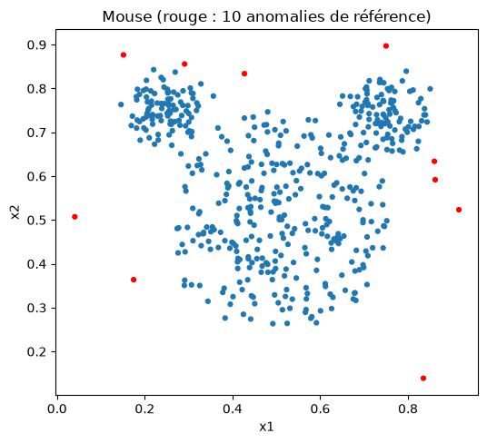
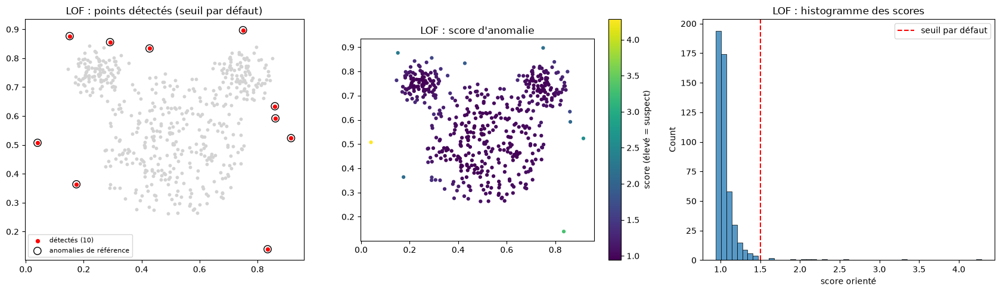
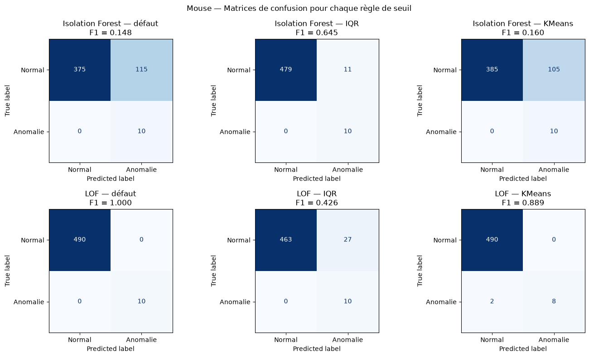
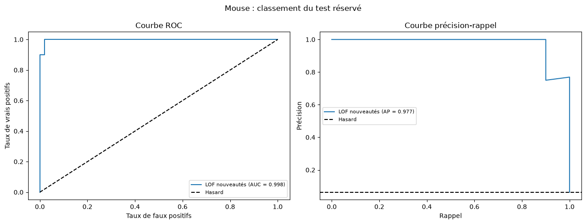
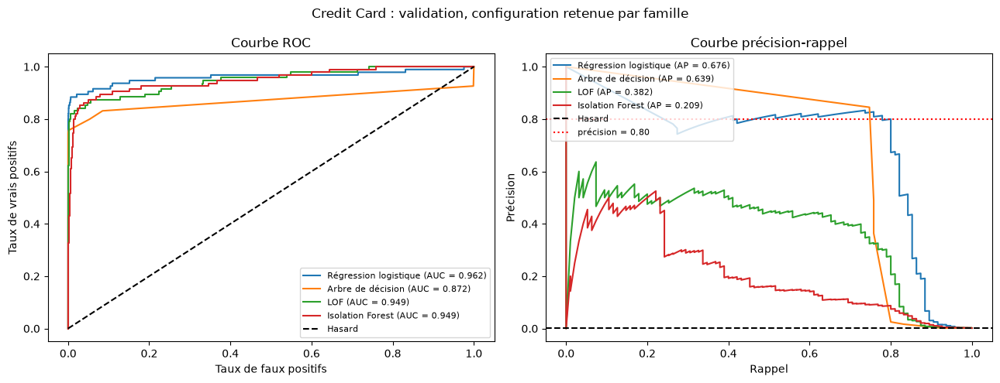
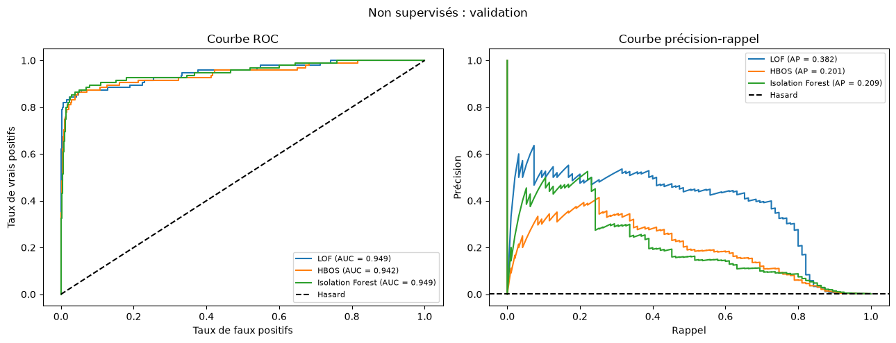
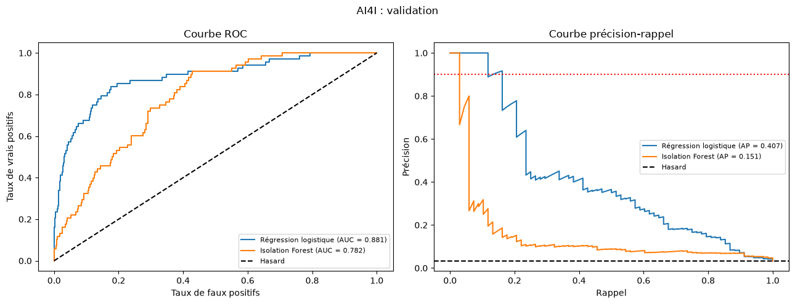

# TP Détection d’anomalies — Questions / Réponses

M’BEY Max — M2 Data Science

## 0. Objectif, organisation et protocole commun

Quel est l’objectif du TP ?

Comparer des méthodes de détection d’anomalies, évaluer leur classement et choisir un seuil répondant à une contrainte opérationnelle. Le travail porte sur Mouse, la fraude bancaire avec Credit Card et la maintenance avec AI4I. Il comprend aussi une méthode non étudiée en cours, une expérience de contamination et des explications avec SHAP.

Ce document suit les cinq parties du sujet 2026–2027. Il détaille les choix et résultats du notebook exécuté `TP_detection_anomalies.ipynb` ; ce n’est pas la synthèse courte, qui reste dans `synthese.pdf`.

Où se trouve le code ?

Le notebook contient les expériences, les sorties et les figures. `utils.py` regroupe le chargement des données, le découpage, les prétraitements, l’apprentissage, les scores, les seuils et les métriques. `requirements.txt` indique les dépendances. Les figures reprises ici sont dans `figures/`.

Comment rendre les expériences reproductibles ?

Les partitions et modèles aléatoires utilisent une graine fixée à 42. L’expérience de robustesse utilise explicitement les graines 0, 1 et 2. Les partitions sont réutilisées entre les méthodes. Les avertissements ne sont pas masqués. Les temps sont mesurés séparément pour l’apprentissage et le calcul des scores ; ils peuvent varier d’une exécution à l’autre et ne constituent pas un benchmark répété.

Versions affichées dans le notebook : Python 3.14.3, numpy 2.5.4, pandas 3.1.0, matplotlib 3.11.2, seaborn 0.13.2, scikit-learn 1.9.1, imbalanced-learn 0.14.2 et SHAP 0.54.1.

### 1. Séparer apprentissage et évaluation

Comment sont séparées les données ?

Pour Credit Card et AI4I, le découpage est stratifié : 60 % apprentissage, 20 % validation et 20 % test. La stratification conserve approximativement la proportion de positifs.

| Jeu | Apprentissage | Validation | Test |
|---|---|---|---|
| Credit Card après dédoublonnage | 165 397 transactions, 284 fraudes | 55 133 transactions, 95 fraudes | 55 133 transactions, 94 fraudes |
| AI4I | 6 000 observations, 203 pannes | 2 000 observations, 68 pannes | 2 000 observations, 68 pannes |

L’apprentissage sert à ajuster les transformations et les modèles. La validation sert à sélectionner les configurations et les seuils. Le test sert à l’évaluation finale, sans modifier les choix en fonction de ses résultats. Mouse suit les deux cadres particuliers demandés : outliers dans tout l’ensemble, puis nouveautés sur un test réservé.

Qu’est-ce qu’une fuite de données et comment est-elle évitée ?

Une fuite apparaît lorsqu’une information indisponible au moment prévu pour la prédiction influence l’apprentissage ou la sélection. Par exemple : standardiser avec les statistiques du test, placer des copies d’une transaction dans plusieurs partitions, ou utiliser les indicateurs de panne comme entrées pour prédire la panne.

Les transformations sont ajustées sur l’apprentissage seulement, dans les pipelines. SMOTE ne rééchantillonne que l’apprentissage. Les doublons de Credit Card sont traités avant le découpage. Les indicateurs de panne et identifiants d’AI4I sont exclus des prédicteurs. Le fond de référence de SHAP vient uniquement de l’apprentissage.

Combien de configurations sont comparées et pourquoi LOF utilise-t-il moins de données ?

La recherche est limitée à six configurations par famille, toutes variantes comprises. HBOS est limité à trois configurations.

| Famille sur Credit Card | Configurations | Observations d’apprentissage avant SMOTE éventuel |
|---|---:|---:|
| Arbre de décision | 6 : deux profondeurs × trois traitements du déséquilibre | 165 397 |
| Régression logistique | 6 : deux valeurs de C × trois traitements du déséquilibre | 165 397 |
| Isolation Forest | 4 | 165 397 |
| LOF | 4 nombres de voisins | 30 000 |
| HBOS | 3 nombres de cases | 165 397 |

LOF utilise un sous-échantillon stratifié fixe, contenant 52 fraudes, car la recherche de voisins est coûteuse. Ce même sous-échantillon sert à ses quatre configurations. Les validations et tests restent complets et identiques pour toutes les méthodes. Les effectifs utilisés sont indiqués dans les tableaux du notebook.

Sur AI4I, les hyperparamètres de la logistique sélectionnée et d’IF sont conservés : une configuration chacun, réajustée sur les 6 000 observations d’apprentissage. L’arbre supplémentaire est un contrôle indicatif sur la validation, hors sélection.

La validation croisée est-elle utilisée ? Faut-il aussi un découpage temporel ?

La validation croisée n’est pas utilisée : le sujet ne l’exige pas. Les choix reposent sur la partition de validation réservée.

Le découpage aléatoire 60/20/20 constitue ici le cadre commun de comparaison. Il mélange passé et futur. Pour évaluer un déploiement prospectif, il faudrait aussi étudier un découpage temporel. Cette expérience complémentaire n’a pas été réalisée.

### 2. Deux niveaux d’évaluation

Que signifient la classe positive et les scores ?

La classe 1 désigne ce que l’on cherche : anomalie, fraude ou panne. La classe 0 désigne le reste. Tous les scores sont orientés pour qu’une grande valeur indique un point plus suspect. Les scores sklearn d’IF et de LOF sont donc inversés. Les classifieurs utilisent la probabilité prédite de la classe 1, sans supposer que cette probabilité est bien calibrée après pondération ou SMOTE. Un score d’Isolation Forest n’est pas une probabilité de fraude.

Quelle différence y a-t-il entre évaluer un classement et évaluer des alertes ?

Le classement est évalué avec les scores continus : courbes ROC et précision-rappel, AUC-ROC et Average Precision (AP). Les alertes sont évaluées après le choix d’un seuil : matrice de confusion, précision, rappel, F1 et balanced accuracy. Un bon classement ne garantit pas que le seuil par défaut donne de bonnes alertes.

Comment lire une matrice de confusion ?

Les lignes représentent les vraies classes et les colonnes les prédictions, dans l’ordre 0 puis 1 :

| | Prédit normal | Prédit anomalie |
|---|---|---|
| Vrai normal | VN : vrai négatif | FP : fausse alerte |
| Vraie anomalie | FN : anomalie manquée | VP : anomalie détectée |

Les mêmes termes s’appliquent aux fraudes et aux pannes. Dans les matrices compactes de ce document, `[[VN, FP], [FN, VP]]` conserve cet ordre.

Quels indicateurs faut-il lire, et que mesure chacun ?

| Indicateur | Calcul | Question à laquelle il répond |
|---|---|---|
| Précision | VP / (VP + FP) | Parmi les alertes, combien sont correctes ? |
| Rappel | VP / (VP + FN) | Parmi les anomalies, combien sont retrouvées ? |
| F1 | 2 × précision × rappel / (précision + rappel) | Quel compromis entre précision et rappel ? |
| Balanced accuracy | (rappel positif + rappel négatif) / 2 | Quelle performance moyenne sur les deux classes ? |
| AP | `average_precision_score(y, scores)` | Les positifs sont-ils bien placés dans le classement ? |
| AUC-ROC | Aire sous la courbe TPR en fonction du FPR | Les positifs sont-ils généralement classés devant les négatifs ? |

L’AP utilisée ici n’est pas l’aire PR calculée par intégration trapézoïdale. En l’absence de prédiction positive, la précision est fixée à 0 pour l’évaluation des décisions.

De quel « taux d’erreur » parle-t-on ?

Il faut préciser le dénominateur. Ces quatre taux ne sont pas interchangeables :

| Taux | Calcul | Interprétation |
|---|---|---|
| Taux de fausses alertes (FPR) | FP / (VN + FP) | Part des observations normales signalées à tort |
| Taux d’anomalies manquées (FNR) | FN / (VP + FN) = 1 − rappel | Part des anomalies qui passent inaperçues |
| Part d’alertes inutiles | FP / (VP + FP) = 1 − précision | Part du travail d’investigation dépensée à tort |
| Taux d’erreur global | (FP + FN) / N | Part de toutes les observations mal classées |

Avec des anomalies rares, un faible taux d’erreur global peut cacher un échec total de détection. Prédire « normal » partout sur le fichier Credit Card brut ne commettrait que 492 erreurs sur 284 807 transactions, soit environ 0,173 %, mais manquerait toutes les fraudes. On ne retient donc pas un modèle à partir de ce seul taux.

### 3. Objectifs opérationnels imposés

Pourquoi imposer 80 % de précision pour les fraudes et 90 % pour la maintenance ?

Pour les fraudes, le scénario demande de retrouver le plus de fraudes possible tout en limitant les enquêtes inutiles : sur la validation, au moins quatre alertes sur cinq doivent être correctes.

Pour la maintenance, chaque alerte entraîne une intervention coûteuse : le sujet exige une précision d’au moins 90 %. Dans les deux cas, on maximise le rappel seulement parmi les seuils respectant cette exigence. Ces valeurs sont pédagogiques, pas des normes universelles.

Comment les seuils et la méthode gagnante sont-ils choisis ?

Sur la validation, je cherche le meilleur rappel parmi les seuils donnant au moins une alerte et une précision d’au moins 80 % pour les fraudes, ou 90 % pour les pannes. En cas d’égalité, la précision puis l’AP départagent les configurations. Si l’objectif est inaccessible, il est signalé et je présente le compromis au F1 maximal, à la fois pour le seuil et pour la configuration.

Le seuil et le modèle sont ensuite figés. Dans les évaluations, une alerte correspond à `score >= seuil`. Pour restituer exactement la décision par défaut d’un détecteur sklearn, la frontière est stricte (`decision_function < 0`) ; aucun score des jeux actuellement comparés ne crée de désaccord à cette frontière. Ces contraintes de précision sont des objectifs pédagogiques, pas des normes universelles.

Un résultat de test inférieur à la contrainte signifie-t-il que le TP est faux ?

Non. La contrainte est utilisée pour sélectionner le seuil sur la validation ; elle n’est pas garantie sur un autre échantillon. Le résultat doit être rapporté, même défavorable. Retoucher le seuil pour satisfaire la contrainte sur le test transformerait ce test en nouveau jeu de validation.

Où retrouve-t-on ce protocole dans le code du notebook ?

| Règle | Application |
|---|---|
| Découpage stratifié 60/20/20 | `utils.decouper_donnees`, appelé dans la préparation de Credit Card et d’AI4I |
| Partitions identiques entre méthodes | Les variables `parts_cc` et `parts_ai` sont créées une fois, puis réutilisées |
| Sous-échantillon fixe de 30 000 observations | `utils.sous_echantillon_stratifie`, puis la configuration commune d’apprentissage de LOF |
| Transformations et SMOTE sur l’apprentissage seulement | Pipelines construits dans « Configurations comparées » |
| Classe 1 et scores élevés pour les observations suspectes | Cibles construites au chargement et `utils.score_anomalie` |
| AP et AUC-ROC sur scores continus | `utils.evaluer` ; courbes avec `utils.tracer_courbes` |
| Matrice, précision, rappel, F1 et balanced accuracy | `utils.rapport_seuil` ; matrices et tableaux affichés dans les évaluations |
| Contraintes de précision | `PRECISION_MIN_FRAUDE = 0.80` et `PRECISION_MIN_PANNE = 0.90` |
| Seuil choisi sur la validation | `utils.choisir_seuil_contraint` dans `utils.comparer_configurations` |
| Sélection des configurations | `utils.selectionner` |
| Évaluation finale, sans nouvelle sélection sur le test | `tableau_test` applique les modèles entraînés et les seuils retenus |

Les tableaux de validation donnent notamment `alertes_val` et `atteint`. Ils permettent de distinguer une contrainte soutenue par de nombreuses alertes d’un résultat fragile sur très peu de cas. Si l’objectif est inaccessible, le résultat est signalé « non atteint » et le compromis au F1 maximal est présenté sans modifier la précision exigée.

## Partie 1 — Données Mouse

1.1.a. Quel est le format des données et que montre leur représentation ?

`mouse.txt` contient 500 points décrits par deux variables numériques, x1 et x2, sans valeur manquante. Les dix derniers points sont les anomalies de référence. Leurs étiquettes sont construites avant tout mélange, mais ne servent pas à entraîner les détecteurs. On reconnaît la tête et les deux oreilles de Mickey, avec des densités différentes. Les deux variables ont des échelles comparables : je ne les standardise pas.

1.1.b. Comment appliquer IF et LOF, visualiser leurs décisions et interpréter leurs scores ?

les deux détecteurs sont ajustés sans étiquettes sur les 500 observations, anomalies comprises. Isolation Forest utilise 100 arbres, `max_samples=256`, `contamination="auto"`, et la graine 42. Il recherche des points isolables par des coupures aléatoires. LOF utilise 20 voisins, `contamination="auto"`, et compare la densité locale d'un point à celle de ses voisins. Ce sont deux familles de détecteurs d'anomalies, pas des modèles donnant une probabilité de fraude ou d'anomalie.

Tous les scores sont orientés vers les valeurs suspectes : `-score_samples` pour IF et `-negative_outlier_factor_` pour LOF en détection d'outliers. Une alerte correspond à `score >= seuil`. Les seuils par défaut orientés sont 0,5 pour IF et 1,5 pour LOF. La convention native de sklearn utilise une inégalité stricte ; aucune égalité ne modifie les décisions présentes.

Les figures réunissent les points détectés, la coloration continue par score et l'histogramme :

Temps mesurés sur Mouse : IF, apprentissage 0.0655 s et score 0.0058 s ; LOF, apprentissage 0.0029 s et récupération du score 0.0000 s. Ces durées dépendent de cette exécution.

Pour LOF, `negative_outlier_factor_` décrit les points ayant servi à l'ajustement. En mode `novelty=True`, `score_samples` est destiné aux observations nouvelles : ce n'est pas un remplacement interchangeable pour réévaluer l'apprentissage. Dans la démonstration du notebook, son emploi incorrect sur les points appris donne des scores moyens différents (normaux : 1,042 contre 1,050 ; anomalies : 2,322 contre 2,407), même si l'AP reste ici égale à 1. Ce constat particulier ne rend pas le protocole incorrect valide.

1.2.a–b. Comment choisir un seuil sans étiquettes et comparer les règles ?

la règle IQR utilise `Q3 + 1,5 × (Q3 − Q1)`, avec coefficient fixé sans consulter les étiquettes. La règle de clustering supplémentaire applique KMeans à deux groupes aux scores unidimensionnels et retient comme suspect le groupe de centre le plus élevé. Ces deux règles ne garantissent aucune amélioration. Le F1 anomalie est la mesure principale après seuillage.

Dans tous les tableaux suivants, une matrice est notée `[[VN, FP], [FN, VP]]` : lignes réelles normal/anomalie, colonnes prédites normal/anomalie. BA désigne la balanced accuracy, moyenne des rappels des deux classes. Les seuils et métriques sont arrondis pour lecture ; les décisions proviennent des valeurs non arrondies du notebook.

| Méthode | Règle | Seuil | Alertes | Matrice | Précision | Rappel | F1 | BA |
|---|---|---:|---:|---|---:|---:|---:|---:|
| IF | Défaut | 0,500 | 125 | [[375,115],[0,10]] | 0,080 | 1,000 | 0,148 | 0,8827 |
| IF | IQR | 0,563 | 21 | [[479,11],[0,10]] | 0,476 | 1,000 | 0,645 | 0,9888 |
| IF | KMeans | 0,503 | 115 | [[385,105],[0,10]] | 0,087 | 1,000 | 0,160 | 0,8929 |
| LOF | Défaut | 1,500 | 10 | [[490,0],[0,10]] | 1,000 | 1,000 | 1,000 | 1,0000 |
| LOF | IQR | 1,226 | 37 | [[463,27],[0,10]] | 0,270 | 1,000 | 0,426 | 0,9724 |
| LOF | KMeans | 1,915 | 8 | [[490,0],[2,8]] | 1,000 | 0,800 | 0,889 | 0,9000 |

Sur cet échantillon, IQR améliore le F1 d'IF, mais dégrade celui de LOF. Le défaut LOF retrouve exactement les dix anomalies ; KMeans en manque deux. IF et LOF ne sont pas interchangeables : IF exploite l'isolement global, LOF une comparaison locale de densité. Au seuil IQR, 17 points sont signalés par les deux, 4 par IF seul et 20 par LOF seul. Ces différences observées ne démontrent pas à elles seules la cause géométrique de chaque décision.

1.2.c. Quelles sont les AP et AUC-ROC et pourquoi sont-elles indépendantes du seuil choisi ?

sur les 500 points Mouse, IF obtient AP = 0,9614 et AUC-ROC = 0,9990 ; LOF obtient AP = 1,0000 et AUC-ROC = 1,0000. Modifier uniquement le seuil ne change pas les scores ni leur classement : cela sélectionne un point des courbes ROC et précision-rappel, sans modifier les courbes ni leurs résumés. IF place les dix anomalies parmi les quatorze premiers rangs ; LOF les place aux dix premiers.

Ces résultats concernent la détection dans l'ensemble même qui a servi à l'ajustement, pas une estimation sur des observations futures. Avec seulement dix anomalies, une anomalie manquée fait perdre dix points de pourcentage de rappel. Un résultat parfait sur ces dix cas est donc fragile.

1.3.a–b. Comment passer à la détection de nouveautés et quelles informations supplémentaires utilise-t-on ?

on réserve 30 % des 490 normaux, soit 147 normaux, et toutes les anomalies. LOF (`novelty=True`, 20 voisins) apprend sur les 343 normaux restants et évalue uniquement le test distinct de 157 points, dont dix anomalies. Les scores de test sont obtenus par `-score_samples`. Le seuil IQR est calculé sur `-negative_outlier_factor_` de l'apprentissage, sans consulter le test. Les temps mesurés sont 0.0018 s pour l’apprentissage et 0.0009 s pour scorer le test.

| Règle | Seuil | AP test | AUC-ROC test | Alertes | Matrice test | Précision | Rappel | F1 | BA |
|---|---:|---:|---:|---:|---|---:|---:|---:|---:|
| Défaut | 1,500 | 0,977 | 0,998 | 11 | [[145,2],[1,9]] | 0,818 | 0,900 | 0,857 | 0,9432 |
| IQR apprentissage | 1,232 | 0,977 | 0,998 | 23 | [[134,13],[0,10]] | 0,435 | 1,000 | 0,606 | 0,9558 |

Au seuil par défaut, neuf anomalies sont retrouvées, une est manquée et deux normaux déclenchent une alerte. Le seuil IQR retrouve toutes les anomalies mais déclenche treize fausses alertes. La figure distingue les normaux d'apprentissage et les observations réservées ; la frontière représente le seuil par défaut.

La détection d'outliers ajuste une référence éventuellement contaminée puis examine cet ensemble. La détection de nouveautés apprend une référence normale et examine des observations nouvelles. Ici, sélectionner les seuls normaux pour l'apprentissage exige leurs étiquettes : cette information supplémentaire transforme le problème en apprentissage de référence normale, de type one-class/semi-supervisé. La comparaison n'est donc pas faite à information identique.

Quels taux d&#x27;erreur distinguer sur Mouse ?

le taux de faux positifs est `FPR = FP / (VN + FP)` ; le taux de faux négatifs est `FNR = FN / (VP + FN)`. La proportion de fausses alertes parmi les alertes est `FP / (VP + FP) = 1 − précision`, lorsque des alertes existent. Elle n'a pas le même dénominateur que le FPR. Le taux global d'erreur est `(FP + FN) / N`.

Calculs effectués à partir des matrices entières ci-dessus ; valeurs en pourcentage :

| Partition et règle | FPR | FNR | Fausses parmi alertes | Erreur globale |
|---|---:|---:|---:|---:|
| Mouse entier, IF défaut | 23,4694 | 0,0000 | 92,0000 | 23,0000 |
| Mouse entier, IF IQR | 2,2449 | 0,0000 | 52,3810 | 2,2000 |
| Mouse entier, IF KMeans | 21,4286 | 0,0000 | 91,3043 | 21,0000 |
| Mouse entier, LOF défaut | 0,0000 | 0,0000 | 0,0000 | 0,0000 |
| Mouse entier, LOF IQR | 5,5102 | 0,0000 | 72,9730 | 5,4000 |
| Mouse entier, LOF KMeans | 0,0000 | 20,0000 | 0,0000 | 0,4000 |
| Test nouveautés, LOF défaut | 1,3605 | 10,0000 | 18,1818 | 1,9108 |
| Test nouveautés, LOF IQR | 8,8435 | 0,0000 | 56,5217 | 8,2803 |

LOF KMeans illustre la limite du taux global : seulement 0,4 % d'erreurs sur Mouse, mais 20 % des anomalies manquées. Prédire tous les points normaux ne donnerait que 2 % d'erreurs tout en manquant toutes les anomalies.

## Partie 2 — Détection des fraudes Credit Card

2.1.a. Quels contrôles effectuer et comment empêcher la fuite par doublons ?

le fichier brut contient 284 807 transactions et 31 colonnes, dont 30 `float64` et une `int64`. Il ne contient pas de valeur manquante et compte 492 fraudes, soit environ 0,173 %. On observe 1 081 doublons exacts toutes colonnes confondues, mais 9 144 doublons sur les variables prédictives après exclusion de `Time`. Aucun groupe de variables prédictives identiques n'a de classes contradictoires.

Le dédoublonnage est donc effectué **avant** la partition, sur V1 à V28 et Amount, en conservant une seule copie. Cela évite de tester une copie d'une observation apprise. Le jeu restant contient 275 663 transactions, 29 variables prédictives et 473 fraudes, soit environ 0,172 %. Cette déduplication modifie la population évaluée : les résultats ci-dessous ne portent pas sur les 284 807 lignes brutes.

| Partition stratifiée, graine 42 | Transactions | Fraudes | Normales |
|---|---:|---:|---:|
| Apprentissage, environ 60 % | 165 397 | 284 | 165 113 |
| Validation, environ 20 % | 55 133 | 95 | 55 038 |
| Test, environ 20 % | 55 133 | 94 | 55 039 |

Les mêmes partitions sont réutilisées entre méthodes. `Time` est exclue des prédicteurs, mais conservée pour discuter la temporalité. Un partage aléatoire mélange les périodes ; il ne mesure pas directement une performance prospective sur des transactions strictement postérieures. Un partage temporel serait nécessaire pour étudier cette question, sans que l'on puisse chiffrer ici son effet.

2.1.b. Quelles échelles et quels prétraitements retenir selon les familles ?

sur l'apprentissage, Amount a une moyenne de 89,95, un écart-type de 240,99, une médiane de 23,92 et un maximum de 11 898,09. Ses valeurs sont non négatives et très asymétriques ; la transformation fixe `log1p(Amount)` réduit cette asymétrie. Les écarts-types de V1 à V28 vont approximativement de 0,33 à 1,96. Ces variables transformées et anonymisées ne permettent pas de retrouver directement une interprétation métier.

| Famille / variante | Prétraitement | Justification |
|---|---|---|
| Arbre sans SMOTE | log1p(Amount) | Coupures sur une variable, pas de distance entre observations |
| Arbre avec SMOTE | log1p(Amount), StandardScaler | Les voisinages SMOTE nécessitent des échelles comparables |
| Régression logistique, toutes variantes | log1p(Amount), StandardScaler | Optimisation et régularisation sensibles à l'échelle |
| Isolation Forest | log1p(Amount) | Détecteur à coupures, sans calcul de distance entre observations |
| LOF | log1p(Amount), StandardScaler | Comparaison locale fondée sur les distances |

Les transformations ajustables sont apprises exclusivement sur l'apprentissage dans les pipelines. SMOTE intervient après standardisation et uniquement pendant l'ajustement. Validation et test ne sont ni rééquilibrés ni utilisés pour apprendre ces transformations.

2.2.a–b. Quelles variantes supervisées et quelles six configurations comparer ?

chaque famille supervisée utilise exactement six configurations, toutes variantes comprises : deux valeurs d'hyperparamètre croisées avec trois traitements du déséquilibre. L'arbre compare les profondeurs 4 et 8 ; la régression logistique compare `C=0,01` et `C=1` (régularisation plus ou moins forte, `max_iter=2000`). Les variantes sont : aucun traitement, `class_weight="balanced"`, ou SMOTE (`sampling_strategy=0.1`, `k_neighbors=5`, graine 42). Les poids équilibrés sont inversement proportionnels aux effectifs de classe. SMOTE interpole des exemples minoritaires au lieu de simplement dupliquer les fraudes ou supprimer la majorité des normales. Le ratio ciblé de 1 fraude pour 10 normales limite le volume synthétique par rapport à un équilibre complet ; il ne garantit pas une amélioration. Les variantes SMOTE apprennent effectivement sur 181 624 observations, dont 16 511 positives, contre 165 397 observations et 284 positives avant rééchantillonnage.

Résultats sur la **validation** ; les seuils des lignes « non » sont des compromis de F1, pas des seuils satisfaisant la contrainte :

| Famille | Paramètre | Variante | AP | AUC-ROC | Seuil | Précision | Rappel | F1 | Alertes | Objectif ≥ 80 % |
|---|---|---|---:|---:|---:|---:|---:|---:|---:|---|
| Arbre | profondeur 4 | Aucun | 0,7206 | 0,8841 | 0,600000 | 0,8590 | 0,7053 | 0,7746 | 78 | Oui |
| Arbre | profondeur 4 | Poids | 0,5083 | 0,9267 | 0,999167 | 0,6293 | 0,7684 | 0,6919 | 116 | Non |
| Arbre | profondeur 4 | SMOTE | 0,6072 | 0,9023 | 0,987526 | 0,7579 | 0,7579 | 0,7579 | 95 | Non |
| Arbre | profondeur 8 | Aucun | 0,6387 | 0,8716 | 1,000000 | 0,8452 | 0,7474 | 0,7933 | 84 | Oui |
| Arbre | profondeur 8 | Poids | 0,5371 | 0,9147 | 0,999494 | 0,6577 | 0,7684 | 0,7087 | 111 | Non |
| Arbre | profondeur 8 | SMOTE | 0,5732 | 0,9133 | 0,994286 | 0,7579 | 0,7579 | 0,7579 | 95 | Non |
| Logistique | C=0,01 | Aucun | 0,7261 | 0,9658 | 0,213307 | 0,8049 | 0,6947 | 0,7458 | 82 | Oui |
| Logistique | C=0,01 | Poids | 0,6780 | 0,9613 | 0,999920 | 0,8022 | 0,7684 | 0,7849 | 91 | Oui |
| Logistique | C=0,01 | SMOTE | 0,7210 | 0,9638 | 0,994384 | 0,8023 | 0,7263 | 0,7624 | 86 | Oui |
| Logistique | C=1 | Aucun | 0,7239 | 0,9636 | 0,384913 | 0,8442 | 0,6842 | 0,7558 | 77 | Oui |
| Logistique | C=1 | Poids | 0,6762 | 0,9619 | 0,999968 | 0,8000 | 0,8000 | 0,8000 | 95 | Oui |
| Logistique | C=1 | SMOTE | 0,7221 | 0,9644 | 0,995750 | 0,8140 | 0,7368 | 0,7735 | 86 | Oui |

La pondération et le rééchantillonnage ne sont donc pas automatiquement préférables : leur intérêt dépend du modèle et du critère demandé. L'AP maximale n'identifie pas nécessairement le meilleur rappel sous contrainte de précision.

2.2.c–d. Comment intégrer IF et LOF sans confondre ajustement non supervisé et sélection supervisée ?

IF apprend sur les 165 397 transactions d'apprentissage, normales et frauduleuses, sans leur cible ni rééchantillonnage supervisé. Quatre configurations croisent 100/300 arbres et `max_samples=256/2048`. LOF apprend, également sans cible, sur un sous-échantillon stratifié fixe de 30 000 transactions d'apprentissage, dont 52 fraudes. Il utilise `novelty=True` et quatre nombres de voisins : 10, 20, 50, 100. Validation et test restent complets ; le mode nouveauté sert uniquement à scorer ces observations non apprises. Chaque famille reste sous la limite de six configurations.

| Famille | Configuration | AP validation | AUC-ROC validation | Seuil compromis | Précision | Rappel | F1 | Alertes |
|---|---|---:|---:|---:|---:|---:|---:|---:|
| IF | 100 arbres, 256 points/arbre | 0,1623 | 0,9478 | 0,656559 | 0,2793 | 0,3263 | 0,3010 | 111 |
| IF | 100 arbres, 2 048 points/arbre | 0,1873 | 0,9464 | 0,701385 | 0,4231 | 0,2316 | 0,2993 | 52 |
| IF | 300 arbres, 256 points/arbre | 0,1465 | 0,9478 | 0,644182 | 0,2479 | 0,3158 | 0,2778 | 121 |
| IF | 300 arbres, 2 048 points/arbre | 0,2086 | 0,9493 | 0,649011 | 0,2991 | 0,3368 | 0,3168 | 107 |
| LOF | 10 voisins | 0,0026 | 0,5262 | 2,313252 | 0,0093 | 0,0211 | 0,0129 | 215 |
| LOF | 20 voisins | 0,0071 | 0,7216 | 2,641017 | 0,0385 | 0,0316 | 0,0347 | 78 |
| LOF | 50 voisins | 0,1677 | 0,9426 | 2,146801 | 0,2488 | 0,5684 | 0,3462 | 217 |
| LOF | 100 voisins | 0,3825 | 0,9487 | 2,796372 | 0,4336 | 0,6526 | 0,5210 | 143 |

Aucune de ces configurations n'atteint l'objectif de précision ≥ 80 % sur la validation. Les détecteurs sont ajustés sans étiquettes, mais le sous-échantillonnage stratifié utilise la cible pour conserver la composition du jeu, et la sélection des réglages et du seuil utilise les étiquettes de validation. Le protocole complet n'est donc pas une sélection purement non supervisée. Le test n'intervient pas dans ces choix. Les scores IF/LOF ne sont pas des probabilités calibrées : un seuil LOF de 2,796372 n'est pas une probabilité.

2.3.a. Que montrent les courbes, l&#x27;AP et les maxima de F1/BA ?

les configurations retenues par famille ont, sur la validation, les couples (AP ; AUC-ROC) suivants : logistique pondérée C=1 (0,6762 ; 0,9619), arbre profondeur 8 sans correction (0,6387 ; 0,8716), LOF 100 voisins (0,3825 ; 0,9487), IF 300 arbres et 2 048 points/arbre (0,2086 ; 0,9493). L'AP est la mesure principale du classement. Une AUC-ROC élevée peut coexister avec une mauvaise précision des alertes : les normales sont si nombreuses qu'un petit FPR produit beaucoup de fausses alertes.

Pour IF, le maximum F1 vaut 0,316832, avec précision 0,299065, rappel 0,336842, BA 0,667740 et 107 alertes. Le maximum BA atteint 0,912492 mais avec précision 0,037563, rappel 0,863158, F1 0,071993 et 2 183 alertes. Aucun de ces maxima ne respecte 80 % de précision. Pour la logistique retenue, le maximum F1 coïncide ici avec le seuil choisi 0,999968 (précision et rappel 0,8), alors que le maximum BA se situe à 0,825068 (précision environ 0,191, rappel 0,884, BA 0,939, 439 alertes).

Le F1 équilibre précision et rappel, sans imposer un plancher de précision. La BA équilibre les rappels des classes, pas la proportion d'enquêtes utiles. Leurs maxima ne résolvent donc pas nécessairement l'objectif opérationnel.

2.3.b. Quelle règle de choix appliquer, quelle méthode sélectionner, et que change le seuil par défaut ?

pour chaque configuration, on cherche sur la validation le rappel maximal parmi les seuils donnant au moins une alerte et une précision ≥ 80 %. On départage par précision, puis AP. Les configurations atteignant l'objectif sont prioritaires. Si aucune n'y parvient dans une famille, on annonce « objectif non atteint » et conserve le meilleur compromis de F1, puis rappel, précision et AP, sans abaisser la contrainte.

La méthode sélectionnée avant le test est **la régression logistique C=1, pondération équilibrée** : 76 fraudes détectées sur 95, 19 fausses alertes, 19 fraudes manquées, soit 95 alertes, précision = rappel = F1 = 0,8. L'arbre retenu atteint également la contrainte mais avec un rappel inférieur (71/95). IF et LOF restent des compromis non conformes à l'objectif.

Comparaison sur la validation, comprenant les matrices reconstruites à partir des effectifs exacts publiés :

| Famille | Règle | Seuil | Matrice validation | Alertes | Précision | Rappel | F1 |
|---|---|---:|---|---:|---:|---:|---:|
| Logistique | Défaut | 0,500000 | [[53676,1362],[10,85]] | 1 447 | 0,0587 | 0,8947 | 0,1102 |
| Logistique | Retenu | 0,999968 | [[55019,19],[19,76]] | 95 | 0,8000 | 0,8000 | 0,8000 |
| Arbre | Défaut | 0,500000 | [[55025,13],[24,71]] | 84 | 0,8452 | 0,7474 | 0,7933 |
| Arbre | Retenu | 1,000000 | [[55025,13],[24,71]] | 84 | 0,8452 | 0,7474 | 0,7933 |
| LOF | Défaut | 1,500000 | [[52569,2469],[14,81]] | 2 550 | 0,0318 | 0,8526 | 0,0612 |
| LOF | Compromis, objectif non atteint | 2,796372 | [[54957,81],[33,62]] | 143 | 0,4336 | 0,6526 | 0,5210 |
| IF | Défaut | 0,500000 | [[54302,736],[22,73]] | 809 | 0,0902 | 0,7684 | 0,1615 |
| IF | Compromis, objectif non atteint | 0,649011 | [[54963,75],[63,32]] | 107 | 0,2991 | 0,3368 | 0,3168 |

L'arbre donne ici les mêmes décisions aux deux seuils. Pour la logistique, relever le seuil réduit fortement les alertes mais manque davantage de fraudes. Les seuils sont ensuite figés : l'affichage arrondi ne doit pas remplacer leur valeur exacte pour reproduire les décisions.

2.3.c. Quels sont les résultats finaux sur le test réservé et les coûts mesurés ?

le test comprend 55 133 transactions, dont 94 fraudes et 55 039 normales. Les modèles déjà ajustés et les seuils de validation figés sont appliqués sans réajustement.

| Méthode retenue | Prétraitement | Déséquilibre | AP test | AUC-ROC test | Seuil | Précision | Rappel | F1 | BA |
|---|---|---|---:|---:|---:|---:|---:|---:|---:|
| **Logistique C=1, sélectionnée** | log1p Amount + standardisation | Poids équilibrés | 0,6798 | 0,9835 | 0,999968 | 0,7753 | 0,7340 | 0,7541 | 0,8668 |
| Arbre profondeur 8 | log1p Amount | Aucun | 0,6811 | 0,8439 | 1,000000 | 0,9200 | 0,7340 | 0,8166 | 0,8670 |
| LOF 100 voisins | log1p Amount + standardisation | Aucun, non supervisé | 0,3295 | 0,9396 | 2,796372 | 0,4677 | 0,6170 | 0,5321 | 0,8079 |
| IF 300 arbres, max_samples=2048 | log1p Amount | Aucun, non supervisé | 0,1524 | 0,9430 | 0,649011 | 0,2000 | 0,1596 | 0,1775 | 0,5792 |

| Méthode | Matrice test | Alertes | Fausses alertes | Fraudes manquées | Apprentissage (s) | Score validation (s) | Score test (s) |
|---|---|---:|---:|---:|---:|---:|---:|
| Logistique sélectionnée | [[55019,20],[25,69]] | 89 | 20 | 25 | 0,2123 | 0,0038 | 0,0060 |
| Arbre | [[55033,6],[25,69]] | 75 | 6 | 25 | 3,3262 | 0,0033 | 0,0029 |
| LOF | [[54973,66],[36,58]] | 124 | 66 | 36 | 0,5006 | 0,7588 | 0,8629 |
| IF | [[54979,60],[79,15]] | 75 | 60 | 79 | 0,7646 | 0,4695 | 0,5036 |

Ces temps sont ceux mesurés pendant l'exécution fournie, pas une moyenne de benchmarks. LOF n'apprend que sur 30 000 lignes alors que les autres utilisent les 165 397 lignes d'apprentissage ; son coût d'apprentissage ne se compare donc pas à effectifs égaux. Tous scorent les mêmes validations et tests complets.

2.3.d. Combien d&#x27;enquêtes, de fraudes manquées, et la contrainte résiste-t-elle au test ?

avec la logistique sélectionnée, 89 alertes doivent être examinées, dont 69 fraudes et 20 enquêtes inutiles. Vingt-cinq fraudes sur 94 échappent à la détection. Sa précision de test est 69/89 = 77,53 %, sous les 80 % obtenus sur la validation. L'objectif n'est donc plus respecté sur ce test. Le choix sur une validation finie n'offre pas une garantie sur une autre partition ; les effectifs sont modestes et les observations différentes. On ne change pas le seuil après ce constat.

L'arbre produit 75 alertes dont 69 fraudes et 6 fausses alertes, et manque également 25 fraudes. Il est meilleur sur ce test en précision et F1, mais cette observation ne permet pas de le déclarer rétroactivement sélectionné : le choix initial utilisait le rappel sous contrainte sur la validation. LOF demande 124 enquêtes dont 66 inutiles et manque 36 fraudes ; IF demande 75 enquêtes dont 60 inutiles et manque 79 fraudes. Une anomalie statistique n'est pas nécessairement une fraude.

Quels sont les taux d&#x27;erreur de fraude et pourquoi un faible taux global est-il trompeur ?

les définitions FPR, FNR et proportion de fausses alertes sont les mêmes que pour Mouse, avec 55 039 normales et 94 fraudes dans le test. Les calculs ci-dessous utilisent les matrices entières, pas les métriques arrondies.

| Méthode, test Credit Card | FPR (%) | FNR (%) | Fausses parmi alertes (%) | Erreur globale (%) |
|---|---:|---:|---:|---:|
| Logistique sélectionnée | 0,0363 | 26,5957 | 22,4719 | 0,0816 |
| Arbre | 0,0109 | 26,5957 | 8,0000 | 0,0562 |
| LOF | 0,1199 | 38,2979 | 53,2258 | 0,1850 |
| IF | 0,1090 | 84,0426 | 80,0000 | 0,2521 |

Par exemple, pour la logistique : `FPR = 20/55039`, `FNR = 25/94`, proportion de fausses alertes `= 20/89`, erreur globale `= (20+25)/55133`. Les sommes des matrices restituent bien les 55 133 transactions, les 94 fraudes et les effectifs d'alertes.

Un modèle qui prédirait toujours « normale » ne ferait que 94/55 133, soit environ 0,1705 % d'erreurs, mais manquerait 100 % des fraudes et ne produirait aucune alerte utile ; sa précision positive serait indéfinie sans convention. L'accuracy ou le taux d'erreur global peuvent donc masquer l'échec opérationnel. De même, le FPR d'IF de 0,1090 % paraît faible, alors que 80 % de ses alertes sont fausses. Le dénominateur est déterminant : toutes les normales pour le FPR, les seules alertes pour `1 − précision`.

## Partie 3 — Rechercher une nouvelle méthode : HBOS

3.a-b. Quelle méthode nouvelle choisir, sur quelle source repose-t-elle et comment construit-elle son score ?

Je choisis **HBOS (Histogram-Based Outlier Score)**. Référence : Goldstein et Dengel, *HBOS: A Fast Unsupervised Anomaly Detection Algorithm*, KI-2012 Poster and Demo Track, p. 59–63. La [documentation officielle de PyOD](https://pyod.readthedocs.io/en/latest/pyod.models.html#module-pyod.models.hbos) présente une implémentation de référence. Le notebook utilise l'implémentation locale `utils.HBOS`, à histogrammes statiques ; il ne faut pas assimiler tous ses détails à ceux de PyOD.

Pour chaque variable, un histogramme à cases de même largeur est ajusté sur l'apprentissage, puis ses hauteurs sont divisées par la hauteur maximale. Une case peu remplie correspond à une valeur rare. Le score utilisé est :

$$S(x)=\sum_{j=1}^{d}\log\frac{1}{\operatorname{hist}_j(x_j)+\alpha}.$$

Le lissage `alpha` évite le logarithme de zéro. Avec alpha = 0,1, une contribution plafonne à environ 2,303 : les variables proches de ce plafond ne permettent pas un classement fin de leur importance. Dans cette implémentation, une valeur hors de l'étendue d'apprentissage reçoit une hauteur nulle. Une grande valeur de $S$ indique une observation suspecte. `score_samples` renvoie son opposé pour respecter la convention sklearn ; la fonction commune réoriente ensuite le score vers « grand = suspect ».

Cette somme repose sur une approximation par distributions marginales indépendantes. Elle ressemble à une log-vraisemblance négative sous indépendance, sans être une densité jointe calibrée : les hauteurs sont normalisées par leur maximum et lissées. Les hypothèses sont que les anomalies présentent des valeurs marginalement rares et que les histogrammes représentent suffisamment les distributions. Une combinaison inhabituelle de valeurs individuellement courantes peut échapper à HBOS.

3.c. Quel intérêt attendre sur Credit Card et quels hyperparamètres étudier ?

HBOS évite les distances entre observations et peut être ajusté sur les **165 397 transactions d'apprentissage**, sans sous-échantillonnage. Ses contributions par variable sont directement lisibles puisqu'elles s'additionnent. Les variables V1 à V28 proviennent d'une ACP : leur décorrélation motive l'essai, mais **décorrélation ne signifie pas indépendance**.

Deux paramètres importants sont `n_bins`, qui règle la finesse des histogrammes, et `alpha`, qui règle notamment la pénalisation des cases vides. Trop peu de cases peut masquer des queues de distribution ; trop de cases peut produire des estimations instables. Les trois configurations autorisées sont `n_bins` = 10, 50, 200, toutes avec `alpha=0.1`.

3.d. Comment intégrer et sélectionner HBOS sans consulter le test ?

HBOS utilise les mêmes partitions Credit Card et les mêmes fonctions d'évaluation que les autres détecteurs. `Amount` est transformé par `log(1 + Amount)` ; il n'y a ni standardisation ni rééchantillonnage supervisé. L'ajustement des histogrammes n'utilise pas les étiquettes. Les étiquettes de validation servent ensuite à choisir les paramètres et le seuil : cette sélection est supervisée.

Voici les **résultats de validation** exécutés. Les temps sont en secondes ; les valeurs sont arrondies comme dans le notebook.

| n_bins | n apprentissage | AP | AUC-ROC | Seuil | Précision | Rappel | F1 | Alertes | Objectif précision ≥ 0,80 | Temps apprentissage | Temps score validation |
|---:|---:|---:|---:|---:|---:|---:|---:|---:|:---|---:|---:|
| 10 | 0.1486 | 0.1631 | 0.9501 | 26.102088 | 0.2440 | 0.4316 | 0.3118 | 168 | non atteint | 0.1486 | 0.0338 |
| 50 | 0.1935 | 0.1681 | 0.9483 | 39.477502 | 0.2360 | 0.4000 | 0.2969 | 161 | non atteint | 0.1935 | 0.0500 |
| 200 | 0.2425 | 0.2008 | 0.9416 | 46.664026 | 0.3441 | 0.3368 | 0.3404 | 93 | non atteint | 0.2425 | 0.0681 |

Aucune configuration n'atteint la précision de 80 %. Les seuils affichés sont donc des **compromis**, pas des seuils satisfaisant la contrainte. La configuration **200 cases, alpha=0.1** est retenue au meilleur F1 de validation (0.3404), avec départage prévu par rappel, précision puis AP. Son modèle et son seuil sont figés avant le test.

3.e. Comment HBOS se compare-t-il à IF et LOF, en réussite, limites et coût ?

Les configurations retenues sont LOF avec 100 voisins, IF avec 300 arbres et `max_samples=2048`, et HBOS avec 200 cases. Sur la **validation**, les trois objectifs sont non atteints :

| Méthode | n apprentissage | AP | AUC-ROC | Seuil | Précision | Rappel | F1 | Alertes | Temps apprentissage (s) | Temps score validation (s) |
|:---|---:|---:|---:|---:|---:|---:|---:|---:|---:|---:|
| LOF | 0.5006 | 0.3825 | 0.9487 | 2.796372 | 0.4336 | 0.6526 | 0.5210 | 143 | 0.5006 | 0.7588 |
| HBOS | 0.2425 | 0.2008 | 0.9416 | 46.664026 | 0.3441 | 0.3368 | 0.3404 | 93 | 0.2425 | 0.0681 |
| Isolation Forest | 0.7646 | 0.2086 | 0.9493 | 0.649011 | 0.2991 | 0.3368 | 0.3168 | 107 | 0.7646 | 0.4695 |

Les courbes de validation sont conservées ici :

Sur le **test Credit Card**, sans retoucher les seuils :

| Méthode | Prétraitement | AP | AUC-ROC | Seuil | Précision | Rappel | F1 | Balanced accuracy | Alertes | Fausses alertes | Fraudes manquées | Temps apprentissage (s) | Temps score test (s) |
|:---|:---|---:|---:|---:|---:|---:|---:|---:|---:|---:|---:|---:|---:|
| LOF | log_amount + standard | 0.3295 | 0.9396 | 2.796372 | 0.4677 | 0.6170 | 0.5321 | 0.8079 | 124 | 66 | 36 | 0.5006 | 0.8254 |
| HBOS | log_amount | 0.1640 | 0.9265 | 46.664026 | 0.3065 | 0.2021 | 0.2436 | 0.6007 | 62 | 43 | 75 | 0.2425 | 0.0702 |
| Isolation Forest | log_amount | 0.1524 | 0.9430 | 0.649011 | 0.2000 | 0.1596 | 0.1775 | 0.5792 | 75 | 60 | 79 | 0.7646 | 0.6914 |

Aucun de ces trois modèles ne reçoit de correction supervisée du déséquilibre. Leurs matrices de test, dans l'ordre `[[TN, FP], [FN, TP]]`, sont : LOF `[[54973, 66], [36, 58]]`, HBOS `[[54996, 43], [75, 19]]`, IF `[[54979, 60], [79, 15]]`.

Une réussite concrète de HBOS est de retrouver **19 fraudes sur le test**, avec un score décomposable. Sur la validation, il détecte 32 fraudes et en manque 63. Les contributions moyennes suivantes décrivent les groupes de validation, sans donner de sens métier aux composantes anonymisées :

| Variable | Fraudes détectées | Fraudes manquées | Transactions normales |
|:---|---:|---:|---:|
| V17 | 2.30 | 1.90 | 0.32 |
| V12 | 2.30 | 1.75 | 0.40 |
| V10 | 2.30 | 1.79 | 0.52 |
| V16 | 2.30 | 1.64 | 0.42 |
| V14 | 2.30 | 1.99 | 0.46 |
| V7 | 2.29 | 1.37 | 0.40 |
| V3 | 2.29 | 1.53 | 0.38 |
| V11 | 2.29 | 1.50 | 0.22 |
| V18 | 2.28 | 0.92 | 0.39 |
| V4 | 2.24 | 1.47 | 0.47 |

Les fraudes manquées restent sous le seuil pour leur **somme** de contributions ; cela ne signifie pas qu'elles sont banales sur chaque variable. LOF obtient ici la meilleure AP et le meilleur rappel des trois, mais n'atteint pas non plus la contrainte. HBOS dépasse IF en AP sur ce test, alors que l'ordre était inverse en validation : ce constat ne justifie aucun changement de sélection après coup. La corrélation de Spearman IF/HBOS sur validation vaut 0.918 ; elle décrit des classements proches, pas des mécanismes identiques.

HBOS est le moins coûteux dans les temps mesurés ci-dessus, notamment pour scorer le test (voir le temps actualisé dans le tableau). La comparaison doit garder les tailles d'apprentissage visibles : LOF utilise 30 000 observations, contre 165 397 pour les deux autres. Ces temps dépendent de cette exécution et ne constituent pas un rapport de vitesse universel.

Quels taux d’erreur obtient-on avec HBOS sur le test Credit Card ?

Les taux suivants sont calculés à partir des matrices de test, avec les dénominateurs définis dans le protocole commun.

| Modèle | FPR (%) | FNR (%) | Alertes inutiles (%) | Erreur globale (%) |
|---|---:|---:|---:|---:|
| HBOS, 200 cases | 0,0781 | 79,7872 | 69,3548 | 0,2140 |

Un faible FPR ne signifie pas que la plupart des alertes sont fiables. Pour juger la couverture, il faut regarder le FNR, et pour le coût des investigations, la proportion d’alertes inutiles.

## Partie 4 — Transférer à la maintenance

4.a. Quelle cible et quelles entrées retenir pour AI4I ? Comment traiter les discordances ?

La cible positive est **`Machine failure=1`**. Les identifiants `UDI` et `Product ID` sont retirés, ainsi que `TWF`, `HDF`, `PWF`, `OSF` et `RNF`, qui décrivent des modes de panne directement liés à la cible. Les inclure comme prédicteurs créerait une fuite d'information.

Les six entrées restantes sont `Type`, `Air temperature [K]`, `Process temperature [K]`, `Rotational speed [rpm]`, `Torque [Nm]` et `Tool wear [min]`.

L'audit constate **27 discordances** entre `Machine failure` et le OU logique des cinq modes :

| Machine failure | OU des modes = 0 | OU des modes = 1 |
|---:|---:|---:|
| 0 | 9643 | 18 |
| 1 | 9 | 330 |

Les 18 lignes de cible 0 concernées ont `RNF=1` ; neuf lignes de cible 1 ont tous les modes à zéro. On conserve **la cible fournie et toutes les lignes** : reconstruire la cible ou supprimer ces cas changerait la tâche. Les modes servent uniquement à cet audit descriptif, jamais à l'apprentissage des prédicteurs.

4.b. Quelle fréquence de pannes, quelles partitions et quel prétraitement ?

AI4I contient **10 000 observations synthétiques**, dont **339 pannes, soit 3.39 %**, sans valeur manquante dans les entrées retenues. Les proportions de panne par `Type` sont :

| Type | Sans panne | Panne |
|:---|---:|---:|
| H | 0.9791 | 0.0209 |
| L | 0.9608 | 0.0392 |
| M | 0.9723 | 0.0277 |

Le découpage stratifié reproductible est commun aux modèles :

| Partition | Observations | Pannes |
|:---|---:|---:|
| Apprentissage | 6000 | 203 |
| Validation | 2000 | 68 |
| Test | 2000 | 68 |

`Type` est encodé en one-hot avec gestion des catégories inconnues. Les cinq variables numériques sont standardisées pour la régression logistique et conservées brutes pour IF. L'encodage et les paramètres de standardisation sont ajustés **uniquement sur l'apprentissage**, dans les pipelines. Le caractère synthétique du jeu limite toute généralisation directe à une usine réelle.

4.c. Quels modèles transférer et que conserve-t-on ?

On reprend la **régression logistique pondérée** choisie sur la validation Credit Card : `C=1.0`, `class_weight='balanced'`, `max_iter=2000`. On reprend également IF avec `n_estimators=300`, `max_samples=2048`, `random_state=42`. Les hyperparamètres sont conservés, mais les modèles et transformations sont **réajustés sur AI4I** : on ne réutilise pas des coefficients ou arbres appris sur les fraudes.

La logistique utilise la pondération des classes, sans rééchantillonnage ; IF est ajusté sans les étiquettes et sans correction du déséquilibre. Les seuils numériques de Credit Card ne sont pas transférés : ils sont choisis à nouveau sur la validation AI4I.

4.d. Quels seuils retient-on sous précision ≥ 90 %, et quels résultats obtient-on ?

Sur la **validation AI4I**, on maximise le rappel parmi les seuils produisant au moins une alerte et atteignant une précision de 90 % :

| Méthode | n apprentissage | AP | AUC-ROC | Seuil | Précision | Rappel | F1 | Alertes | Objectif | Temps apprentissage (s) | Temps score validation (s) |
|:---|---:|---:|---:|---:|---:|---:|---:|---:|:---|---:|---:|
| Logistique pondérée | 0.0228 | 0.4072 | 0.8811 | 0.979916 | 0.9167 | 0.1618 | 0.2750 | 12 | atteint | 0.0228 | 0.0050 |
| Isolation Forest | 0.5973 | 0.1514 | 0.7816 | 0.681207 | 1.0000 | 0.0294 | 0.0571 | 2 | atteint | 0.5973 | 0.0746 |

La **logistique est sélectionnée sur validation** : elle retrouve 11 pannes avec 12 alertes, contre deux pannes avec deux alertes pour IF. Une précision élevée soutenue par si peu de cas reste fragile.

Sur le **test AI4I**, en conservant les seuils :

| Méthode | Prétraitement | Déséquilibre | AP | AUC-ROC | Seuil | Précision | Rappel | F1 | Balanced accuracy | Alertes | Interventions inutiles | Pannes manquées | Temps apprentissage (s) | Temps score test (s) |
|:---|:---|:---|---:|---:|---:|---:|---:|---:|---:|---:|---:|---:|---:|---:|
| Logistique pondérée | one-hot Type + standard | class_weight | 0.4087 | 0.9046 | 0.979916 | 1.0 | 0.0588 | 0.1111 | 0.5294 | 4 | 0 | 64 | 0.0228 | 0.0075 |
| Isolation Forest | one-hot Type | aucun (non supervisé) | 0.0919 | 0.7465 | 0.681207 | 0.5 | 0.0147 | 0.0286 | 0.5071 | 2 | 1 | 67 | 0.5973 | 0.0737 |

Matrices de confusion du **test**, lignes = réalité, colonnes = prédiction :

| Logistique | Sans panne prédite | Panne prédite |
|:---|---:|---:|
| Sans panne réelle | 1932 | 0 |
| Panne réelle | 64 | 4 |

| Isolation Forest | Sans panne prédite | Panne prédite |
|:---|---:|---:|
| Sans panne réelle | 1931 | 1 |
| Panne réelle | 67 | 1 |

La logistique déclenche quatre interventions toutes justifiées, mais **manque 64 pannes sur 68** : la fiabilité des alertes est bonne dans cet échantillon, leur couverture est très faible. IF déclenche deux interventions, dont une inutile, et manque 67 pannes. Il ne maintient donc pas la précision de 90 % sur le test, malgré sa précision parfaite sur les deux alertes de validation. On rapporte cet échec sans changer son seuil. L'objectif n'est pas inaccessible en validation ici ; dans le cas contraire, il faudrait écrire « objectif non atteint » et présenter explicitement un compromis.

4.e. Pourquoi le gagnant sur les fraudes peut-il changer, et pourquoi ne pas comparer directement les AP des deux jeux ?

Les variables, les distributions et les relations avec la cible changent. Une même famille de modèles et les mêmes hyperparamètres ne garantissent donc pas le même classement des méthodes. Les mécanismes synthétiques d'AI4I peuvent inclure des seuils et interactions ; une frontière linéaire a des limites de représentation, mais les seules métriques ne prouvent pas la cause des erreurs observées.

Un contrôle **indicatif, hors sélection**, teste l'arbre de profondeur 8 sur la validation AI4I uniquement. Il obtient AP **0.588**, AUC-ROC **0.892** ; son compromis au seuil **0.75** donne précision **0.811**, rappel **0.632**, **53 alertes**, objectif **non atteint**. Il classe mieux selon l'AP de validation que la logistique, mais ne satisfait pas la contrainte imposée. Aucun résultat de test n'est utilisé pour cet arbre. Cela distingue **qualité globale du classement** et **utilité à très haute précision** : un meilleur AP n'implique pas automatiquement un meilleur rappel sous précision ≥ 90 %.

La proportion de positifs diffère fortement entre les jeux (environ 0,17 % de fraudes contre 3,39 % de pannes dans AI4I). Le niveau de référence de l'AP dépend de cette prévalence. Les observations, les cibles et les contraintes de précision (80 % contre 90 %) diffèrent aussi : les AP des deux jeux ne sont pas des mesures directement comparables de difficulté. On peut comparer les méthodes **à l'intérieur d'un même jeu et d'une même partition**, pas attribuer leur écart entre jeux à une cause unique.

Quels sont les taux d’erreur sur le test AI4I ?

Les taux suivants sont calculés à partir des matrices de test, avec les dénominateurs définis dans le protocole commun.

| Modèle | FPR (%) | FNR (%) | Alertes inutiles (%) | Erreur globale (%) |
|---|---:|---:|---:|---:|
| Logistique | 0,0000 | 94,1176 | 0,0000 | 3,2000 |
| Isolation Forest | 0,0518 | 98,5294 | 50,0000 | 3,4000 |

Un faible FPR ne signifie pas que la plupart des alertes sont fiables. Pour juger la couverture, il faut regarder le FNR, et pour le coût des investigations, la proportion d’alertes inutiles.

## Partie 5 — Robustesse et explicabilité

5.1. Comment contaminer la référence normale sans modifier le test ni la taille d&#x27;apprentissage ?

On reprend les **343 points normaux d'apprentissage Mouse** de la partie nouveautés. On conserve exactement le **test réel réservé de 157 points : 147 normaux et les dix anomalies**, sans aucune injection.

Des points normaux tirés sans remise sont **remplacés**, et non ajoutés. Le nombre est `round(taux × 343)` :

| Taux nominal | Normaux remplacés / points synthétiques | Normaux conservés | Taille finale | Taux effectif de remplacement |
|---:|---:|---:|---:|---:|
| 0 % | 0 | 343 | 343 | 0 % |
| 5 % | 17 | 326 | 343 | 17/343 ≈ 4,956 % |
| 10 % | 34 | 309 | 343 | 34/343 ≈ 9,913 % |

Les taux effectifs sont le calcul des effectifs imposés par l'arrondi, pas une mesure supplémentaire exécutée. Les points synthétiques suivent une loi uniforme dans la boîte englobante de la référence normale, élargie de **20 % de chaque côté**. Certains peuvent tomber au milieu d'un nuage normal : le taux de remplacement n'est donc pas une garantie de proportion d'anomalies réellement atypiques.

Les hyperparamètres restent fixes : IF avec **100 arbres**, `max_samples='auto'`, et LOF avec **20 voisins**, `novelty=True`. Chaque expérience est répétée avec les graines **0, 1, 2**, qui déterminent les remplacements, les points générés et l'aléa d'IF. Aucun paramètre n'est choisi d'après ces résultats du test.

5.1. Quelles moyennes et dispersions observe-t-on, et quelles conclusions sont permises ?

Les résultats ci-dessous sont calculés sur le **même test réel Mouse**. La dispersion est l'écart-type fourni par l'agrégation pandas sur les trois graines, pas un intervalle de confiance.

| Méthode | Contamination nominale | AP moyenne | AP écart-type | AUC-ROC moyenne | AUC-ROC écart-type |
|:---|---:|---:|---:|---:|---:|
| Isolation Forest | 0 % | 0.7790 | 0.1133 | 0.9803 | 0.0096 |
| Isolation Forest | 5 % | 0.9346 | 0.0373 | 0.9948 | 0.0026 |
| Isolation Forest | 10 % | 0.9252 | 0.0400 | 0.9934 | 0.0041 |
| LOF | 0 % | 0.9769 | 0.0000 | 0.9980 | 0.0000 |
| LOF | 5 % | 0.9810 | 0.0165 | 0.9982 | 0.0016 |
| LOF | 10 % | 0.9923 | 0.0133 | 0.9993 | 0.0012 |

LOF reste très performant dans cette expérience. À 0 %, il est déterministe et reçoit la même référence, ce qui explique son écart-type nul. IF a une AP moyenne plus élevée avec les remplacements synthétiques qu'à 0 %, mais elle ne croît pas entre 5 % et 10 %. Il ne faut donc ni conclure que toute contamination dégrade les modèles, ni que contaminer améliore systématiquement IF.

**Hypothèses, non mécanismes vérifiés :** l'extension de l'étendue par les points uniformes peut modifier les coupures d'IF ; les voisinages utiles de LOF peuvent rester relativement stables. L'influence exacte des coupures ou des voisins n'a pas été mesurée. Les conclusions dépendent du générateur uniforme, de sa boîte élargie, de trois graines seulement et des dix anomalies réelles de test. Une contamination proche des nuages ou concentrée dans une région pourrait produire d'autres résultats.

5.2. Quelles six observations Credit Card sont expliquées avec SHAP et quel fond utilise-t-on ?

On explique l'IF de la partie 2 (**300 arbres, `max_samples=2048`**), avec son seuil de validation figé à **0.649011**, sur des observations du **test Credit Card**. Les catégories disponibles sont 15 fraudes détectées, 60 fausses alertes et 79 fraudes manquées. Toutes sont présentes : on prend **deux cas de chaque catégorie**, sans besoin de remplacement.

Les deux scores les plus élevés sont choisis parmi les fraudes détectées et les fausses alertes ; les deux plus faibles parmi les fraudes manquées. Ce sont donc des cas volontairement contrastés, **pas un échantillon représentatif**. Les étiquettes de test servent à construire les catégories d'explication, sans modifier l'ajustement, le seuil ou la sélection du modèle.

Le fond SHAP contient **50 transactions tirées uniquement de l'apprentissage**, avec `random_state=42`, après le même prétraitement `log(1 + Amount)` que les observations expliquées.

5.2. Quelle sortie SHAP explique-t-il exactement, quel est le signe des contributions et comment le vérifier ?

Pour cet Isolation Forest, `shap.TreeExplainer` explique la **longueur moyenne de chemin corrigée** $h(x)$ : elle inclut la correction liée à la taille des feuilles, et n'est pas simplement le nombre brut de coupures. SHAP n'explique ici ni une probabilité de fraude, ni directement le score final d'anomalie.

Avec $\psi=2048$ et la constante de normalisation $c(\psi)$, le score orienté est :

$$s(x)=-\texttt{score\_samples}(x)=2^{-h(x)/c(\psi)},\qquad h(x)=-c(\psi)\log_2 s(x).$$

Le code utilise $c(\psi)=2(\log(\psi-1)+\gamma)-2(\psi-1)/\psi$. Un chemin court donne un score élevé. Ainsi, **une contribution SHAP négative raccourcit le chemin et pousse vers l'alerte** ; une contribution positive allonge le chemin et pousse dans le sens opposé.

La vérification numérique compare `expected_value + somme(SHAP)` à $-c(\psi)\log_2(-\texttt{score\_samples}(x))$. L'écart maximal observé sur les six cas vaut **2.5795097080560936e-07**. La valeur de base affichée est **21.017**.

| Cas de test | h(x) | Score orienté |
|:---|---:|---:|
| Fraude détectée #1 | 4.798 | 0.794 |
| Fraude détectée #2 | 5.976 | 0.750 |
| Fausse alerte #1 | 4.988 | 0.787 |
| Fausse alerte #2 | 5.156 | 0.780 |
| Fraude manquée #1 | 21.772 | 0.351 |
| Fraude manquée #2 | 21.745 | 0.351 |

Les quatre premiers scores dépassent le seuil figé, contrairement aux deux derniers. Les nombres sont arrondis pour la lecture ; la vérification numérique utilise les valeurs non arrondies.

5.2. Quelles variables contribuent aux alertes et que peut-on affirmer à partir de ces six cas ?

Les barres rouges correspondent aux contributions négatives à $h(x)$, donc au sens de l'alerte :

Le tableau exécuté suivant donne, pour chaque catégorie de **deux cas**, la moyenne de `max(-SHAP, 0)` : il mesure uniquement les contributions poussant vers l'alerte, pas la contribution signée nette.

| Variable | Fraude détectée | Fausse alerte | Fraude manquée |
|:---|---:|---:|---:|
| V1 | 1.629 | 1.651 | 0.000 |
| V3 | 1.241 | 0.823 | 0.000 |
| V8 | 0.973 | 0.200 | 0.000 |
| V5 | 0.930 | 0.888 | 0.000 |
| V7 | 0.928 | 0.841 | 0.037 |
| V18 | 0.914 | 0.226 | 0.029 |
| V12 | 0.868 | 0.202 | 0.000 |
| V17 | 0.803 | 0.097 | 0.011 |

V1 pousse fortement vers l'alerte pour les fraudes détectées **et** les fausses alertes sélectionnées. V3, V5 et V7 participent aussi à ces profils. Dans ce petit choix, V8, V18, V12 et V17 contribuent davantage pour les fraudes détectées que pour les fausses alertes. Les contributions ne sont pas toutes négatives : les quatre cas alertés comportent respectivement **2, 5, 3 et 3 contributions positives**. C'est leur somme avec la valeur de base qui détermine la sortie expliquée.

Les deux fraudes manquées sélectionnées ont des chemins corrigés un peu supérieurs à la valeur de base et des scores faibles. Cela explique leur absence d'alerte pour ce modèle et ce seuil, mais ne caractérise pas les **79** fraudes manquées dans leur ensemble. Aucun effet chiffré d'un changement de seuil n'est déduit de SHAP.

SHAP décrit une décomposition du comportement du modèle relativement au fond choisi. Il **ne prouve aucune causalité**, ne garantit pas que la transaction est frauduleuse et ne restitue pas une signification métier aux composantes ACP anonymisées V1 à V28. Des profils proches pour une fraude et une fausse alerte rappellent qu'une anomalie statistique n'est pas forcément une fraude. Les contributions dépendent aussi du fond de 50 observations et des relations entre variables ; deux cas par catégorie ne permettent pas de généraliser une importance globale.

## 6. Bilan, limites et éléments à rendre

Que retenir de la comparaison des modèles ?

Sur Mouse, la différence entre un bon classement et un bon seuil est très visible. Sur Credit Card, la logistique pondérée est sélectionnée sur la validation ; ce choix reste conservé même si l’arbre paraît plus intéressant sur le test. Sur AI4I, le transfert des mêmes hyperparamètres ne donne pas un bon rappel sous la contrainte de précision. Aucune méthode n’est gagnante pour tous les jeux et tous les objectifs.

Quels sont les principaux pièges à éviter ?

Confondre valeur extrême et erreur de saisie ; retirer des anomalies pour améliorer le score ; utiliser une information révélant directement la cible ; standardiser avant le découpage ; appliquer SMOTE à la validation ou au test ; calculer ROC et AP sur des prédictions binaires au lieu des scores ; choisir le modèle avec les résultats du test ; comparer des taux d’erreur qui n’ont pas le même dénominateur ; présenter une explication plausible comme un mécanisme démontré.

Les discordances d’étiquettes d’AI4I sont signalées, mais pas corrigées arbitrairement. Les faibles résultats restent dans le rendu : ils font partie de l’évaluation.

Quelles conclusions ne peut-on pas tirer de ce TP ?

Les expériences n’établissent ni une garantie de précision sur des données futures, ni la supériorité générale d’un modèle. Les dix anomalies de Mouse et les faibles effectifs positifs des validations rendent les métriques fragiles. Les données AI4I sont synthétiques. Le découpage aléatoire de Credit Card ne mesure pas un déploiement chronologique. Les trois graines de contamination ne représentent pas tous les types d’anomalies possibles. Les six explications SHAP ne décrivent pas toutes les transactions.

Quelles améliorations seraient pertinentes dans une étude réelle ?

Étudier un découpage temporel, la stabilité des seuils, des intervalles d’incertitude, le coût des fausses alertes et des cas manqués, et la qualité de l’étiquetage. On pourrait aussi comparer plusieurs générateurs d’anomalies et explorer des variables d’interaction en maintenance. Ce sont des pistes, pas des expériences réalisées dans ce TP. Toute nouvelle sélection devrait garder une évaluation finale indépendante.

Quels fichiers constituent le rendu ?

Le notebook exécuté `TP_detection_anomalies.ipynb`, les fonctions `utils.py`, les dépendances `requirements.txt` et la synthèse de deux pages `synthese.pdf`. Ce document Q/R est une version détaillée complémentaire, illustrée avec `figures/` ; il ne remplace pas la synthèse de deux pages demandée par le sujet. Le compte rendu narratif est conservé séparément.

Quelles sources ont été utilisées ?

- Sujet : *Atelier : Détection d’anomalies avec Python*, version 2026–2027, cinq parties.
- Cours de H. Elghazel : distinction outliers/nouveautés (diapo 4), LOF (6–14), Isolation Forest (16–24), déséquilibre (25–33), évaluation et seuils (34–43).
- Credit Card : https://www.kaggle.com/datasets/mlg-ulb/creditcardfraud
- AI4I 2020 et description des variables : https://doi.org/10.24432/C5HS5C
- Goldstein et Dengel (2012), *Histogram-Based Outlier Score (HBOS): A Fast Unsupervised Anomaly Detection Algorithm*, KI-2012. Documentation et implémentation PyOD : https://pyod.readthedocs.io/en/latest/_modules/pyod/models/hbos.html

